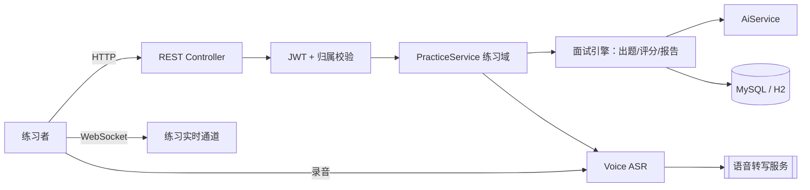

# AI 面试练习

> 给**没面试过、或很久没面试**的求职者用的 AI 模拟面试练习工具。
> 选方向 → AI 出题 → 文字/语音作答 → 逐题反馈 → 整场复盘 → 再练一次。
>
> Java 17 · Spring Boot 3.5 · MyBatis-Plus · MySQL/H2 · WebSocket · WebRTC · Vue 3 · TypeScript · 大模型 + RAG + 语音转写

---

## 1. 这是什么

第一次面试最怕的不是不会，而是：

- 不知道会被问什么；
- 知道答案但说不清；
- 说完没人告诉你哪里可以更好；
- 练了一次，不知道下次该练什么。

这个项目把这些拆成可练习的闭环：

| 练习者的困扰 | 产品里的做法 |
|---|---|
| 不知道会被问什么 | 8 个练习方向（Java 后端 / 前端 / 产品 / 数据 / 测试 / 运维 / 算法 / 通用 HR 面），按方向出题 |
| 开不了口 | 没有真人压力，可暂停、可跳过、可重答，先练胆 |
| 不会组织语言 | 每题可要「提示」，不直接给答案，引导先给结论再展开 |
| 说不清楚 | 支持**录音 → 转写 → 修改后提交**，模拟真实面试的表达过程 |
| 不知道差在哪 | 每题给分数、四维点评、命中/遗漏；整场给能力分、优势、短板、下一步建议 |
| 看完就忘 | 复盘里逐题对照参考答案；练习记录可回看；面试指南补基础 |

> 这不是企业招聘系统：没有 HR、没有岗位发布、没有录用建议，只有你和 AI 面试官。

## 2. 功能

**练习闭环**
- 8 个内置练习方向，含重点考察点、默认题数、难度
- 创建练习：方向 + 面试模式（技术 / HR / 综合）+ 题数（3-15）+ 可选简历
- 练习房间：逐题作答、提示、跳过、提前结束、实时四维反馈
- **语音作答**：说完一句即时转写（WebSocket + VAD 断句），文本可编辑后提交；流式不可用时自动回退整段录音
- 练习复盘：总分、等级、四维能力、优势/待提升、逐题参考答案、下一步练习建议
- 练习记录：继续未完成的练习、回看已完成复盘
- **AI 教练**：练习中随时提问，真实调用 DeepSeek function calling，工具包括知识库检索、练习状态、我的简历，回答带引用来源与完整调用链
- **视频面试**：微信视频通话风格，支持 AI 模拟面试（数字人 + TTS + 实时字幕 + 语音作答）与真人 1v1（WebRTC + 房间码）
- **实时字幕**：说话过程中右侧实时出字；AI 朗读支持接豆包/OpenAI 兼容 TTS，未配置时浏览器兜底

**辅助**
- 我的简历：上传 docx / pdf / txt / md 或粘贴文本，AI 解析后用于个性化出题（PDF 先转 docx 再复用同一套清洗逻辑）
- 面试指南：流程、准备清单、自我介绍模板、STAR 法则、常见问题、语音作答建议
- 个人中心：资料与密码
- 登录 / 注册 / 令牌续期处理

## 3. 技术栈

| 层次 | 技术 |
|---|---|
| 后端 | Java 17、Spring Boot 3.5、Spring Security、Spring WebSocket、Bean Validation |
| 持久层 | MyBatis-Plus 3.5、HikariCP、MySQL 8 / H2 |
| 缓存 | Redis（生产，可选）/ 本地内存（开发） |
| AI | OpenAI 兼容协议（对话 + 语音转写 + function calling），内置 Mock 兜底 |
| RAG | 自研 BM25（CJK 2-gram + IDF 截断），可选 embedding 混合检索，引用可溯源 |
| 实时 | WebSocket（信令/字幕/心跳）+ WebRTC（音视频 P2P） |
| 前端 | Vue 3.5、TypeScript、Vite 6、Pinia、Vue Router、Element Plus、Axios |
| 测试 | JUnit 5 + MockMvc/TestRestTemplate、Playwright |

## 4. 架构



练习域复用成熟面试引擎（会话状态机、出题、评分、报告），并新增：

- `practice_target`：练习方向
- `practice` 接口族：创建 / 开始 / 作答 / 提示 / 跳过 / 复盘
- `voice` 接口：录音转写
- `knowledge` + `agent`：RAG 检索与 AI 教练（工具调用 + 引用）
- `video` + `/ws/call`：视频房间与 WebRTC 信令

## 5. 快速开始

### 5.1 环境

- JDK 17+、Maven 3.8+
- Node.js 20+（前端）
- 开发环境无需 MySQL / Redis（H2 + 本地缓存 + Mock AI）

### 5.2 启动后端

```bash
cd ai-interview-assistance
mvn spring-boot:run
```

- Swagger：http://localhost:8080/swagger-ui.html
- H2 控制台：http://localhost:8080/h2-console（URL `jdbc:h2:mem:aiinterview`，用户 `sa`，密码空）

### 5.3 启动前端

```bash
cd web
npm install
npm run dev
```

打开 http://localhost:5173 。

### 5.4 演示账号

| 用户名 | 密码 | 角色 |
|---|---|---|
| candidate | 123456 | 练习者（自带一份已解析简历） |

> 旧版本遗留的 `interviewer` / `admin` 账号仍可登录，但产品中已无招聘入口。

### 5.5 语音转写（可选）

默认 `app.voice.provider=mock`：录音入口可用，但转写会提示「未配置」，文字作答不受影响。
启用真实转写：

```bash
set APP_ASR_PROVIDER=openai
set APP_ASR_BASE_URL=https://api.openai.com/v1
set APP_ASR_API_KEY=sk-xxxx
set APP_ASR_MODEL=whisper-1
mvn spring-boot:run
```

任何兼容 OpenAI `/audio/transcriptions` 的服务都可用。

### 5.6 接入真实对话模型（可选）

```bash
set APP_AI_PROVIDER=openai
set APP_AI_BASE_URL=https://api.deepseek.com/v1
set APP_AI_API_KEY=sk-xxxx
set APP_AI_MODEL=deepseek-chat
```

不配置时使用内置 Mock：出题、评分、复盘、提示均可跑通。

### 5.7 RAG 与 AI 教练（可选配置）

- 默认纯 BM25 检索，已经可用；`/api/v1/knowledge/search` 可单独验证；
- 想升级为向量混合检索，配置 OpenAI 兼容 embedding：

```bash
set APP_EMBEDDING_PROVIDER=openai
set APP_EMBEDDING_BASE_URL=https://api.openai.com/v1
set APP_EMBEDDING_API_KEY=sk-xxxx
set APP_EMBEDDING_MODEL=text-embedding-3-small
```

- 教练 Agent 复用上面的 `APP_AI_*`（DeepSeek 用 `deepseek-chat`，支持 tools）；
- 未配置模型时教练走知识库降级，`fallback=true`，仍然返回真实引用。

### 5.8 语音链路：一次转写 vs 流式转写

| 模式 | 触发 | 出字时机 | 适用 |
|---|---|---|---|
| 流式（默认） | 点「语音作答」→ 边说边传 100ms 一帧 | 说完一句 + 600ms 静音 + 约 1.2s 转写 | 追求「像真人对话」的练习 |
| 一次性 | 流式不可用时自动回退 | 停止录音后整段上传（10s 音频约 12s） | 浏览器不支持 AudioWorklet |

流式端点：`ws://host/ws/asr?token=<JWT>&language=zh`，消息见 [docs/08 第 5.5 节](docs/08-RAG-Agent-视频通话实现.md)。
调延迟主要改 `app.voice.stream.end-silence-ms`（默认 600，越小越快、越容易切碎句子）。

### 5.9 一套已实测的供应商组合

本项目当前验证过的混搭（对话用 DeepSeek，检索与语音用硅基流动）：

```powershell
# 对话 / 出题 / 评分 / Agent
$env:DEEPSEEK_API_KEY = "sk-DeepSeek的Key"
$env:APP_AI_PROVIDER = "openai"
$env:APP_AI_BASE_URL = "https://api.deepseek.com/v1"
$env:APP_AI_MODEL = "deepseek-chat"

# RAG 向量
$env:APP_EMBEDDING_PROVIDER = "openai"
$env:APP_EMBEDDING_BASE_URL = "https://api.siliconflow.cn/v1"
$env:APP_EMBEDDING_API_KEY = "sk-硅基流动的Key"
$env:APP_EMBEDDING_MODEL = "BAAI/bge-m3"

# 语音转写
$env:APP_ASR_PROVIDER = "openai"
$env:APP_ASR_BASE_URL = "https://api.siliconflow.cn/v1"
$env:APP_ASR_API_KEY = "sk-硅基流动的Key"
$env:APP_ASR_MODEL = "FunAudioLLM/SenseVoiceSmall"

java -jar target\ai-interview-platform.jar
```

- `provider` 一律填 `openai`（表示 OpenAI 兼容协议），不是供应商名；
- DeepSeek 没有 embedding 与语音接口，这两项要配别的服务；
- 用 IDEA 启动时，Key 要填在 **Environment variables**，不要填在 **Active profiles**；
- 命令行启动可用 `config\secrets.env` + `scripts\run-local.ps1`（模板见 [config/secrets.example.env](config/secrets.example.env)）。

验证方式：

```bash
# 知识库是否向量化
curl http://localhost:8080/api/v1/knowledge/stats -H "Authorization: Bearer $TOKEN"
# 期望 embeddingEnabled=true、embeddingModel=BAAI/bge-m3

# 教练是否真实调用模型与工具
curl -X POST .../practice/sessions/$SID/coach -H "Authorization: Bearer $TOKEN" \
  -H "Content-Type: application/json" -d '{"message":"这道题怎么答更好？"}'
# 期望 fallback=false，toolCalls 含 search_knowledge
```

> 首次启动要把演示资料向量化，`/actuator/health` 已经 UP 时知识库可能还在灌入（`documentCount` 会从 4 涨到 9），稍等再测。

### 5.10 视频面试

- 真人 1v1：创建房间 → 把房间码/链接发给朋友 → 双方进入后自动建立 WebRTC；
- AI 模拟：选择方向后进入视频房间，AI 用浏览器 TTS 读题，练习者录音作答；
- 默认只配置公共 STUN；跨 NAT 生产环境需要自建 TURN（见 `docs/08` 第 4.6 节）。

## 6. 测试

```bash
mvn test          # 67 个后端测试
cd web
npm run test:e2e  # 练习 + AI 教练 UI 冒烟（需本机 Chrome）
node scripts/video-test.mjs   # 视频面试 E2E（假摄像头，覆盖 AI 与真人 WebRTC）
```

| 测试 | 覆盖 |
|---|---|
| `PracticeFlowTest` | 方向列表、创建、开始、提示、跳过、作答、复盘、匿名 401 |
| `ApiIntegrationTest` | 登录、鉴权、旧面试引擎回归 |
| `Bm25IndexTest` | 中文 2-gram、英文关键词、空查询 |
| `OpenAiAsrClientTest` | multipart 结构（Content-Length、无 chunked）、401 包装 |
| `VadSegmenterTest` | VAD 切句、长句强制分段、flush、WAV 头 |
| `PdfResumeExtractionTest` | PDF 抽取、docx 合法 ZIP、扫描件提示、格式拒绝 |
| `AgentFallbackTest` | 无 Key 降级、工具调用循环、越权 |
| `VideoRoomServiceTest` | 房间创建、AI 归属、房间码、结束幂等 |
| `web/scripts/ui-smoke.mjs` | 登录 → 工作台 → 房间 → 提示 → AI 教练（引用/工具）→ 复盘 → 记录 → 指南 → 移动端 |
| `web/scripts/video-test.mjs` | AI 视频面试 5 题、真人 1:1 offer/answer/ICE、双方远端视频流 |
| `web/scripts/asr-stream-test.mjs` | WS 流式转写：READY / SPEECH_START / TRANSCRIPT 与文本 |
| `web/scripts/vad-probe.mjs` | 4 档音量的 VAD 检出率与「尾句先于 STOPPED」顺序 |
| `VadSegmenterTest`（回归） | 小声检出、句中停顿不切碎、说话期噪声底不上涨 |
| `TtsClientTest` | OpenAI 兼容请求体、火山 base64 解码、未配置提示 |

UI 截图输出到 `web/screenshots/`。

## 7. 目录结构

```
src/main/java/com/aiinterview
├── practice/          # ★ 练习域：方向、会话编排、提示、跳过、复盘
├── knowledge/         # ★ RAG：文档、切块、BM25、可选向量
├── agent/             # ★ AI 教练：工具循环、引用、调用链
├── video/             # ★ 视频房间、REST 与 /ws/call 信令
├── ai/voice/          # ★ 语音转写（ASR）
├── interview/         # 面试引擎：会话、题目、评分、报告、WebSocket
├── resume/            # 简历解析
├── ai/                # 对话模型网关、Prompt、Mock
├── security/          # JWT 与鉴权
├── common/            # 统一响应、异常、配置
├── infrastructure/    # 缓存、文件存储
└── bootstrap/         # 演示数据（练习方向 + 知识库）

web/                   # 前端（Vue 3 + TS + Vite）
├── src/views/practice/  # 工作台、创建、房间、复盘、记录
├── src/views/video/     # 视频大厅、视频通话（AI / 真人）
├── src/components/coach/ # AI 教练抽屉
├── src/views/guide/     # 面试指南
├── src/views/resume/    # 我的简历
├── src/api/             # 接口层（practice / voice / knowledge / agent / video）
└── screenshots/         # UI 冒烟截图（01-17）
```

## 8. 文档

| 文档 | 内容 |
|---|---|
| [RAG · Agent · 视频通话实现](docs/08-RAG-Agent-视频通话实现.md) | BM25/混合检索、工具调用、WebRTC 信令、流式 ASR（VAD）、PDF 简历、TTS、配置与验证 |
| [缺陷报告 01：流式语音漏检与尾句丢失](docs/09-缺陷报告-01-流式语音漏检与尾句丢失.md) | 现象、实测数据、根因、修复与回归用例 |
| [语音链路三版演进与测试报告](docs/10-语音链路三版演进与测试报告.md) | v1/v2/v3 设计与优缺点、缺陷定位方法、67 个测试与 E2E 全流程报告 |
| [练习工具产品重构方案](docs/07-练习工具产品重构方案.md) | 定位、信息架构、练习闭环、语音方案、路线图 |
| [源码阅读指南](docs/02-源码阅读指南-全流程.md) | 启动、请求链路、面试引擎、AI、WebSocket、断点调试 |
| [数据库设计](docs/03-数据库设计.md) | 表结构（含 `practice_target` / 知识库 / 视频房间）、状态机 |
| [API 接口文档](docs/04-API接口文档.md) | 练习、知识库、教练、视频、语音接口 |
| [前端开发方案](docs/06-前端开发方案.md) | 技术选型、页面与状态设计 |
| [部署与运行](docs/05-部署与运行.md) | 打包、生产配置、供应商组合、IDEA/环境变量配置、TURN |

## 9. 设计要点

- **练习引擎复用**：练习会话复用 `interview_session` 等表，`position_id` 存 `practice_target.id`，对外完全切换为练习语义；
- **三级出题**：AI → 题库 → 内置模板，任何情况下都能开练；
- **跳过不计分**：跳过的题分数为空，不拉低整场均分，但计入进度；
- **练习等级**：≥85 优秀 / ≥70 良好 / ≥55 待提升 / 其余需加强；
- **语音可编辑**：转写结果先落到输入框，允许修改后再提交，避免识别错误影响评分；
- **RAG 真检索**：BM25 真实打分 + 引用溯源；没有 embedding 也能用，配好后自动混合；
- **Agent 真工具调用**：DeepSeek function calling 执行知识库/状态/简历工具，调用链写入 `agent_trace`；
- **视频信令与媒体分离**：WebSocket 传信令/字幕，WebRTC 传音视频，AI 模式用 TTS + 字幕；
- **降级优先**：AI / ASR / 模型不可用时，文字练习闭环始终可用。

## 10. 说明

- 本项目为源码学习与二次开发示例；生产使用前请更换 `app.jwt.secret`、关闭 H2 控制台与演示数据、启用 HTTPS。
- 旧招聘接口（岗位、面试官视角）仍保留在后端，前端已不再使用，后续版本会物理清理。
- 练习会话表沿用 `interview_*` 命名，下一阶段再做 `practice_*` 重命名。
