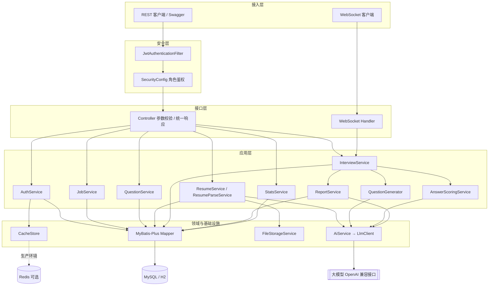
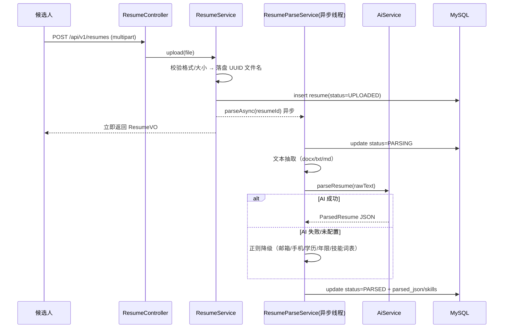
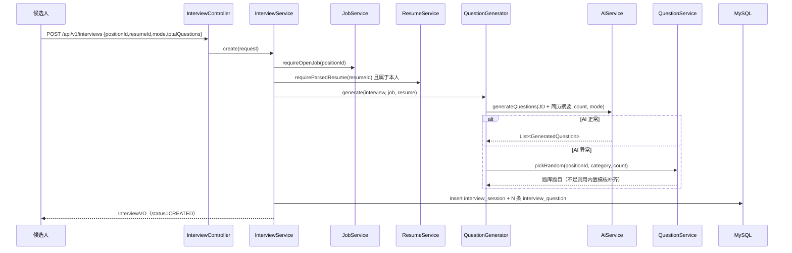
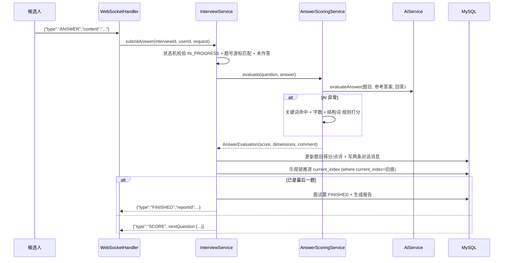
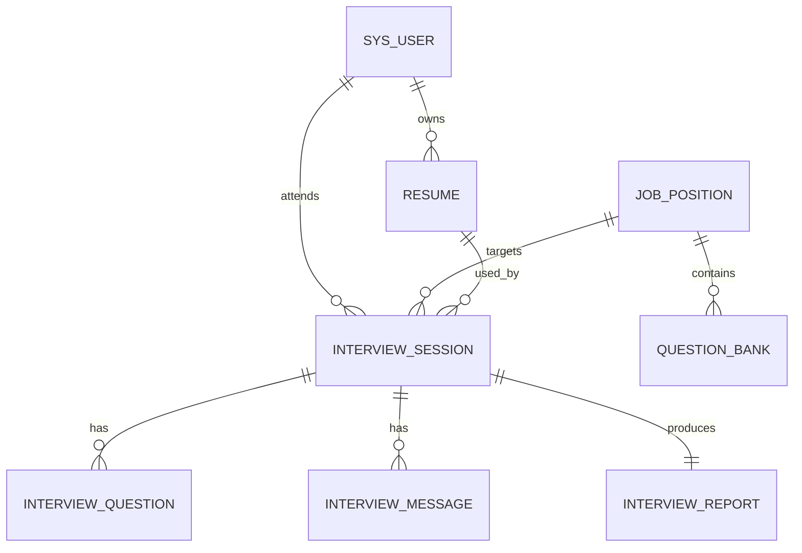
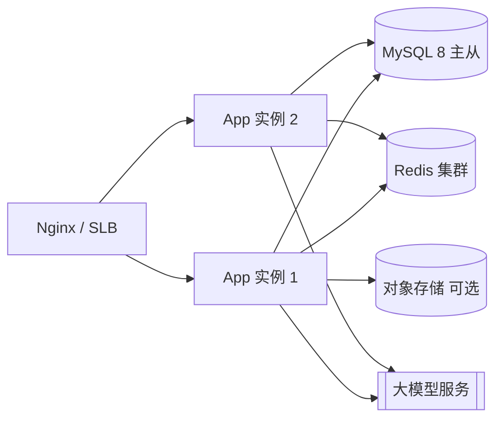

# AI 面试平台 技术方案

> ⚠️ **产品定位已调整（v2.0）**：本项目当前定位为「面向求职者的 AI 面试练习工具」，不是企业招聘系统。
> 招聘角色、岗位发布、录用建议等设计已从产品中移除。最新产品方案见
> [《练习工具产品重构方案》](07-练习工具产品重构方案.md)；本文保留 v1 的技术架构与引擎设计，仍有参考价值。
>
> 版本：v1.0　|　技术栈：Java 17 + Spring Boot 3.5 + MyBatis-Plus + MySQL/H2 + Redis（可选）+ WebSocket + 大模型
> 目标：让候选人随时完成一场「AI 出题 → 实时作答 → AI 评分 → 生成报告」的结构化面试，并让面试官在管理端沉淀岗位、题库与面试数据。

---

## 1. 项目概述

### 1.1 背景与痛点

传统技术面试存在三个问题：

1. **排期成本高**：面试官与候选人时间难对齐，初筛往往只能靠简历；
2. **标准不统一**：不同面试官提问深度、评分口径差异大，横向对比困难；
3. **数据不沉淀**：面试过程没有结构化记录，复盘、复盘报告与招聘决策缺少依据。

### 1.2 建设目标

| 目标 | 落地方式 |
|---|---|
| 面试随时可进行 | 候选人自助创建面试，AI 充当面试官，7×24 可用 |
| 提问有针对性 | 结合岗位 JD + 简历结构化信息生成题目，而非固定题库 |
| 评分有标准 | 统一维度：准确性、深度、表达、逻辑结构；单题 + 整场两级评分 |
| 过程可回溯 | 题目快照 + 对话消息 + 每题得分全部落库 |
| 结果可决策 | 生成结构化报告（总分/维度分/优势/短板/录用建议） |
| 成本可控 | 大模型调用统一网关 + 日志计量 + 规则降级，AI 不可用时业务不中断 |

### 1.3 角色与职责

| 角色 | 关键能力 |
|---|---|
| 候选人 CANDIDATE | 注册登录、上传/粘贴简历、查看解析结果、创建并参加面试、查看报告 |
| 面试官 INTERVIEWER | 维护岗位与题库、查看所有面试记录与报告 |
| 管理员 ADMIN | 用户管理、统计看板、全部数据权限 |

### 1.4 范围说明（v1.0）

- 交付：后端服务（REST + WebSocket）、数据库脚本、演示数据、接口文档、源码阅读文档。
- 不含：前端页面、语音识别与合成、视频监考、支付与多租户。这些在「演进路线」中给出设计。

---

## 2. 总体架构

### 2.1 架构风格

v1.0 采用**模块化单体（Modular Monolith）**：一个 Spring Boot 进程，但按业务域严格分包、包间只通过 Service 接口协作。
选择理由：

- 团队规模小、业务仍在验证期，单体部署与调试成本最低；
- 模块边界清晰，后续可按「简历域 / 面试域 / AI 网关 / 管理域」平滑拆分为微服务（见第 10 章）；
- 源码阅读友好，一个进程即可观察完整调用链。

### 2.2 分层视图



### 2.3 模块划分

| 模块 | 包名 | 职责 | 关键类 |
|---|---|---|---|
| 通用 | `common` | 统一响应、异常、参数校验、JSON、AOP 操作日志 | `Result`、`GlobalExceptionHandler`、`OperationLogAspect` |
| 安全 | `security` | JWT 签发校验、过滤器、角色鉴权、当前用户 | `JwtTokenProvider`、`SecurityConfig` |
| 用户 | `system` | 注册登录、资料、改密、用户管理 | `AuthService`、`UserService` |
| 岗位 | `job` | 岗位 CRUD、状态流转 | `JobService` |
| 题库 | `question` | 题目 CRUD、随机取题（出题降级源） | `QuestionService` |
| 简历 | `resume` | 上传、文本抽取、AI 解析、匹配度 | `ResumeService`、`ResumeParseService`、`ResumeTextExtractor` |
| 面试 | `interview` | 会话、出题、作答、评分、状态机、报告、WS | `InterviewService`、`QuestionGenerator`、`AnswerScoringService`、`ReportService` |
| AI 网关 | `ai` | 提示词、模型客户端、结构化解析、调用日志 | `AiService`、`OpenAiCompatibleLlmClient`、`MockLlmClient` |
| 管理 | `admin` | 统计看板、用户管理 | `StatsService` |
| 基础设施 | `infrastructure` | 缓存、文件存储 | `CacheStore`、`LocalFileStorageService` |

---

## 3. 技术选型

| 关注点 | 选型 | 理由 |
|---|---|---|
| 运行时 | Java 17 | LTS、record/文本块/switch 表达式让 DTO 与 Prompt 更简洁 |
| 框架 | Spring Boot 3.5 | 生态完善，Security/WebSocket/Validation 开箱即用 |
| 持久层 | MyBatis-Plus 3.5.15 | 单表 CRUD 零 SQL，分页插件与 Lambda Wrapper 提升可读性；复杂统计用 Wrapper 也能表达 |
| 数据库 | MySQL 8（生产）/ H2（开发） | 开发零依赖启动；SQL 保持可移植（不用 JSON 类型、不用窗口函数） |
| 缓存 | Redis（生产）/ 内存（开发） | 令牌黑名单、限流计数需要跨实例共享；开发环境用 `CacheStore` 本地实现 |
| 鉴权 | Spring Security + 自研 HS256 JWT | 无状态、易水平扩展；不引第三方 JWT 库，签名/校验过程完全可读 |
| 实时通道 | 原生 WebSocket | 面试问答天然长连接；不引 STOMP，协议更轻、更易讲清 |
| 大模型 | OpenAI 兼容协议 | 一套代码适配 OpenAI / DeepSeek / 通义千问 / 自建 vLLM；本地可切 Mock 桩 |
| 文档 | springdoc-openapi | 代码即文档，Swagger UI 可直接调试 |
| 异步 | Spring `@Async` 线程池 | 简历解析、报告生成不阻塞请求线程 |

---

## 4. 核心业务流程

### 4.1 注册与登录

1. 注册：校验用户名唯一 → BCrypt 加密密码 → 落库（角色固定 CANDIDATE）→ 直接签发令牌返回；
2. 登录：查用户 → 校验密码（用户不存在与密码错误返回同一提示，防用户枚举）→ 校验状态 → 更新 `last_login_at` → 签发 JWT；
3. 请求携带 `Authorization: Bearer <token>`，过滤器解析并写入 `SecurityContext`；
4. 登出：把令牌 `jti` 写入黑名单（TTL 为剩余有效期），后续请求即使签名有效也会被拒绝。

### 4.2 简历上传与解析



要点：

- **上传与解析解耦**：上传接口只做落盘与建记录，解析走异步线程池，避免大文件阻塞；
- **解析结果结构化**：`parsed_json` 保存完整结构，`skills` / `years_of_experience` / `education` 冗余为列，便于列表与匹配检索；
- **失败可观测**：`status=FAILED` + `error_message`，前端可提示重新上传。

### 4.3 创建面试与生成题目



设计要点：

- **题目快照**：创建时一次性生成并落库，面试过程不依赖模型可用性，报告阶段也无需再次出题；
- **多级题源**：AI → 题库 → 内置模板，保证任何情况下都能开出面试；
- **题量约束**：3-15 题，默认 5 题。

### 4.4 作答与单题评分



并发控制：`current_index` 采用**乐观锁**（`UPDATE ... WHERE id=? AND current_index=?`），重复提交或并发提交只有一次成功，另一次收到 409「请勿重复提交」。

### 4.5 面试报告

报告生成在「最后一题作答完成」或「候选人主动结束」时触发：

1. 汇总每题得分 → 整场均分；
2. 解析每题维度 JSON → 四个维度均分（accuracy / depth / expression / structure）；
3. 把岗位、问答明细、均分交给大模型生成优势、短板、录用建议与总结；
4. 模型不可用时按阈值规则生成建议（≥80 PASS，60-79 HOLD，<60 REJECT），优势/短板从每题点评归纳；
5. 落库 `interview_report`（一个面试一份，可重新生成）。

### 4.6 管理端

- 统计概览：用户数、面试数、进行中/已完成、平均分、近 7 天趋势、状态分布、热门岗位 Top5；
- 用户管理：分页检索、启用/禁用（禁止禁用自己、禁止禁用最后一个可用管理员）；
- 面试记录：面试官/管理员可分页查看全部面试。

---

## 5. 数据模型

详见 `docs/03-数据库设计.md`，此处给出核心 ER 关系：



设计约定：

- 主键统一 `BIGINT` + 雪花算法（应用层生成，不依赖数据库自增，便于分库）；
- 所有表带 `created_at` / `updated_at`，由 MyBatis-Plus `MetaObjectHandler` 自动填充；
- 结构化扩展字段（维度分、解析结果、优势列表）以 JSON 字符串存入 `TEXT`，保持 MySQL/H2 兼容；
- 面试题目落库为**快照**，题库后续修改不影响历史面试。

---

## 6. 接口设计

### 6.1 统一规范

| 项 | 约定 |
|---|---|
| 前缀 | `/api/v1` |
| 响应 | `{code, message, data, timestamp}`，`code=0` 成功 |
| 分页 | `{total, current, size, pages, records}`，`page` 从 1 开始，`size` 最大 100 |
| 鉴权 | `Authorization: Bearer <JWT>` |
| 错误 | HTTP 状态码与业务码同时表达语义（400/401/403/404/409/503/500） |
| 长整型 | 所有 `Long` 序列化为字符串，避免前端精度丢失 |
| 文档 | `/swagger-ui.html` |

### 6.2 接口清单（节选）

| 方法 | 路径 | 权限 | 说明 |
|---|---|---|---|
| POST | /api/v1/auth/register | 公开 | 注册候选人 |
| POST | /api/v1/auth/login | 公开 | 登录 |
| GET | /api/v1/auth/me | 登录 | 当前用户 |
| POST | /api/v1/auth/logout | 登录 | 登出（令牌加入黑名单） |
| GET/POST/PUT/DELETE | /api/v1/jobs/** | 读：登录；写：ADMIN/INTERVIEWER | 岗位管理 |
| GET/POST/PUT/DELETE | /api/v1/questions/** | 读：登录；写：ADMIN/INTERVIEWER | 题库管理 |
| POST | /api/v1/resumes | 登录 | 上传简历（异步解析） |
| POST | /api/v1/resumes/text | 登录 | 粘贴文本建简历 |
| GET | /api/v1/resumes/{id}/match | 本人 | 岗位匹配度 |
| POST | /api/v1/interviews | 本人 | 创建面试并出题 |
| POST | /api/v1/interviews/{id}/start | 本人 | 开始面试 |
| GET | /api/v1/interviews/{id}/questions/current | 本人 | 当前题 |
| POST | /api/v1/interviews/{id}/answers | 本人 | 提交答案并评分 |
| POST | /api/v1/interviews/{id}/finish | 本人 | 提前结束并生成报告 |
| GET | /api/v1/interviews/{id}/report | 本人/管理员 | 查看报告 |
| GET | /api/v1/admin/stats/overview | ADMIN | 统计概览 |
| GET | /api/v1/admin/users | ADMIN | 用户列表 |

完整参数与示例见 `docs/04-API接口文档.md`。

---

## 7. AI 工程化设计

### 7.1 分层

```
业务 Service（决定降级策略）
      ↓
AiService（拼 Prompt、解析 JSON、记日志）
      ↓
LlmClient（OpenAI 兼容 HTTP 客户端 / Mock 桩）
```

### 7.2 结构化输出

- 所有场景都要求模型「只输出 JSON」，并在 Prompt 中显式给出字段与取值约束；
- 解析前用 `JsonUtils.stripCodeFence` 剥离 ```json 代码块，取第一个 `{`/`[` 到最后一个 `}`/`]`；
- 解析失败抛 `AI_ERROR`，由业务层降级；
- `record` + Jackson 反序列化，字段缺失由紧凑构造器归一化（如集合 null → 空集合）。

### 7.3 场景与降级策略

| 场景 | Prompt 输入 | 降级策略 |
|---|---|---|
| RESUME_PARSE | 简历原文（截断 12000 字） | 正则提取邮箱/手机/学历/年限 + 技能词表 |
| QUESTION_GENERATE | 岗位 JD + 简历摘要 + 模式 + 题数 | 题库随机 → 内置模板 |
| ANSWER_SCORE | 题目 + 参考答案 + 回答 + 模式 | 关键词命中 + 字数 + 结构词加权 |
| REPORT_GENERATE | 岗位 + 问答明细 + 均分 + 维度分 | 阈值规则 + 每题点评归纳 |
| RESUME_MATCH | 简历文本 + 岗位要求 | 技能交集/差集计算 |

### 7.4 成本与稳定性

- 统一在 `AiService.chat` 记录 `ai_call_log`（场景、模型、token、耗时、是否降级、错误信息）；
- 调用超时由 `app.ai.timeout-seconds` 控制（默认 60s）；
- 单次简历解析截断输入，参考答案截断，控制 token；
- `provider=mock` 时使用内置桩，本地开发零成本、可离线；
- 生产环境建议在网关层再加限流与配额（扩展点）。

---

## 8. 非功能性设计

### 8.1 安全

- 密码 BCrypt 加盐哈希，实体 `password` 字段 `@JsonIgnore`；
- JWT HS256，密钥长度校验，签名比较使用 `MessageDigest.isEqual` 防时序攻击；
- 登出黑名单依赖 `CacheStore`（生产 Redis）；
- URL 级 + 方法级双重鉴权；资源归属校验 `SecurityUtils.requireOwner`；
- 文件上传：扩展名白名单、UUID 落盘、路径穿越校验（`normalize` + `startsWith(root)`）；
- docx 解析禁用 XML 外部实体（防 XXE）；SQL 全部走 MyBatis 参数绑定。

### 8.2 并发与一致性

- 面试状态机集中管理，非法流转直接 409；
- 答题提交用乐观锁推进游标，避免重复计分；
- 报告一个面试唯一（`UNIQUE(interview_id)`），重复生成走更新；
- 异步线程池有界队列 + `CallerRunsPolicy`，防止任务丢失。

### 8.3 性能

- 列表查询走索引（`user_id`、`status`、`interview_id + seq`）；
- 分页插件限制单页最大 200 条；
- 面试题目一次性生成，答题阶段无模型出题开销；
- 报告只在结束时生成一次，可手动重算。

### 8.4 可观测

- 全链路日志：请求 URI、AI 场景与耗时、异常堆栈；
- `ai_call_log` 可统计各场景调用量、失败率、平均耗时；
- `sys_operation_log` 通过 AOP 记录关键写操作（谁、哪个接口、耗时、成功与否）；
- Actuator 健康检查：`/actuator/health`（已接入，仅暴露 health/info）。

---

## 9. 部署架构

### 9.1 开发环境

- H2 内存库 + 本地缓存 + Mock AI，一条命令启动：`mvn spring-boot:run`；
- H2 控制台：`/h2-console`（JDBC URL 见 `application-dev.yml`）。

### 9.2 生产环境



- 应用无状态，可水平扩容；
- JWT 黑名单、限流计数放 Redis；
- 简历文件建议迁移至对象存储（`FileStorageService` 已抽象）；
- 数据库脚本 `db/schema.sql` 手动执行一次（`spring.sql.init.mode=never`）。

### 9.3 配置项

| 配置 | 说明 |
|---|---|
| `app.jwt.secret` | 至少 32 字符，生产用环境变量覆盖 |
| `app.ai.provider` | `mock` / `openai` |
| `app.ai.base-url` / `api-key` / `model` | 模型服务地址、密钥、模型名 |
| `app.cache.mode` | `local` / `redis` |
| `app.storage.root` | 文件存储根目录 |
| `app.demo-data.enabled` | 是否初始化演示数据 |

---

## 10. 演进路线

| 阶段 | 演进内容 | 说明 |
|---|---|---|
| v1.1 | 追问机制 | 低分题自动追问一层，考察真实深度 |
| v1.2 | 语音面试 | 接入 ASR/TTS，WebSocket 传输音频分片 |
| v1.3 | 防作弊 | 切屏/粘贴行为采集、题目乱序、时间窗校验 |
| v2.0 | 服务拆分 | 简历域、面试域、AI 网关、管理域拆为独立服务，Nacos + Gateway |
| v2.1 | 题库智能化 | 向量检索相似题、AI 自动扩充题库并人工审核 |
| v2.2 | 多租户与商业化 | 企业空间隔离、配额计费、审计报表 |

### 拆分映射

| 微服务 | 现有模块 | 数据表 |
|---|---|---|
| user-service | system | sys_user、sys_operation_log |
| job-service | job、question | job_position、question_bank |
| resume-service | resume | resume |
| interview-service | interview | interview_session、interview_question、interview_message、interview_report |
| ai-gateway | ai | ai_call_log |
| admin-bff | admin | 聚合查询 |

拆分时只需把包内 Service 暴露为 HTTP/RPC 接口，`AiService` 保持为独立网关即可。

---

## 11. 风险与对策

| 风险 | 影响 | 对策 |
|---|---|---|
| 大模型输出不稳定 | 解析失败、评分异常 | 结构化 Prompt + JSON 清洗 + 全链路降级 + 日志留痕 |
| 模型成本不可控 | 费用超支 | 面试题目一次性生成、输入截断、调用日志计量、配额限流 |
| 评分公信力不足 | 业务不认可 | 维度可解释、参考答案显式给出、支持人工复核与重算 |
| 简历格式多样 | 解析失败 | docx/txt/md 原生解析 + 失败提示 + 文本粘贴兜底 |
| 并发重复提交 | 重复计分 | 状态机 + 乐观锁 + 幂等校验 |
| 单体膨胀 | 维护困难 | 严格分包、包间只通过 Service 调用，预留拆分路径 |

---

## 12. 交付物

| 文件 | 内容 |
|---|---|
| `docs/01-技术方案.md` | 本文 |
| `docs/02-源码阅读指南-全流程.md` | 从启动到一次完整面试的源码走读 |
| `docs/03-数据库设计.md` | 表结构、字段、索引、示例数据 |
| `docs/04-API接口文档.md` | 全部接口与示例 |
| `docs/05-部署与运行.md` | 环境要求、启动、打包、生产部署 |
| `docs/06-前端开发方案.md` | 前端技术选型、页面/路由/WS 设计、全链路覆盖与排期 |
| `docs/07-练习工具产品重构方案.md` | **v2.0 产品定位**：面试练习工具的闭环、语音方案、数据模型与路线图 |
| `docs/08-RAG-Agent-视频通话实现.md` | **v3.0 能力**：BM25/混合检索、Agent 工具调用、WebRTC 视频与信令 |
| `README.md` | 项目速览与快速开始 |
