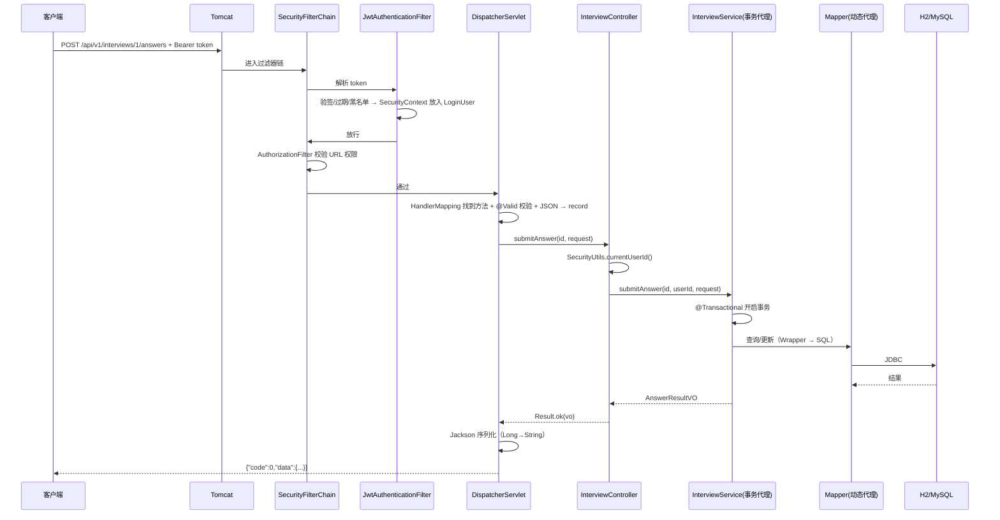
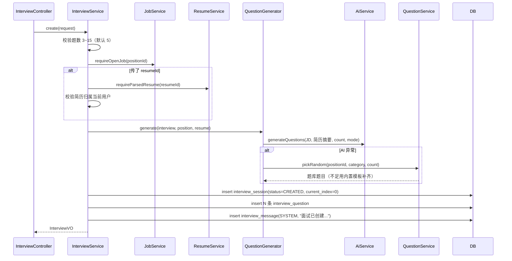

# 源码阅读指南（全流程）

> ⚠️ **产品定位已调整（v2.0）**：当前产品是「AI 面试练习工具」，练习接口在 `com.aiinterview.practice`，
> 语音转写在 `com.aiinterview.ai.voice`。本文以面试引擎为主线，仍适用于理解出题、评分、报告、鉴权、WebSocket；
> 练习域与产品变化见 [《练习工具产品重构方案》](07-练习工具产品重构方案.md)。
>
> 面向：要通读本项目的开发者
> 目标：读完后你能独立回答「一个请求从进来到落库经历了什么」「AI 挂了系统为什么还能跑」「并发重复提交为什么不会重复计分」
> 建议配合 `docs/01-技术方案.md` 一起看：01 讲「为什么这么设计」，本文讲「代码怎么走的」。

---

## 0. 怎么用这份文档

### 0.1 推荐阅读顺序（约 3 小时）

| 顺序 | 内容 | 时长 | 产出 |
|---|---|---|---|
| 1 | 第 1 章 工程结构 + 第 2 章 启动流程 | 30 min | 知道每个包干什么、应用怎么起来 |
| 2 | 第 3 章 一次 HTTP 请求的全链路 | 40 min | 能画出 Filter → Controller → Mapper 的调用图 |
| 3 | 第 4 章 认证鉴权 | 20 min | 能说清 JWT 签发/校验/黑名单 |
| 4 | 第 5 章 简历链路 | 30 min | 理解异步解析与降级 |
| 5 | 第 6 章 面试主链路（重点） | 60 min | 理解状态机、乐观锁、报告生成 |
| 6 | 第 7~10 章 AI / WebSocket / 缓存 / 异步 | 30 min | 理解 AI 网关与实时通道 |
| 7 | 第 11 章 逐包类清单 + 第 12 章 断点路线 | 20 min | 建立「类 → 职责」索引，能自己调试 |

### 0.2 边读边跑

```bash
# 1. 启动（H2 内存库 + Mock AI，无需外部依赖）
mvn spring-boot:run

# 2. 跑一遍主链路，观察日志中的 SQL 与 AI 调用
powershell -ExecutionPolicy Bypass -File scripts/smoke-test.ps1

# 3. 跑 WebSocket 实时面试链路
node scripts/ws-test.mjs
```

启动后打开 `http://localhost:8080/swagger-ui.html`，对照第 4 章接口文档点一点，比只看代码快得多。

---

## 1. 工程结构

```
src/main/java/com/aiinterview
├── AiInterviewApplication.java        # 启动类
├── common/                            # 与业务无关的通用能力
│   ├── api/                           # Result / PageResult / ErrorCode
│   ├── exception/                     # BizException / GlobalExceptionHandler
│   ├── util/                          # JsonUtils / TextUtils
│   ├── config/                        # MyBatis-Plus、Jackson、异步、OpenAPI
│   └── log/                           # @OperationLog 注解与切面
├── security/                          # JWT 与 Spring Security
├── infrastructure/                    # 缓存、文件存储（可替换实现）
│   ├── cache/                         # CacheStore + 本地/Redis 实现
│   └── storage/                       # FileStorageService + 本地磁盘实现
├── system/                            # 用户与认证
├── job/                               # 岗位
├── question/                          # 题库
├── resume/                            # 简历：抽取、解析、匹配
├── interview/                         # 面试：出题、答题、评分、报告、WebSocket
│   └── ws/                            # 实时面试通道
├── ai/                                # 大模型网关：Prompt、客户端、日志
├── admin/                             # 管理端统计与用户管理
└── bootstrap/                         # 演示数据初始化
```

### 1.1 依赖方向（只能上层依赖下层）

```
controller ──▶ service ──▶ mapper ──▶ DB
                   │
                   ├──▶ ai（AiService）
                   ├──▶ infrastructure（cache / storage）
                   └──▶ common（Result / 异常 / 工具）
```

约束：

- 跨模块**只调用对方的 Service**，不直接访问对方的 Mapper（`admin`、`report` 中的统计查询属于只读聚合，是例外）；
- `common`、`security` 不依赖任何业务模块；
- 实体（entity）只被本模块的 Mapper / Service 使用，对外一律返回 DTO。

### 1.2 命名约定

| 后缀 | 含义 | 示例 |
|---|---|---|
| `Controller` | HTTP 入口，只做参数校验与响应封装 | `InterviewController` |
| `Service` | 业务编排、事务边界 | `InterviewService` |
| `Mapper` | MyBatis-Plus 数据访问接口 | `InterviewMapper` |
| `VO` | 响应对象（record） | `InterviewVO` |
| `Request` / `Query` | 请求对象（record / @Data） | `SubmitAnswerRequest` |
| `XxxStateMachine` | 状态机（纯函数，无状态） | `InterviewStateMachine` |
| `XxxGenerator` / `XxxScoringService` | 可替换的算法策略 | `QuestionGenerator` |

---

## 2. 启动流程

### 2.1 入口

```java
@SpringBootApplication(exclude = UserDetailsServiceAutoConfiguration.class)
@MapperScan("com.aiinterview.**.mapper")
@ConfigurationPropertiesScan
@EnableAsync
@EnableTransactionManagement
public class AiInterviewApplication {
    public static void main(String[] args) {
        SpringApplication.run(AiInterviewApplication.class, args);
    }
}
```

逐个注解的作用：

| 注解 | 作用 | 源码位置 |
|---|---|---|
| `@SpringBootApplication` | 组件扫描（`com.aiinterview` 下全部 `@Component/@Service/@RestController/@Configuration`） | 启动类 |
| `exclude = UserDetailsServiceAutoConfiguration` | 我们不用表单登录，排除后不会打印「Using generated security password」 | 启动类 |
| `@MapperScan("com.aiinterview.**.mapper")` | 扫描所有 Mapper 接口，由 MyBatis 生成 JDK 动态代理 | 启动类 |
| `@ConfigurationPropertiesScan` | 绑定 `app.jwt` / `app.ai` / `app.storage` 等配置 | `JwtProperties`、`LlmProperties`、`StorageProperties` |
| `@EnableAsync` | 让 `@Async` 生效（简历解析用） | `AsyncConfig` |
| `@EnableTransactionManagement` | 让 `@Transactional` 生效 | 各 Service |

### 2.2 启动顺序（建议在日志里对照）

```
1. SpringApplication.run
   └─ 创建 AnnotationConfigServletWebServerApplicationContext
2. 加载 application.yml + application-dev.yml（profile=dev）
   └─ 数据源指向 H2 内存库：jdbc:h2:mem:aiinterview;MODE=MySQL
3. 执行 db/schema.sql（spring.sql.init.mode=always）
   └─ 建表：sys_user / job_position / question_bank / resume / interview_session ...
4. 自动配置装配
   ├─ Spring Security（SecurityConfig 覆盖默认行为）
   ├─ MyBatis-Plus（MybatisPlusConfig 注册分页插件）
   ├─ Jackson（JacksonConfig：Long → String）
   └─ WebSocket（WebSocketConfig 注册 /ws/interview）
5. 自定义 Bean 初始化
   ├─ AiService：根据 app.ai.provider 装配 MockLlmClient 或 OpenAiCompatibleLlmClient
   ├─ LocalFileStorageService：创建 ./data/uploads
   └─ AsyncConfig：创建 taskExecutor（core=4，max=8，queue=200）
6. Tomcat 启动，监听 8080
7. DataInitializer（ApplicationRunner）灌入演示数据
   ├─ 用户：admin / interviewer / candidate（密码 123456）
   ├─ 岗位 3 个、题库 16 道
   └─ 候选人一份已解析简历
```

### 2.3 关键 Bean 的装配逻辑

**AI 客户端二选一**（条件装配）：

```java
@ConditionalOnProperty(name = "app.ai.provider", havingValue = "openai")
public class OpenAiCompatibleLlmClient implements LlmClient { ... }

@ConditionalOnProperty(name = "app.ai.provider", havingValue = "mock", matchIfMissing = true)
public class MockLlmClient implements LlmClient { ... }
```

`AiService` 只依赖 `LlmClient` 接口，**完全不知道**当前是真实模型还是桩。

**缓存二选一**（`CacheConfig`）：

- `app.cache.mode=local` → `LocalCacheStore`（ConcurrentHashMap + 惰性过期）
- `app.cache.mode=redis` → `RedisCacheStore`（StringRedisTemplate）

**过滤器只注册一次**：

`JwtAuthenticationFilter` 既是 `@Component` 又被 `addFilterBefore` 加入 Security 链。Spring Boot 会把容器里的 `Filter` Bean 自动注册到 Servlet 容器，导致执行两次。`SecurityConfig#jwtFilterRegistration` 用 `FilterRegistrationBean.setEnabled(false)` 关闭自动注册。

---

## 3. 一次 HTTP 请求的全链路

以「提交答案」`POST /api/v1/interviews/{id}/answers` 为例，从网络到数据库再到响应。

### 3.1 总览



### 3.2 第一站：过滤器链

`SecurityConfig#securityFilterChain` 定义了链路的关键行为：

```java
http.csrf(AbstractHttpConfigurer::disable)                    // 无状态，不需要 CSRF
    .cors(Customizer.withDefaults())                          // 允许跨域
    .sessionManagement(s -> s.sessionCreationPolicy(STATELESS))
    .authorizeHttpRequests(auth -> auth
        .requestMatchers("/api/v1/auth/login", "/api/v1/auth/register", ...).permitAll()
        .requestMatchers("/api/v1/admin/**").hasRole("ADMIN")
        .anyRequest().authenticated())
    .addFilterBefore(jwtAuthenticationFilter, UsernamePasswordAuthenticationFilter.class);
```

`JwtAuthenticationFilter` 的核心逻辑（源码见该类）：

1. 从 `Authorization: Bearer xxx` 取 token，没有就**直接放行**（是否拦截交给后面的授权规则）；
2. `JwtTokenProvider.parseToken` 做四件事：格式 → 签名（常量时间比较）→ issuer → exp；
3. 查 `CacheStore` 的 `auth:blacklist:{jti}`，命中视为已登出；
4. 构造 `LoginUser` 作为 principal，权限为 `ROLE_<role>`，写入 `SecurityContext`；
5. 任何异常都只清空上下文并放行，不在这里返回 401 —— 由 `RestAuthenticationEntryPoint` 统一返回。

> 为什么「失败也放行」？因为公开接口（登录、Swagger、健康检查）不需要令牌。真正需要登录的接口会在授权阶段被拒绝，然后走 EntryPoint。

### 3.3 第二站：DispatcherServlet

- `HandlerMapping` 根据路径匹配到 `InterviewController#submitAnswer`；
- `RequestResponseBodyMethodProcessor` 用 Jackson 把请求体反序列化为 `SubmitAnswerRequest`（record，靠 `-parameters` 编译参数按名字绑定）；
- `@Valid` 触发 Bean Validation：`questionId` 必填、`answer` 非空且 ≤10000 字、`thinkingSeconds` ≥ 0；
- 校验失败抛 `MethodArgumentNotValidException` → `GlobalExceptionHandler` → 400。

### 3.4 第三站：Controller

```java
@PostMapping("/{id}/answers")
public Result<AnswerResultVO> submitAnswer(@PathVariable Long id,
                                           @Valid @RequestBody SubmitAnswerRequest request) {
    return Result.ok(interviewService.submitAnswer(id, SecurityUtils.currentUserId(), request));
}
```

Controller 只做三件事：取参数、取当前用户、调 Service。**没有业务逻辑，也没有 try-catch**。

### 3.5 第四站：Service（事务 + 业务）

`InterviewService#submitAnswer` 上的 `@Transactional(rollbackFor = Exception.class)` 由 Spring AOP 代理生效：

- 进入方法前开启事务（连接从 HikariCP 获取，绑定到当前线程）；
- 方法内所有 Mapper 调用复用同一连接；
- 抛异常回滚，正常返回提交；
- 方法内的 AI 调用（HTTP）也在事务内 —— 这是有意的取舍：评分失败会整体回滚，不会出现「题目已扣分但游标没推进」的中间态（见第 6.3 节）。

### 3.6 第五站：Mapper（MyBatis-Plus 动态代理）

```java
Interview interview = interviewMapper.selectById(interviewId);
List<InterviewQuestion> questions = questionMapper.selectList(
        Wrappers.<InterviewQuestion>lambdaQuery()
                .eq(InterviewQuestion::getInterviewId, interviewId)
                .orderByAsc(InterviewQuestion::getSeq));
```

- `InterviewMapper` 只是 `extends BaseMapper<Interview>`，没有任何 XML；
- `@MapperScan` 为接口生成 JDK 动态代理，方法调用被 `MybatisMapperProxy` 拦截；
- `LambdaQueryWrapper` 通过方法引用解析出列名（`getInterviewId` → `interview_id`），拼成参数化 SQL；
- 分页由 `PaginationInnerInterceptor` 自动改写 `LIMIT` 并执行 `COUNT`。

### 3.7 第六站：返回与序列化

- Service 返回 VO（record），Controller 包成 `Result.ok(vo)`；
- `JacksonConfig` 注册了 `Long → String` 序列化器，雪花 id 以字符串返回，避免 JS 精度丢失；
- 时间统一格式化为 `yyyy-MM-dd HH:mm:ss`（`spring.jackson.date-format`）。

> 注意：WebSocket 下行消息不走 Spring MVC 的 ObjectMapper，而是 `JsonUtils` 的静态 MAPPER，所以 `JsonUtils` 里也注册了同样的 `Long → String` 模块。否则 WS 里的题目 id 会变成数字，前端再次提交时精度丢失，表现为「题目不存在」。

### 3.8 异常统一出口

`GlobalExceptionHandler` 把异常映射为「HTTP 状态码 + Result 业务码」：

| 异常 | HTTP | 业务码 |
|---|---|---|
| `BizException(NOT_FOUND)` | 404 | 40400 |
| `BizException(CONFLICT)` | 409 | 40900 |
| `MethodArgumentNotValidException` | 400 | 40000 |
| 未认证 | 401（由 EntryPoint 写出） | 40100 |
| `AccessDeniedException` | 403 | 40300 |
| `Exception` | 500 | 50099 |

---

## 4. 认证与鉴权链路

### 4.1 登录

`AuthController#login` → `AuthService#login`：

1. 按用户名查 `sys_user`；
2. **用户不存在与密码错误返回同一提示**「用户名或密码错误」，防止用户枚举；
3. `passwordEncoder.matches(raw, encoded)` 校验 BCrypt；
4. `status == DISABLED` → 403；
5. 更新 `last_login_at`；
6. `jwtTokenProvider.createToken(new LoginUser(id, username, role.name()))`；
7. 返回 `LoginResponse(accessToken, "Bearer", expiresInSeconds, UserVO)`。

### 4.2 JWT 结构

```
header.payload.signature
```

payload 示例：

```json
{
  "sub": "2125863319389638658",
  "username": "candidate",
  "role": "CANDIDATE",
  "iss": "ai-interview-platform",
  "iat": 1795680354,
  "exp": 1795694754,
  "jti": "7d4315f415ba4e08b6..."
}
```

实现要点（`JwtTokenProvider`）：

- 签名：`HmacSHA256(secret, header + "." + payload)`，Base64URL 无 padding；
- 校验签名用 `MessageDigest.isEqual`，避免逐字节比较的时序侧信道；
- 密钥长度在构造器里强制 ≥ 32 字符，启动即失败（fail fast）；
- `jti` 用于登出黑名单，`exp` 决定令牌与黑名单的 TTL。

### 4.3 登出

`AuthService#logout`：

1. 从请求头取 token；
2. 解析出 `jti` 与 `expiresAt`；
3. `cacheStore.put("auth:blacklist:" + jti, "1", Duration.between(now, expiresAt))`；
4. 令牌自然过期后黑名单自动清理，不会无限增长；
5. 解析失败静默返回（登出是幂等操作，不应报错）。

### 4.4 角色鉴权

两层：

1. **URL 级**：`SecurityConfig` 中 `/api/v1/admin/**` 要求 `ROLE_ADMIN`；
2. **方法级**：`@EnableMethodSecurity` + `@PreAuthorize("hasAnyRole('ADMIN','INTERVIEWER')")`，由 Spring Security 的 AOP 拦截器校验。

### 4.5 资源归属

角色只能解决「能不能进这个接口」，不能解决「能不能看这条数据」。归属校验在 Service 内：

```java
SecurityUtils.requireOwner(interview.getUserId());   // 非本人且非管理员 → 403
```

`InterviewService` 提供两个归属校验方法，按「读/写」区分：

- `requireOwnedInterview(interviewId, userId)`：**写操作**（开始、作答、结束、取消、切屏上报），只允许本人或管理员；
- `requireReadableInterview(interviewId)`：**只读操作**（详情、报告、对话回放），允许本人、面试官或管理员。

HTTP 与 WebSocket 都复用这两个方法，避免出现「面试官能看列表却打不开详情」的权限缺口。

### 4.6 WebSocket 握手鉴权

浏览器 WebSocket API 不能自定义 Header，因此令牌通过 query 传递：

```
ws://localhost:8080/ws/interview?token=<accessToken>&interviewId=<id>
```

`InterviewHandshakeInterceptor` 在握手阶段：

1. 读取 `token` / `interviewId`，缺失返回 401；
2. `parseToken` 校验签名与过期；
3. `interviewService.requireOwnedInterview(interviewId, userId)` 校验归属；
4. 把 `LoginUser` 与 `interviewId` 写入 session attributes；
5. 后续消息处理只读 attributes，不再重复校验。

---

## 5. 简历链路

### 5.1 上传

```
ResumeController#upload(MultipartFile)
  → ResumeService#upload
      ├─ storage.store(file, "resume")           # 校验扩展名/大小 → UUID 文件名 → 年/月/日 分目录
      ├─ insert resume(status=UPLOADED)
      └─ triggerAsyncParse(resumeId)             # 事务提交后触发异步解析
```

`triggerAsyncParse` 用 `TransactionSynchronizationManager.registerSynchronization(...afterCommit)`：

> 如果直接在事务里调用异步方法，异步线程可能读不到尚未提交的 INSERT，导致「解析时查不到简历」。注册 afterCommit 回调可以保证异步任务一定在提交之后执行。

### 5.2 文本抽取

`ResumeTextExtractor` 按扩展名分派：

| 格式 | 实现 | 说明 |
|---|---|---|
| txt / md | `Files.readString(path, UTF_8)` | 直接读 |
| docx | JDK `ZipFile` 解压 + DOM 解析 `word/document.xml` | 不引第三方库；`<w:p>` → 换行，`<w:t>` → 文本 |
| pdf | 抛 `BizException(BAD_REQUEST, "PDF 暂不支持...")` | 提示用户改用 docx 或粘贴文本 |

安全点：

- `DocumentBuilderFactory` 禁用 DOCTYPE 与外部实体，防 XXE；
- 抽取结果截断 20000 字，避免超长简历拖垮 Prompt。

### 5.3 异步解析

`ResumeParseService#parseAsync(Long resumeId)`，在 `taskExecutor` 线程中执行：

```
1. status = PARSING
2. rawText 为空 → 从 filePath 读文件并抽取
3. aiService.parseResume(rawText)
   ├─ 成功 → parsedJson / skills / yearsOfExperience / education / status=PARSED
   └─ 失败 → fallbackParse(rawText) 规则提取 → status=PARSED（summary 标注「规则提取」）
4. 连规则都失败 → status=FAILED + errorMessage
```

规则降级的技能词表在 `SKILL_KEYWORDS`（20+ 个），正则提取邮箱、手机号、学历、工作年限。

> 注意 `@Async` 的代理陷阱：同类内部 `this.parseAsync()` 不会走代理，异步不生效。因此 `ResumeService` 注入 `ResumeParseService`（另一个 Bean）来调用，而不是自调用。

### 5.4 匹配度

`ResumeService#match(resumeId, positionId)`：

- 正常：`aiService.matchResume(简历文本, 岗位标题, 岗位要求)`；
- 降级：技能交集 / 岗位技能数 × 100，夹在 40~95，并给出缺失技能与建议。

---

## 6. 面试主链路（核心）

### 6.1 创建面试



代码阅读入口：`InterviewService#create` → `QuestionGenerator#generate`。

题源优先级（`QuestionGenerator`）：

1. **AI**：`AiService#generateQuestions`，Prompt 里包含岗位 JD、简历摘要、模式、题数；
2. **题库**：`QuestionService#pickRandom`，优先匹配岗位，再补通用题；
3. **内置模板**：`QuestionGenerator.TEMPLATES`（Java/Spring/MySQL/Redis/算法/软素质）。

每一级都做**去重**（`usedContents`）与**数量补齐**，保证最终题目数 = `totalQuestions`。

### 6.2 开始面试

`InterviewService#start`：

1. `requireInterview` → 状态机 `assertCanStart`（仅 CREATED）；
2. `markStarted`：CREATED → IN_PROGRESS，写 `started_at`；
3. 查 `seq = 1` 的题目；
4. 写一条 `AI/QUESTION` 消息；
5. 返回 `CurrentQuestionVO`。

### 6.3 提交答案（最值得细读的方法）

`InterviewService#submitAnswer`，按代码顺序：

```
1. requireOwnedInterview(interviewId, userId)      # 归属 + 存在性
2. InterviewStateMachine.assertInProgress          # 必须 IN_PROGRESS
3. 查题目：id + interviewId 双条件
4. 校验 seq == currentIndex + 1                    # 防止跳题/重复题
5. 校验 answer == null                             # 防止重复作答
6. answerScoringService.evaluate(...)              # AI 或规则降级
7. 更新题目：answer/answer_at/score/dimension_scores/comment/thinking_seconds
8. 写消息：CANDIDATE/ANSWER + AI/SCORE
9. 乐观锁推进游标：
   UPDATE interview_session SET current_index = current_index + 1
   WHERE id = ? AND current_index = ?
   影响 0 行 → 抛 409「请勿重复提交」
10. 判断是否最后一题：
    currentIndex + 1 == totalQuestions
      → markFinished + reportService.generate
      → AnswerResultVO(finished=true, reportId)
    else
      → 查下一题 → AnswerResultVO(finished=false, nextQuestion)
```

为什么要乐观锁？

- 用户双击、前端重试、WS 与 HTTP 同时提交，都可能让同一题被评分两次；
- 用「条件更新」把并发变成串行：只有一个请求能改成功，另一个收到 409；
- 整个过程在一个事务里，冲突时题目更新与消息写入一起回滚。

### 6.4 评分：AI 与规则降级

`AnswerScoringService#evaluate`：

```java
try {
    return aiService.evaluateAnswer(question, referenceAnswer, answer, mode);
} catch (BizException e) {
    return ruleBasedScore(question, answer);   // 关键词命中 + 字数 + 结构词
}
```

规则评分的设计（源码见该类）：

- 关键词：`question.keywords` 与回答做包含匹配，命中越多分越高；
- 字数：过短扣分，适中加分，超长封顶；
- 结构：出现「首先/其次/最后/因为/所以/1./2.」等结构词加权；
- 四维度分别计算，避免所有维度都是同一个分。

### 6.5 结束与报告

`ReportService#generate(interview, questions)`：

1. 汇总已评分题目的均分（未作答不计入）；
2. 逐题解析 `dimension_scores` JSON，对 `accuracy/depth/expression/structure` 求平均；
3. 组装 `QaPair` 列表，调用 `aiService.generateReport(...)`；
4. AI 失败降级：
   - `suggestion` 按分数阈值：≥80 PASS、≥60 HOLD、否则 REJECT；
   - `strengths`：取高分题（≥75）的点评，最多 4 条；
   - `weaknesses`：取低分题（<60）的点评，最多 4 条；
   - `summary`：整体分 + 维度分拼接；
5. upsert `interview_report`（先按 `interviewId` 查，有则更新）；
6. 返回 `ReportVO`（含逐题回顾）。

> 报告只生成一次，`/report/regenerate` 可重算（仅 FINISHED 状态允许）。

### 6.6 状态机

`InterviewStateMachine` 是纯静态工具，所有状态变更必须经过它：

```
CREATED ──markStarted──▶ IN_PROGRESS ──markFinished──▶ FINISHED
   │                          │
   └──────markCancelled───────┴──────markCancelled──▶ CANCELLED
```

- `assertCanStart`：只有 CREATED 能开始；
- `assertInProgress`：只有 IN_PROGRESS 能答题；
- `markFinished`：写 `finished_at` 与 `duration_seconds`；
- `markCancelled`：FINISHED 不允许取消。

Service 中**不允许**直接 `interview.setStatus(...)`，这样状态流转只有一处可审计。

---

## 7. AI 工程化链路

### 7.1 分层

```
业务 Service（决定降级策略）
      ↓
AiService（拼 Prompt、解析 JSON、记录日志）
      ↓
LlmClient（OpenAiCompatibleLlmClient / MockLlmClient）
```

### 7.2 一次 AI 调用发生了什么

以 `AiService#parseResume` 为例：

```
1. 校验输入非空
2. 组装消息：[system(模板), user(简历文本)]
3. chat(scene, messages)
   ├─ 记录开始时间
   ├─ llmClient.chat(...)
   ├─ aiCallLogService.record(success=true, tokens, latency)
   └─ 失败 → record(success=false, fallback=true, error) → 抛 BizException(AI_ERROR)
4. JsonUtils.parseAiJson(content, ParsedResume.class)
   ├─ stripCodeFence 剥离 ```json
   └─ Jackson 反序列化（record 紧凑构造器归一化 null 集合）
```

### 7.3 Prompt 设计

`PromptTemplates` 里每个场景两个方法（system / user）：

| 场景 | System 关键约束 | User 关键输入 |
|---|---|---|
| 简历解析 | 只输出 JSON；缺失不编造；技能用通用名 | 简历原文（截断 12000 字） |
| 出题 | 数组长度=要求题数；难度 2-4；结合简历；不重复 | 岗位 JD、简历摘要、模式、题数 |
| 单题评分 | 四维度；给出 hits/misses；明确分档标准 | 题目、参考答案、回答 |
| 报告 | 四维度均分；suggestion 阈值；优势/短板具体 | 岗位、问答明细、均分 |
| 匹配 | 只输出 JSON；技能数组；建议 ≤80 字 | 简历文本、岗位要求 |

### 7.4 为什么必须降级

大模型不可用的原因很多：没配 Key、超时、限流、返回非 JSON、内容被截断。
本项目把 **AI 当作增强能力而不是强依赖**：

- 没有 Key → `MockLlmClient` 返回结构合法的模拟数据，全流程可跑；
- 真实模型失败 → 业务层用规则兜底（简历正则、题库出题、关键词评分、阈值报告）；
- 每次失败都写 `ai_call_log`，可按场景统计失败率与耗时。

### 7.5 换一个模型要改什么

只改配置，不改代码：

```yaml
app:
  ai:
    provider: openai
    base-url: https://api.deepseek.com/v1
    api-key: ${APP_AI_API_KEY}
    model: deepseek-chat
```

因为 `OpenAiCompatibleLlmClient` 走的是 OpenAI 的 `/chat/completions` 协议，DeepSeek、通义千问兼容模式、vLLM、Ollama 都可用。

---

## 8. WebSocket 实时面试链路

### 8.1 组件关系

```
WebSocketConfig
  ├─ 注册 InterviewWebSocketHandler 到 /ws/interview
  ├─ 挂载 InterviewHandshakeInterceptor（握手鉴权）
  └─ ServletServerContainerFactoryBean（缓冲区、空闲超时）

InterviewWebSocketHandler
  ├─ afterConnectionEstablished → WsSessionRegistry.register + CONNECTED
  ├─ handleTextMessage → 按 type 分派 START / ANSWER / SWITCH / PING
  └─ afterConnectionClosed → unregister

WsSessionRegistry
  └─ ConcurrentHashMap<Long, Set<WebSocketSession>>，支持向同一面试广播
```

### 8.2 消息协议

客户端 → 服务端：

```json
{"type":"START"}
{"type":"ANSWER","content":"我的回答...","thinkingSeconds":45,"data":{"questionId":"2125..."}}
{"type":"SWITCH"}
{"type":"PING"}
```

服务端 → 客户端：

| type | 何时发送 | data |
|---|---|---|
| `CONNECTED` | 连接建立 | `{interviewId}` |
| `QUESTION` | START 成功 | `CurrentQuestionVO`（含 questionId） |
| `SCORE` | 单题评分完成 | `AnswerResultVO`（含 score、下一题） |
| `FINISHED` | 最后一题答完 | `{reportId}` |
| `SWITCH_ACK` | 切屏上报 | - |
| `PONG` | 心跳 | - |
| `ERROR` | 业务/系统异常 | - |

### 8.3 与 HTTP 的关系

两者调用**同一套 Service**：

```
HTTP: InterviewController → InterviewService.submitAnswer(id, currentUserId(), request)
WS:   InterviewWebSocketHandler → InterviewService.submitAnswer(id, loginUser.id(), request)
```

因此状态机、乐观锁、评分逻辑只有一份。WebSocket 只是「另一个入口 + 推送」。

### 8.4 调试方法

- 浏览器控制台：

```js
const ws = new WebSocket(`ws://localhost:8080/ws/interview?token=${token}&interviewId=${id}`);
ws.onmessage = (e) => console.log(JSON.parse(e.data));
ws.send(JSON.stringify({ type: 'START' }));
```

- 或者直接运行 `node scripts/ws-test.mjs`，脚本会完整走完连接、心跳、开始、作答、结束。

---

## 9. 缓存与异步

### 9.1 缓存抽象

```java
public interface CacheStore {
    void put(String key, String value, Duration ttl);
    Optional<String> get(String key);
    void delete(String key);
    boolean exists(String key);
    long increment(String key, Duration ttl);
}
```

| 实现 | 场景 | 数据结构 |
|---|---|---|
| `LocalCacheStore` | 开发/单机 | `ConcurrentHashMap` + 过期时间戳，读取时惰性删除 |
| `RedisCacheStore` | 生产/多实例 | `StringRedisTemplate`，`increment` 首次设 TTL |

当前用途：JWT 登出黑名单。`increment` 已预留限流计数的能力。

### 9.2 异步线程池

`AsyncConfig`：

- core=4，max=8，queue=200，`CallerRunsPolicy`（队列满时由调用线程执行，保证不丢任务）；
- 线程名前缀 `ai-async-`，日志里一眼能看出是异步任务；
- 关闭时等待 30 秒，避免解析任务被硬中断。

### 9.3 异步的边界

| 适合异步 | 不适合异步 |
|---|---|
| 简历解析（秒级、可重试） | 答题评分（用户要立刻看到分数） |
| 报告生成（可后续补偿） | 面试创建（需要立即返回题目） |
| 通知、埋点 | 事务内的核心写操作 |

---

## 10. 数据访问层

### 10.1 MyBatis-Plus 提供了什么

| 能力 | 配置/注解 | 效果 |
|---|---|---|
| CRUD | `BaseMapper<T>` | 无需写 SQL |
| 条件构造 | `LambdaQueryWrapper` | 方法引用解析列名，编译期安全 |
| 分页 | `PaginationInnerInterceptor` | 自动改写 COUNT/LIMIT |
| 防全表更新 | `BlockAttackInnerInterceptor` | 拦截没有 WHERE 的 update/delete |
| 自动填充 | `AuditMetaObjectHandler` | `created_at` / `updated_at` |
| 主键 | `@TableId(type = ASSIGN_ID)` | 雪花算法，应用层生成 |
| 枚举 | 字段直接声明 enum | 按 `name()` 存 VARCHAR |

### 10.2 一个查询的完整路径

```
Service 调用 mapper.selectPage(page, wrapper)
  → MybatisMapperProxy.invoke
  → MapperMethod 解析（SELECT + IPage 参数）
  → SqlSessionTemplate → Executor
  → PaginationInnerInterceptor 改写 SQL（先 COUNT 再 LIMIT）
  → PreparedStatement 参数绑定
  → ResultSet → DefaultResultSetHandler 映射为实体
  → 返回 Page<Interview>
```

### 10.3 为什么不用 XML

- 单表 CRUD 占 90%，Wrapper 足够；
- 统计查询（分组、聚合）用 `QueryWrapper.select("DATE(created_at) AS d", "COUNT(*) AS c").groupBy(...)` 表达；
- 少一层 XML 映射，源码阅读时「方法 → SQL」的路径更短。

### 10.4 雪花 id 与 JS 精度

- 雪花 id 是 19 位 Long，超过 JS `Number.MAX_SAFE_INTEGER`（2^53-1）；
- 解决方案：HTTP 与 WebSocket 序列化都把 `Long` 转成字符串；
- 反序列化时 Jackson 自动把字符串转回 Long，业务代码无感知。

---

## 11. 逐包类清单

> 按「先读谁」排序，★ 表示核心类。

### 11.1 common（通用）

| 类 | 职责 |
|---|---|
| `Result<T>` ★ | 统一响应体 |
| `PageResult<T>` | 分页响应 |
| `ErrorCode` | 业务错误码 |
| `BizException` | 业务异常 |
| `GlobalExceptionHandler` ★ | 全局异常 → 标准响应 |
| `JsonUtils` ★ | JSON 序列化、AI 输出清洗 |
| `TextUtils` | 文本/关键词工具 |
| `MybatisPlusConfig` | 分页与防全表更新插件 |
| `AuditMetaObjectHandler` | 时间字段自动填充 |
| `JacksonConfig` | Long → String |
| `AsyncConfig` | 异步线程池 |
| `OpenApiConfig` | Swagger 信息与鉴权 |
| `OperationLog` / `OperationLogAspect` | 操作审计 |

### 11.2 security（安全）

| 类 | 职责 |
|---|---|
| `JwtProperties` | JWT 配置 |
| `JwtTokenProvider` ★ | 签发与校验 HS256 令牌 |
| `TokenPayload` | 解析后的载荷 |
| `LoginUser` | SecurityContext 中的 principal |
| `JwtAuthenticationFilter` ★ | 每请求解析令牌 |
| `SecurityUtils` | 当前用户 / 归属校验 |
| `SecurityConfig` ★ | 过滤器链与 URL 权限 |
| `RestAuthenticationEntryPoint` | 401 JSON |
| `RestAccessDeniedHandler` | 403 JSON |

### 11.3 system / job / question

| 类 | 职责 |
|---|---|
| `AuthService` ★ | 注册、登录、登出、当前用户 |
| `UserService` | 资料、改密、用户管理 |
| `AuthController` / `UserController` | 认证与用户接口 |
| `JobService` | 岗位 CRUD 与 `requireOpenJob` |
| `JobController` | 岗位接口 |
| `QuestionService` | 题库 CRUD 与 `pickRandom` |
| `QuestionController` | 题库接口 |

### 11.4 resume（简历）

| 类 | 职责 |
|---|---|
| `ResumeTextExtractor` ★ | txt/md/docx 文本抽取 |
| `ResumeParseService` ★ | 异步解析 + 规则降级 |
| `ResumeService` ★ | 上传、列表、详情、删除、匹配 |
| `ResumeController` | 简历接口 |

### 11.5 interview（面试）

| 类 | 职责 |
|---|---|
| `InterviewService` ★★ | 创建、开始、答题、结束、查询、报告入口 |
| `InterviewStateMachine` ★ | 状态流转唯一入口 |
| `QuestionGenerator` ★ | AI → 题库 → 模板 三级出题 |
| `AnswerScoringService` ★ | AI 评分 + 规则降级 |
| `ReportService` ★ | 汇总维度分、生成报告 |
| `InterviewController` | 面试接口 |
| `InterviewWebSocketHandler` ★ | 实时通道消息处理 |
| `InterviewHandshakeInterceptor` | 握手鉴权 |
| `WsSessionRegistry` | 会话注册与广播 |
| `WsMessage` | 通道消息结构 |
| `WebSocketConfig` | 端点注册 |

### 11.6 ai（模型网关）

| 类 | 职责 |
|---|---|
| `AiService` ★ | 五个场景的门面，统一日志与异常 |
| `PromptTemplates` ★ | 所有提示词 |
| `LlmClient` | 客户端接口 |
| `OpenAiCompatibleLlmClient` | OpenAI 协议实现 |
| `MockLlmClient` | 离线桩 |
| `LlmProperties` | 模型配置 |
| `AiCallLogService` | 调用日志落库 |
| `model/*` | 结构化模型（ParsedResume 等） |

### 11.7 admin / infrastructure / bootstrap

| 类 | 职责 |
|---|---|
| `StatsService` | 统计概览、用户管理 |
| `AdminController` | 管理端接口 |
| `CacheStore` / `LocalCacheStore` / `RedisCacheStore` | 缓存抽象与实现 |
| `FileStorageService` / `LocalFileStorageService` | 文件存储抽象与实现 |
| `DataInitializer` | 演示数据 |

---

## 12. 断点调试路线

> 在 IDEA 中按顺序打断点，配合 `scripts/smoke-test.ps1` 走一遍，能覆盖 80% 的核心逻辑。

| # | 断点位置 | 观察什么 |
|---|---|---|
| 1 | `AiInterviewApplication#main` | 启动参数、profile |
| 2 | `DataInitializer#run` | 演示数据是否重复插入（幂等） |
| 3 | `JwtAuthenticationFilter#doFilterInternal` | token 解析结果、黑名单命中、SecurityContext |
| 4 | `AuthService#login` | 用户是否存在、密码校验、角色 |
| 5 | `AuthService#logout` | jti 与黑名单 TTL |
| 6 | `ResumeService#upload` | 文件落盘路径、事务提交时机 |
| 7 | `ResumeParseService#parseAsync` | 异步线程名 `ai-async-`、解析状态流转 |
| 8 | `QuestionGenerator#generate` | AI 是否异常、题库补齐数量 |
| 9 | `InterviewService#create` | 岗位/简历校验、题目插入条数 |
| 10 | `InterviewService#submitAnswer` ★ | 题号校验、评分、乐观锁 update 返回值 |
| 11 | `ReportService#generate` | 维度均分、AI 是否降级、upsert 分支 |
| 12 | `InterviewWebSocketHandler#handleTextMessage` | 消息类型、attributes 中的用户与面试 id |
| 13 | `GlobalExceptionHandler#handleBiz` | 异常如何映射为 HTTP 状态 |

调试小技巧：

- 在 `InterviewService#submitAnswer` 的乐观锁 `update` 处观察返回值：0 表示并发冲突；
- 把 `app.ai.provider` 改成 `openai` 且不填 Key，可验证「AI 失败 → 规则降级」；
- 把 `logging.level.com.aiinterview` 调成 `DEBUG`，可看到令牌校验失败的细节；
- H2 控制台（`/h2-console`）可直接查表验证数据。

---

## 13. 常见改造任务

### 13.1 新增一个接口

以「查询我的面试报告列表」为例：

1. `InterviewController` 加方法，路径 `/api/v1/interviews/{id}/report` 已有，改为列表可新增 `GET /api/v1/reports/my`；
2. 新建 `ReportController` + `ReportService#myReports`；
3. 复用 `SecurityUtils.currentUserId()` 与 `PageResult`；
4. 写操作记得加 `@OperationLog`；
5. Swagger 会自动出现新接口。

### 13.2 新增评分维度

1. `PromptTemplates#answerScoreSystem` 与 `#reportGenerateSystem` 的 JSON 字段加上新维度；
2. `ReportService.DIMENSIONS` 常量加上新维度名；
3. 前端展示维度时按返回的 Map 动态渲染；
4. 无需改表结构（维度存 JSON）。

### 13.3 接入新的大模型

1. 若兼容 OpenAI 协议：只改 `app.ai.base-url/api-key/model`；
2. 若不兼容：实现 `LlmClient` 接口，加 `@ConditionalOnProperty`，`AiService` 不用改。

### 13.4 加一层缓存

1. 注入 `CacheStore`；
2. key 设计成 `业务:标识`，TTL 明确；
3. 写操作后 `delete` 对应 key（先更新库再删缓存）。

### 13.5 拆分微服务

按第 1.1 节的依赖方向切：

- `interview` 只依赖 `JobService`/`ResumeService` 两个方法 → 改成 Feign 客户端；
- `ai` 独立成网关 → `AiService` 改为 HTTP 调用；
- 拆完后 `interview_session` 与 `interview_question` 仍同库，事务不变。

---

## 14. 测试与验证

| 测试 | 命令 | 覆盖 |
|---|---|---|
| 单元测试 | `mvn test` | JWT、缓存、JSON 清洗、Mock 模型、状态机 |
| 集成测试 | `mvn test`（`ApiIntegrationTest`） | 登录、401/403、创建面试、开始、作答 |
| HTTP 全链路 | `scripts/smoke-test.ps1` | 登录→岗位→简历→面试→报告→统计→权限→异步解析 |
| WebSocket 全链路 | `node scripts/ws-test.mjs` | 握手、心跳、开始、逐题作答、结束、报告 |

当前测试数量：25 个（单元 + 集成），全部通过。

---

## 15. 设计决策 FAQ

**Q1：为什么不用 jjwt 而手写 JWT？**
A：依赖更少，签名/校验/过期判断的每一行都能读懂；同时演示了 `HmacSHA256`、Base64URL、常量时间比较等安全细节。生产可用 jjwt，接口不变。

**Q2：为什么题目要在创建面试时一次性生成？**
A：三个好处：面试过程不依赖模型可用性；题目顺序稳定可回溯；报告阶段无需再次调用模型，成本可控。

**Q3：为什么用乐观锁而不是悲观锁？**
A：答题是低频写、冲突概率低，乐观锁无锁等待、无死锁风险，冲突时给用户明确提示即可。

**Q4：为什么 `Long` 要序列化成字符串？**
A：雪花 id 超出 JS 安全整数范围，直接返回数字会精度丢失，表现为「题目不存在 / 找不到资源」。HTTP 与 WebSocket 都已统一处理。

**Q5：为什么表名是 `interview_session` 而不是 `interview`？**
A：避免与数据库关键字/保留字冲突，语义也更准确（一场面试会话）。

**Q6：为什么 AI 失败不直接报错？**
A：AI 是增强能力。简历解析失败用正则、出题失败用题库、评分失败用关键词、报告失败用阈值规则——业务永远可用，同时通过 `ai_call_log` 暴露问题。

**Q7：为什么报告生成放在事务里？**
A：评分与报告需要一致：报告写入失败时，不应把面试标记为 FINISHED。代价是事务时间较长，后续可改为「先落报告任务，异步补偿」（见演进路线）。

**Q8：为什么 `InterviewService` 既有 HTTP 又有 WebSocket 调用？**
A：两者是同一业务的两个入口，共用 Service 才能保证状态机、幂等、评分逻辑只有一份实现。

---

## 16. 术语表

| 术语 | 含义 |
|---|---|
| 面试会话（Interview） | 一次完整的面试，对应 `interview_session` 一行 |
| 题目快照 | 创建面试时生成的 `interview_question` 记录，后续不随题库变化 |
| 维度分 | accuracy/depth/expression/structure 四项评分 |
| 降级 | AI 不可用时切换到规则实现 |
| 乐观锁 | 用 `WHERE current_index = 旧值` 保证并发更新只有一次成功 |
| 黑名单 | 登出令牌的 jti 集合，存于 `CacheStore` |
| Mock 模式 | `app.ai.provider=mock`，用内置桩替代真实模型 |
