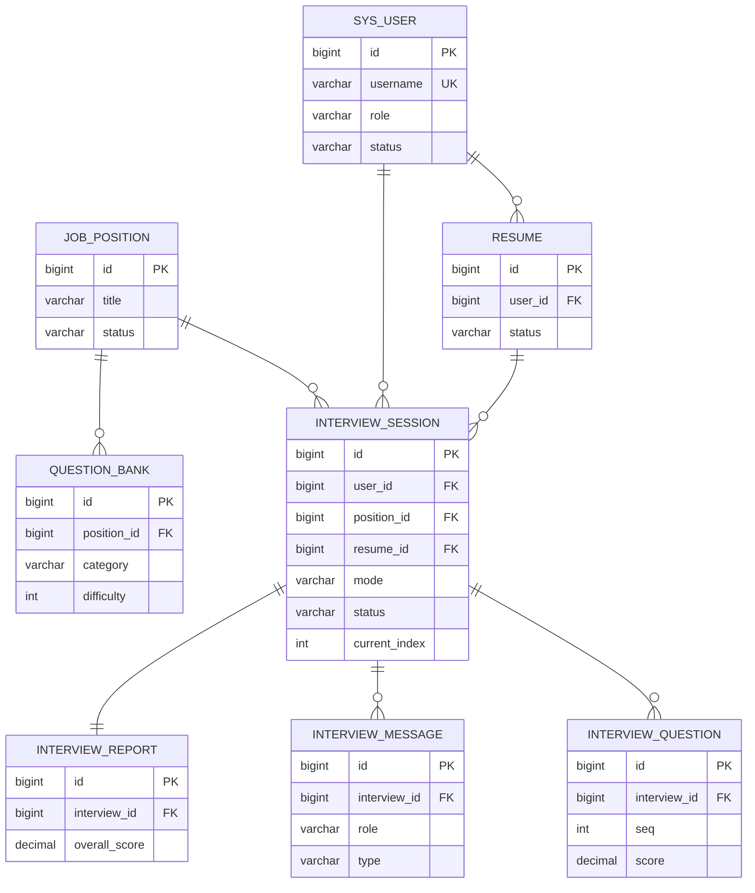

# 数据库设计

> ⚠️ **产品定位已调整（v2.0）**：新增 `practice_target`（练习方向）；练习会话复用 `interview_*` 表，
> `interview_session.position_id` 存练习方向 id。招聘相关的 `job_position` 已停用但未删除。详见第 3.11 节与
> [《练习工具产品重构方案》](07-练习工具产品重构方案.md)。

> 数据库：MySQL 8.0（生产） / H2 2.x `MODE=MySQL`（开发、测试）
> 脚本：`src/main/resources/db/schema.sql`
> 约定：UTF-8；引擎 InnoDB（生产可显式指定）；所有表无外键约束，由应用层保证一致性；主键为雪花算法 `BIGINT`。

---

## 1. 设计约定

| 项 | 约定 | 原因 |
|---|---|---|
| 主键 | `id BIGINT`，MyBatis-Plus `ASSIGN_ID` | 不依赖数据库自增，便于分库分表与数据迁移 |
| 时间 | `DATETIME`，`created_at` / `updated_at` | 由 `AuditMetaObjectHandler` 自动填充 |
| 枚举 | `VARCHAR(20)` 存枚举名 | 可读性好，Java 侧用 enum 映射 |
| 布尔 | `TINYINT`（0/1） | MySQL 原生；H2 兼容 |
| 结构化扩展 | `TEXT` 存 JSON 字符串 | 避免 MySQL `JSON` 类型导致 H2 不兼容 |
| 金额/分数 | `DECIMAL(5,2)` | 精确小数，避免浮点误差 |
| 索引 | 只建高频查询列 | 控制写放大 |
| 外键 | 不建 | 应用层已做归属与引用校验，避免分库受限 |

---

## 2. 表关系



---

## 3. 表结构明细

### 3.1 sys_user 用户表

| 字段 | 类型 | 空 | 说明 |
|---|---|---|---|
| id | BIGINT | 否 | 主键 |
| username | VARCHAR(64) | 否 | 登录名，唯一 |
| password | VARCHAR(100) | 否 | BCrypt 哈希 |
| real_name | VARCHAR(64) | 是 | 真实姓名 |
| email | VARCHAR(128) | 是 | 邮箱 |
| phone | VARCHAR(32) | 是 | 手机号 |
| role | VARCHAR(20) | 否 | CANDIDATE / INTERVIEWER / ADMIN |
| status | VARCHAR(20) | 否 | ACTIVE / DISABLED |
| avatar | VARCHAR(255) | 是 | 头像 URL |
| last_login_at | DATETIME | 是 | 最近登录时间 |
| created_at / updated_at | DATETIME | 是 | 审计时间 |

索引：`uk_sys_user_username(username)`。

### 3.2 job_position 岗位表

| 字段 | 类型 | 说明 |
|---|---|---|
| id | BIGINT | 主键 |
| title | VARCHAR(128) | 岗位名称 |
| department | VARCHAR(64) | 部门 |
| level | VARCHAR(20) | JUNIOR / MIDDLE / SENIOR |
| description | TEXT | 岗位职责 |
| requirements | TEXT | 任职要求（AI 出题与匹配的核心输入） |
| status | VARCHAR(20) | DRAFT / OPEN / CLOSED |
| created_by | BIGINT | 创建人 |

索引：`idx_job_position_status(status)`。

### 3.3 question_bank 题库表

| 字段 | 类型 | 说明 |
|---|---|---|
| id | BIGINT | 主键 |
| position_id | BIGINT | 所属岗位，NULL 表示通用题 |
| category | VARCHAR(32) | JAVA / SPRING / MYSQL / REDIS / ALGORITHM / BEHAVIOR … |
| difficulty | INT | 1-5 |
| content | TEXT | 题干 |
| reference_answer | TEXT | 参考答案 / 评分要点 |
| keywords | VARCHAR(512) | 逗号分隔关键点，规则评分用 |
| tags | VARCHAR(255) | 标签 |
| source | VARCHAR(20) | MANUAL / AI |
| created_by | BIGINT | 创建人 |

索引：`idx_question_bank_category(category)`、`idx_question_bank_position(position_id)`。

### 3.4 resume 简历表

| 字段 | 类型 | 说明 |
|---|---|---|
| id | BIGINT | 主键 |
| user_id | BIGINT | 所属候选人 |
| file_name | VARCHAR(255) | 原始文件名 |
| file_path | VARCHAR(512) | 相对存储路径 |
| raw_text | TEXT | 抽取后的纯文本 |
| parsed_json | TEXT | AI 解析后的结构化 JSON（`ParsedResume`） |
| skills | VARCHAR(1024) | 技能标签（逗号分隔，冗余检索列） |
| years_of_experience | INT | 工作年限 |
| education | VARCHAR(64) | 最高学历 |
| status | VARCHAR(20) | UPLOADED / PARSING / PARSED / FAILED |
| error_message | VARCHAR(512) | 失败原因 |

索引：`idx_resume_user(user_id)`。

`parsed_json` 结构示例：

```json
{
  "name": "张伟",
  "email": "zhangwei@example.com",
  "phone": "13800000003",
  "yearsOfExperience": 5,
  "education": "本科",
  "skills": ["Java", "Spring Boot", "MySQL", "Redis"],
  "workExperiences": [{"company": "某公司", "title": "Java 工程师", "period": "2021.06-至今", "description": "..."}],
  "projects": [{"name": "订单服务重构", "role": "技术负责人", "period": "2023", "description": "..."}],
  "highlights": ["有高并发经验"],
  "summary": "5 年 Java 后端经验"
}
```

### 3.5 interview_session 面试会话表

| 字段 | 类型 | 说明 |
|---|---|---|
| id | BIGINT | 主键 |
| user_id | BIGINT | 候选人 |
| position_id | BIGINT | 应聘岗位 |
| resume_id | BIGINT | 使用的简历 |
| mode | VARCHAR(20) | TECH / HR / COMPREHENSIVE |
| status | VARCHAR(20) | CREATED / IN_PROGRESS / FINISHED / CANCELLED |
| total_questions | INT | 总题数 |
| current_index | INT | 已答题数（也作为题号游标） |
| started_at | DATETIME | 开始时间 |
| finished_at | DATETIME | 结束时间 |
| duration_seconds | INT | 总耗时 |
| switch_count | INT | 切屏次数（反作弊上报） |

索引：`idx_interview_user(user_id)`、`idx_interview_status(status)`。

> 表名使用 `interview_session` 而非 `interview`，避免与关键字冲突。

### 3.6 interview_question 面试题目表（快照）

| 字段 | 类型 | 说明 |
|---|---|---|
| id | BIGINT | 主键 |
| interview_id | BIGINT | 所属面试 |
| seq | INT | 题号，从 1 开始 |
| content | TEXT | 题干 |
| category | VARCHAR(32) | 分类 |
| difficulty | INT | 难度 |
| reference_answer | TEXT | 参考答案 |
| answer | TEXT | 候选人回答 |
| answer_at | DATETIME | 作答时间 |
| thinking_seconds | INT | 思考耗时 |
| score | DECIMAL(5,2) | 本题得分 |
| dimension_scores | TEXT | 维度得分 JSON |
| comment | TEXT | AI 点评 |

索引：`idx_interview_question_interview(interview_id, seq)`。

`dimension_scores` 示例：`{"accuracy":82,"depth":75,"expression":80,"structure":78}`。

### 3.7 interview_message 面试消息表

| 字段 | 类型 | 说明 |
|---|---|---|
| id | BIGINT | 主键 |
| interview_id | BIGINT | 所属面试 |
| role | VARCHAR(20) | SYSTEM / AI / CANDIDATE |
| type | VARCHAR(20) | QUESTION / ANSWER / SCORE / SYSTEM |
| content | TEXT | 消息内容 |

索引：`idx_interview_message_interview(interview_id)`。

### 3.8 interview_report 面试报告表

| 字段 | 类型 | 说明 |
|---|---|---|
| id | BIGINT | 主键 |
| interview_id | BIGINT | 所属面试，唯一 |
| overall_score | DECIMAL(5,2) | 整场得分 |
| dimension_scores | TEXT | 维度均分 JSON |
| strengths | TEXT | 优势（JSON 数组字符串） |
| weaknesses | TEXT | 短板（JSON 数组字符串） |
| suggestion | VARCHAR(20) | PASS / HOLD / REJECT |
| summary | TEXT | 总结 |

约束：`uk_interview_report_interview(interview_id)`。

### 3.9 ai_call_log AI 调用日志表

| 字段 | 类型 | 说明 |
|---|---|---|
| id | BIGINT | 主键 |
| scene | VARCHAR(32) | 场景枚举 |
| provider | VARCHAR(32) | mock / openai-compatible |
| model | VARCHAR(64) | 模型名 |
| prompt_tokens / completion_tokens | INT | token 用量 |
| latency_ms | INT | 耗时 |
| success | TINYINT | 是否成功 |
| fallback | TINYINT | 是否降级 |
| error_message | VARCHAR(512) | 错误摘要 |

索引：`idx_ai_call_log_scene(scene)`。

### 3.10 sys_operation_log 操作日志表

| 字段 | 类型 | 说明 |
|---|---|---|
| id | BIGINT | 主键 |
| user_id / username | BIGINT / VARCHAR(64) | 操作人 |
| action | VARCHAR(64) | 操作描述（注解值） |
| method / path | VARCHAR(255) | HTTP 方法与 URI |
| ip | VARCHAR(64) | 来源 IP |
| cost_ms | INT | 耗时 |
| success | TINYINT | 是否成功 |

### 3.11 practice_target 练习方向表（v2.0 新增）

| 字段 | 类型 | 说明 |
|---|---|---|
| id | BIGINT | 主键 |
| code | VARCHAR(32) | 唯一编码（java-backend / frontend / …） |
| title | VARCHAR(64) | 方向名称 |
| subtitle | VARCHAR(128) | 一句话描述 |
| category | VARCHAR(32) | BACKEND / FRONTEND / PRODUCT / DATA / TEST / DEVOPS / ALGORITHM / GENERAL |
| description | TEXT | 方向说明 |
| focus_topics | VARCHAR(512) | 重点考察点，逗号分隔 |
| default_questions | INT | 默认题数 |
| difficulty | INT | 默认难度 1-5 |
| icon | VARCHAR(32) | 前端图标名 |
| sort | INT | 排序 |
| created_at / updated_at | DATETIME | 审计时间 |

约束：`uk_practice_target_code(code)`。内置 8 个方向，由 `DataInitializer` 首次启动时插入。

**与面试引擎的映射**：

- `interview_session.position_id` 存 `practice_target.id`（字段名沿用历史命名）；
- 题目、对话、报告仍使用 `interview_question` / `interview_message` / `interview_report`；
- 招聘用的 `job_position` 在练习产品中已停用，仅保留表结构，后续版本清理。

### 3.12 knowledge_document / knowledge_chunk 知识库（v3.0 新增）

| 表 | 关键字段 | 说明 |
|---|---|---|
| knowledge_document | id, title, category, source, content, status, created_at, updated_at | 知识文档 |
| knowledge_chunk | id, document_id, chunk_index, content, tokens, embedding, created_at | 分块与向量；`uk(document_id, chunk_index)` |

启动时灌入 9 篇中文面试资料，切块后写入 `knowledge_chunk`；BM25 索引在内存构建，`embedding` 为 JSON 数组文本（可为空）。

### 3.13 agent_trace AI 教练调用链（v3.0 新增）

| 字段 | 类型 | 说明 |
|---|---|---|
| id | BIGINT | 主键 |
| user_id / session_id | BIGINT | 用户与练习会话 |
| scene | VARCHAR(32) | COACH |
| input / output | TEXT | 问题与最终回答 |
| tool_calls | TEXT | 工具调用链 JSON |
| success | TINYINT | 是否由真实模型完成（降级为 0） |
| latency_ms | INT | 耗时 |

索引：`idx_agent_trace_session(session_id)`。

### 3.14 video_room 视频房间（v3.0 新增）

| 字段 | 类型 | 说明 |
|---|---|---|
| id | BIGINT | 主键 |
| code | VARCHAR(12) | 8 位房间码，唯一 |
| mode | VARCHAR(16) | AI / HUMAN |
| practice_session_id | BIGINT | AI 模式绑定练习 |
| host_user_id | BIGINT | 房主 |
| status | VARCHAR(16) | WAITING / ACTIVE / ENDED |
| created_at / ended_at | DATETIME | 时间 |

约束：`uk_video_room_code(code)`。房间成员关系在服务端内存（`CallSessionRegistry`），不落库。

---

## 4. 索引与查询

| 查询场景 | 使用索引 |
|---|---|
| 登录（按用户名） | `uk_sys_user_username` |
| 我的简历列表 | `idx_resume_user` |
| 我的面试列表 | `idx_interview_user` |
| 管理端按状态筛选面试 | `idx_interview_status` |
| 面试答题（按 session + seq） | `idx_interview_question_interview` |
| 面试回放（按 session） | `idx_interview_message_interview` |
| 报告（按 session） | `uk_interview_report_interview` |
| 题库按分类/岗位取题 | `idx_question_bank_category`、`idx_question_bank_position` |

---

## 5. 状态机与数据一致性

```
interview_session.status
  CREATED ──start──▶ IN_PROGRESS ──答完/finish──▶ FINISHED
     │                    │
     └──────cancel────────┴──────cancel────────▶ CANCELLED
```

- `current_index` 与 `interview_question.seq` 严格对应：第 N 题 = `seq = current_index + 1`；
- 推进游标使用乐观锁 SQL：`UPDATE interview_session SET current_index = current_index + 1 WHERE id = ? AND current_index = ?`；
- 一个面试只有一份报告（唯一约束），重新生成走 `UPDATE`。

---

## 6. 初始化与演示数据

- 开发环境：`spring.sql.init.mode=always`，启动自动执行 `schema.sql`（先 DROP 再 CREATE）；
- 演示数据：`DataInitializer` 在用户表为空时创建
  - `admin / 123456`（ADMIN）
  - `interviewer / 123456`（INTERVIEWER）
  - `candidate / 123456`（CANDIDATE，附带一份已解析简历）
  - 3 个岗位、16 道题库题目；
- 生产环境：手动执行 `schema.sql`，并关闭 `app.demo-data.enabled`。

---

## 7. 常用排查 SQL

```sql
-- 某场面试的题目与得分
SELECT seq, LEFT(content, 40) AS question, score, comment
FROM interview_question WHERE interview_id = ? ORDER BY seq;

-- 近 7 天面试量
SELECT DATE(created_at) AS d, COUNT(*) AS c
FROM interview_session
WHERE created_at >= DATE_SUB(CURDATE(), INTERVAL 6 DAY)
GROUP BY DATE(created_at) ORDER BY d;

-- AI 调用失败率
SELECT scene, COUNT(*) AS total,
       SUM(CASE WHEN success = 0 THEN 1 ELSE 0 END) AS failed,
       ROUND(AVG(latency_ms)) AS avg_ms
FROM ai_call_log GROUP BY scene;

-- 维度均分（人工复核）
SELECT AVG(overall_score) FROM interview_report;
```
