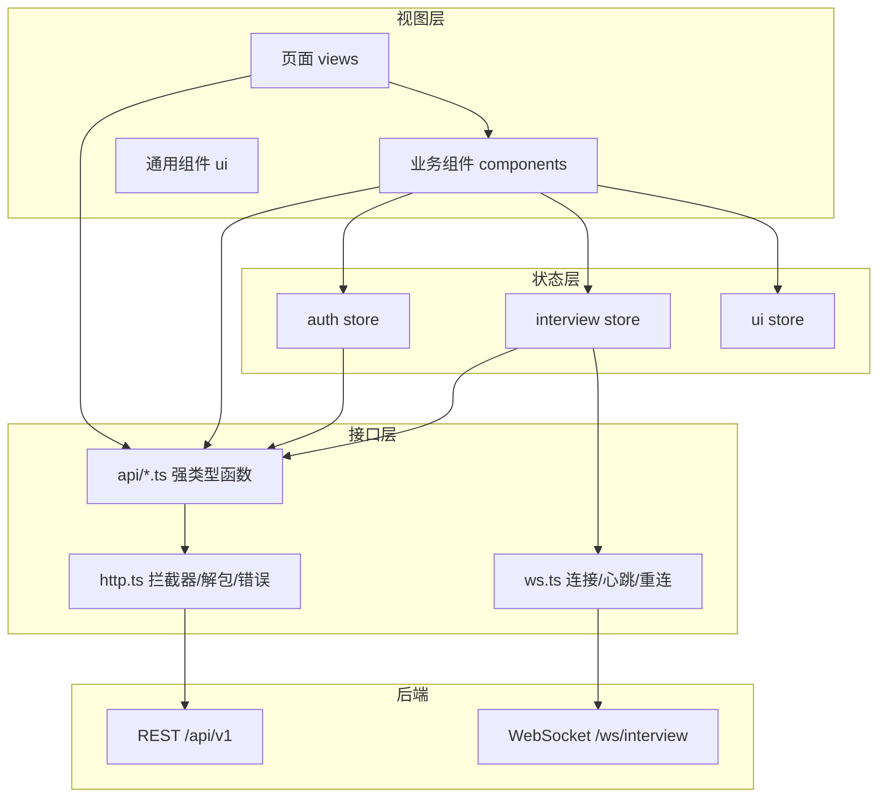
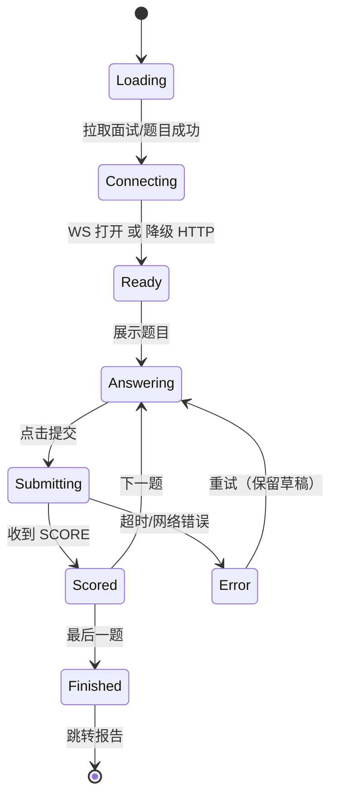
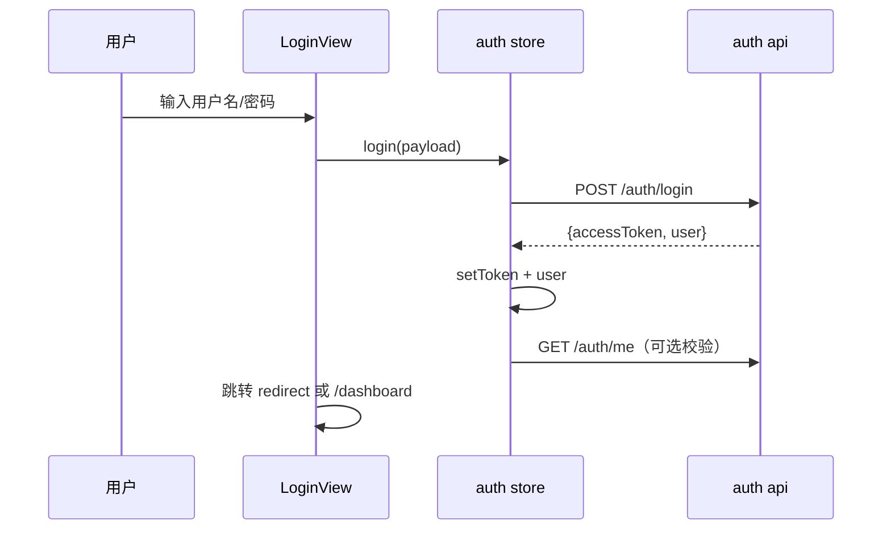
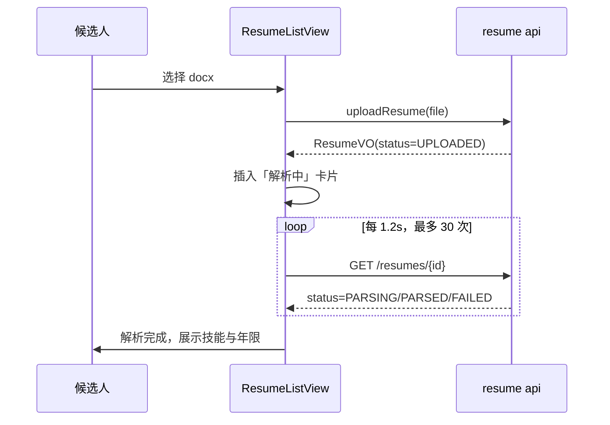
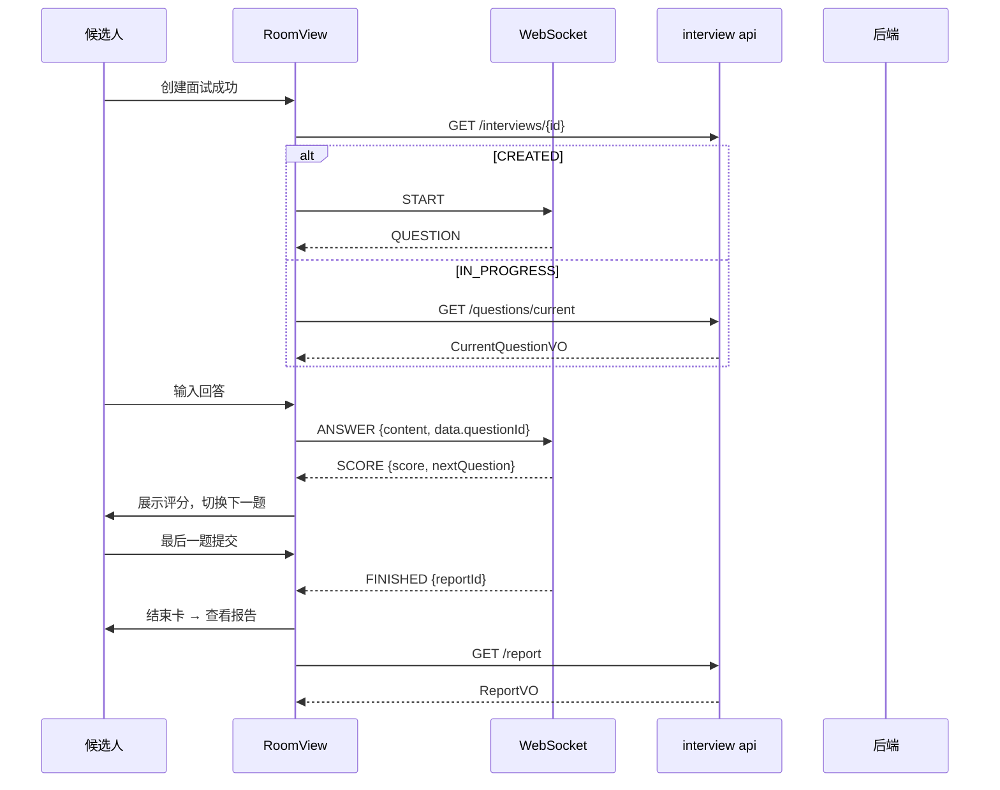
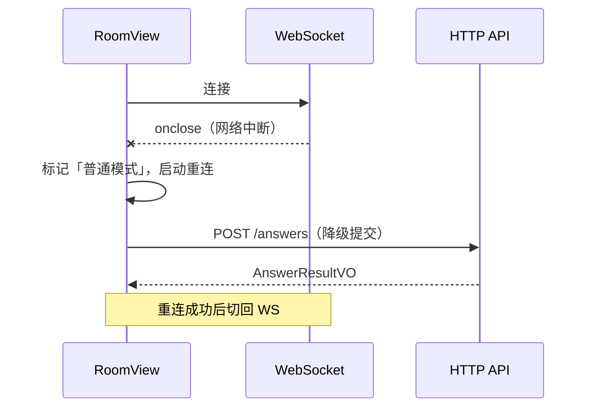
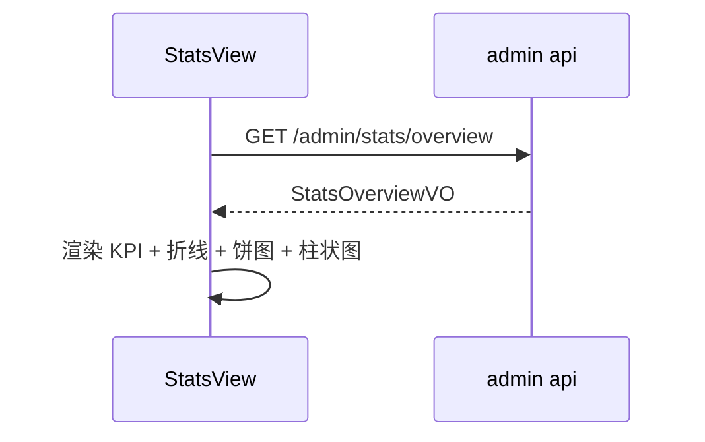

# AI 面试平台 前端开发方案

> 版本：v1.0　|　配套后端：`docs/04-API接口文档.md`（同一仓库）
> 目标：交付一个**可交互、完整覆盖全链路**的 Web 前端，覆盖「认证 → 简历 → 面试 → 报告 → 管理」全部角色与状态。
> 阅读对象：前端开发、后端联调、产品与测试。

---

## 0. 落地状态（v0.2 · 练习工具）

> ⚠️ 产品定位已调整：前端已从「招聘管理」改为「面试练习工具」。招聘页面（岗位/题库/统计/用户管理）已从路由与菜单移除。
> 当前页面：练习工作台、开始练习、练习房间（文字 + 语音）、练习复盘、练习记录、面试指南、我的简历、个人中心。
> 最新产品与页面说明见 [《练习工具产品重构方案》](07-练习工具产品重构方案.md) 与 `web/README.md`。

本文档保留最初的设计方法（分层、API 封装、WS、工程化），第 10 章的部分页面（岗位管理、统计、用户管理）已不适用。

**当前已实现（练习工具）**

| 能力 | 状态 | 代码位置 |
|---|---|---|
| 工程脚手架（Vue 3 + TS + Vite + Pinia + Element Plus） | ✅ 已完成 | `web/` |
| 登录 / 注册 / 登出 / 路由守卫 / 401 统一处理 | ✅ 已完成 | `web/src/views/auth`、`web/src/stores/auth.ts` |
| 练习工作台（继续练习、统计、方向卡片） | ✅ 已完成 | `web/src/views/practice/PracticeHomeView.vue` |
| 开始练习（方向、可选简历、模式、题数） | ✅ 已完成 | `web/src/views/practice/PracticeCreateView.vue` |
| 练习房间（提示、跳过、文字作答、录音转写、四维反馈） | ✅ 已完成 | `web/src/views/practice/PracticeRoomView.vue`、`composables/useVoiceRecorder.ts` |
| 练习复盘（总分环、等级、维度、逐题参考答案、下一步建议） | ✅ 已完成 | `web/src/views/practice/PracticeReviewView.vue` |
| 练习记录（筛选、继续、回看复盘） | ✅ 已完成 | `web/src/views/practice/PracticeHistoryView.vue` |
| 面试指南（流程、清单、自我介绍、STAR、常见问题） | ✅ 已完成 | `web/src/views/guide/GuideView.vue` |
| 我的简历（上传/解析/详情） | ✅ 已完成 | `web/src/views/resume` |
| 个人中心 | ✅ 已完成 | `web/src/views/profile` |
| 旧招聘页面（岗位/题库/统计/用户管理） | 已从路由与菜单移除，文件暂留 | `web/src/views/job` 等 |

- 启动：`cd web && npm install && npm run dev`（需先启动后端 8080）；
- 截图：`web/screenshots/`（由 `npm run test:e2e` 自动生成）；
- UI 冒烟：`npm run test:e2e`，覆盖登录 → 工作台 → 选方向 → 房间（提示/作答/反馈）→ 复盘 → 记录 → 指南 → 移动端；
- 语音：未配置 ASR 时转写返回提示，文字作答不受影响（见 `docs/07` 第 9 章）。

**实际落地版本**：Vue 3.5.46、Vite 6.4.6、Pinia 2.3.1、Element Plus 2.14.8、Vue Router 4.6.5、Axios 1.21.1、Playwright 1.65.1。

两个与文档建议不同的工程取舍（均为本机环境/阶段所致）：

1. Element Plus 暂时**全量引入**（`element` chunk gzip ≈ 285KB），保证第一阶段稳定；后续改按需引入；
2. 生产构建使用 `target: 'esnext'` + `terser`：本机曾出现 esbuild 清理临时文件 `Access is denied`，绕过后构建稳定（见 `web/README.md` 第 6 节）。

---

## 1. 目标与范围

### 1.1 业务目标

| 角色 | 前端要解决的问题 |
|---|---|
| 候选人 | 不用看文档就能完成「登录 → 传简历 → 选岗位 → 面试 → 看报告」 |
| 面试官 | 维护岗位/题库，查看面试记录与报告，判断是否进入下一轮 |
| 管理员 | 看板掌握面试量/质量，管理用户与岗位 |

### 1.2 「完整覆盖全链路」的定义

前端必须覆盖以下 6 条链路，每条链路都能在界面上闭环，不依赖 Swagger 或 curl：

| # | 链路 | 起点 | 终点 |
|---|---|---|---|
| L1 | 认证 | 注册/登录 | 登出、令牌过期回登录 |
| L2 | 简历 | 上传 docx / 粘贴文本 | 解析完成、详情查看、岗位匹配 |
| L3 | 面试 | 选择岗位+简历+模式+题数 | 逐题作答、评分反馈、结束 |
| L4 | 报告 | 面试结束 | 总分/雷达/逐题回顾/导出 |
| L5 | 管理 | 面试官/管理员登录 | 岗位/题库维护、面试记录、用户管理 |
| L6 | 统计 | 管理员登录 | 近 7 天趋势、状态分布、热门岗位 |

### 1.3 验收标准（可交互）

- [ ] 三种角色分别登录，侧边栏菜单与可访问路由完全符合权限矩阵；
- [ ] 上传一份 docx，页面自动从 `UPLOADED → PARSING → PARSED`，无需手动刷新；
- [ ] 创建面试后进入「面试房间」，能看到题目、计时、进度，并在 5 题后自动跳转报告；
- [ ] 面试房间刷新页面（F5）后能恢复到当前题，草稿不丢；
- [ ] 断网/WS 断开时自动降级到 HTTP，界面有明确状态提示；
- [ ] 最后一题提交后展示「本题得分 + 整场结束」，一键查看报告；
- [ ] 报告页展示总分仪表、四维雷达、逐题回顾，可打印为 PDF；
- [ ] 管理员禁用用户、修改岗位状态、筛选面试记录均有即时反馈；
- [ ] 所有接口错误都有可读提示（401/403/404/409/5xx 分别处理）；
- [ ] 手机（≥375px）可完成「登录 → 面试 → 报告」主流程。

### 1.4 不在本期范围

- 语音/视频面试（需 ASR/TTS 与媒体服务）；
- 多语言（预留 i18n 结构，不实现文案）；
- 移动端 App / 小程序；
- 在线支付、多租户。

---

## 2. 技术选型

### 2.1 选型原则

1. **交付速度优先**：后台表单/表格多，选组件库成熟、中文资料多的方案；
2. **类型安全**：后端 DTO 多且 id 是字符串，必须用 TypeScript 约束；
3. **实时能力原生**：后端是原生 WebSocket + 自定义 JSON 协议，不引入 STOMP/socket.io；
4. **可读可维护**：目录按业务域划分，API 层与页面解耦；
5. **不引入不必要的复杂度**：内部系统，不需要 SSR/SEO。

### 2.2 最终选型

| 关注点 | 选型 | 版本（建议） | 说明 |
|---|---|---|---|
| 框架 | **Vue 3**（Composition API + `<script setup>`） | ^3.5 | 学习成本低、模板直观、生态成熟 |
| 语言 | **TypeScript** | ~5.7 | 与后端 DTO 一一对应 |
| 构建 | **Vite** | ^6 / ^7 | 冷启动快、HMR 稳定、配置简单 |
| 路由 | **Vue Router** | ^4.5 | 官方方案，支持懒加载与守卫 |
| 状态 | **Pinia** | ^3 | 官方推荐，TS 友好；仅鉴权持久化 |
| UI 组件 | **Element Plus** | ^2.9 | 后台表格/表单/弹窗齐全，CSS 变量易定制 |
| 图标 | `@element-plus/icons-vue` | ^2.3 | 与组件库同源 |
| HTTP | **Axios** | ^1.7 | 拦截器、上传进度、取消请求完善 |
| 图表 | **ECharts + vue-echarts** | ^5.6 / ^7 | 雷达图、仪表盘、趋势图能力最强 |
| 时间 | **dayjs** | ^1.11 | 轻量，格式与后端一致 |
| 工具库 | **@vueuse/core** | ^12 | `useIntervalFn`、`useLocalStorage`、`useDebounceFn` |
| 实时 | **原生 WebSocket 封装** | — | 后端协议自定义，避免 socket.io 适配层 |
| 样式 | **SCSS + CSS Variables** | sass ^1.8 | 一套主题变量覆盖 Element Plus |
| 包管理 | **pnpm** | ^9 / ^10 | 安装快、磁盘占用小 |
| 单测 | **Vitest + @vue/test-utils** | ^3 / ^2.4 | 与 Vite 同源 |
| E2E | **Playwright** | ^1.50 | 可覆盖 WS、上传、下载 |
| Mock | **MSW** | ^2.7 | 后端未就绪时按契约联调 |
| 质量 | ESLint 9 + typescript-eslint + Prettier | — | 统一风格 |
| 类型生成 | **openapi-typescript** | ^7 | 从 `/v3/api-docs` 生成接口类型 |

> 版本以创建脚手架时的最新稳定版为准，最终以 `pnpm-lock.yaml` 锁定。
>
> 实际落地版本与上表的差异（Pinia 2.3、Vite 6.4、Element Plus 2.14）见第 0 章；Package Manager 实际使用 npm（Node 22 自带），pnpm 为可选建议。

### 2.3 候选对比

**框架**

| 方案 | 优点 | 缺点 | 结论 |
|---|---|---|---|
| Vue 3 + Vite | 模板直观、Element Plus 配套、团队上手快 | 生态略小于 React | ✅ 采用 |
| React 18/19 + Vite | 生态最大、招聘容易 | 表单/表格需要更多自研或拼装 | 备选 |
| Nuxt 3 | SSR/SEO | 内部系统无 SEO 需求，增加部署复杂度 | ❌ |

**组件库**

| 方案 | 优点 | 缺点 | 结论 |
|---|---|---|---|
| Element Plus | 后台组件全、中文文档、CSS 变量主题 | 视觉偏传统 | ✅ |
| Ant Design Vue | 设计规范强、企业风格 | 包体略大、部分组件 API 变动多 | 备选 |
| Naive UI | 轻、TS 友好 | 生态与示例相对少 | ❌ |

**状态管理**

| 方案 | 结论 |
|---|---|
| Pinia | ✅ 全局只放「鉴权 + 当前面试 + UI 偏好」，服务端数据不进全局 |
| Vuex | ❌ 官方已推荐 Pinia |
| TanStack Query | 可选增强（缓存/重试），本期用「api 层 + 页面局部状态」即可 |

**实时通信**

| 方案 | 结论 |
|---|---|
| 原生 WebSocket 封装 | ✅ 后端是原生协议，需要自定义心跳、重连、降级 |
| socket.io-client | ❌ 协议不兼容，需服务端改造 |
| reconnecting-websocket | 可用，但重连策略与「握手带 token」需定制，自研约 120 行更可控 |

**样式**

| 方案 | 结论 |
|---|---|
| SCSS + CSS 变量 | ✅ 与 Element Plus 主题变量统一，无第二套原子类体系 |
| Tailwind CSS | 可选；若团队已用可叠加，但需处理与 Element Plus 的优先级 |
| CSS-in-JS | ❌ 增加运行时与心智负担 |

### 2.4 依赖清单（建议）

```json
{
  "name": "ai-interview-web",
  "private": true,
  "type": "module",
  "scripts": {
    "dev": "vite",
    "build": "vue-tsc -b && vite build",
    "preview": "vite preview",
    "lint": "eslint . --fix",
    "format": "prettier --write \"src/**/*.{ts,vue,scss}\"",
    "test": "vitest run",
    "test:e2e": "playwright test",
    "gen:api": "openapi-typescript http://localhost:8080/v3/api-docs -o src/types/openapi.d.ts"
  },
  "dependencies": {
    "vue": "^3.5.13",
    "vue-router": "^4.5.0",
    "pinia": "^3.0.1",
    "pinia-plugin-persistedstate": "^4.2.0",
    "element-plus": "^2.9.5",
    "@element-plus/icons-vue": "^2.3.1",
    "axios": "^1.7.9",
    "echarts": "^5.6.0",
    "vue-echarts": "^7.0.3",
    "dayjs": "^1.11.13",
    "@vueuse/core": "^12.5.0"
  },
  "devDependencies": {
    "typescript": "~5.7.3",
    "vite": "^6.0.11",
    "@vitejs/plugin-vue": "^5.2.1",
    "vue-tsc": "^2.2.0",
    "sass": "^1.83.4",
    "unplugin-auto-import": "^19.0.0",
    "unplugin-vue-components": "^28.0.0",
    "vitest": "^3.0.5",
    "@vue/test-utils": "^2.4.6",
    "@playwright/test": "^1.50.1",
    "msw": "^2.7.0",
    "eslint": "^9.19.0",
    "typescript-eslint": "^8.22.0",
    "eslint-plugin-vue": "^9.32.0",
    "prettier": "^3.4.2",
    "openapi-typescript": "^7.5.0"
  }
}
```

---

## 3. 总体架构

### 3.1 分层



原则：

- **页面不直接调 axios**，只调 `api/*.ts` 的强类型函数；
- **服务端数据不放进全局 store**（除鉴权与当前面试），避免缓存失效难维护；
- **Result 解包只在 http 层做一次**，页面拿到的就是业务数据；
- **错误只抛 `ApiError`**，页面按 `code/status` 决定提示或跳转。

### 3.2 目录结构

```
ai-interview-web/
├── public/
├── src/
│   ├── api/
│   │   ├── http.ts              # axios 实例、拦截器、ApiError
│   │   ├── auth.ts              # 注册/登录/me/登出/改密
│   │   ├── jobs.ts
│   │   ├── questions.ts
│   │   ├── resumes.ts
│   │   ├── interviews.ts
│   │   └── admin.ts
│   ├── components/
│   │   ├── layout/              # AppShell / SideMenu / TopBar / Breadcrumb
│   │   ├── common/              # PageHeader / EmptyState / StatusTag / ScoreRing
│   │   ├── interview/           # QuestionCard / AnswerEditor / ScorePanel / RoomStatus
│   │   ├── report/              # RadarChart / DimensionBars / QaReviewList
│   │   └── charts/              # LineChart / PieChart / GaugeChart / BarChart
│   ├── composables/
│   │   ├── useWebSocket.ts      # 面试通道封装
│   │   ├── useCountdown.ts      # 计时
│   │   ├── usePolling.ts        # 简历解析轮询
│   │   └── usePermission.ts     # 角色判断
│   ├── router/
│   │   ├── index.ts
│   │   ├── routes.ts
│   │   └── guard.ts
│   ├── stores/
│   │   ├── auth.ts
│   │   ├── interview.ts
│   │   └── ui.ts
│   ├── styles/
│   │   ├── index.scss
│   │   ├── variables.scss
│   │   └── element-override.scss
│   ├── types/
│   │   ├── api.ts               # 与后端 DTO 对齐
│   │   ├── enums.ts
│   │   └── openapi.d.ts         # 自动生成（可选）
│   ├── utils/
│   │   ├── format.ts            # 时间、时长、分数
│   │   ├── storage.ts           # token / 草稿
│   │   └── constants.ts
│   ├── views/
│   │   ├── auth/LoginView.vue
│   │   ├── auth/RegisterView.vue
│   │   ├── dashboard/DashboardView.vue
│   │   ├── job/JobListView.vue
│   │   ├── job/JobEditView.vue
│   │   ├── job/JobDetailView.vue
│   │   ├── question/QuestionListView.vue
│   │   ├── question/QuestionEditView.vue
│   │   ├── resume/ResumeListView.vue
│   │   ├── resume/ResumeDetailView.vue
│   │   ├── interview/InterviewCreateView.vue
│   │   ├── interview/InterviewListView.vue
│   │   ├── interview/InterviewRoomView.vue
│   │   ├── interview/InterviewDetailView.vue
│   │   ├── report/ReportView.vue
│   │   ├── admin/UserListView.vue
│   │   ├── admin/StatsView.vue
│   │   ├── profile/ProfileView.vue
│   │   └── error/NotFoundView.vue, ForbiddenView.vue
│   ├── App.vue
│   └── main.ts
├── tests/
│   ├── unit/
│   └── e2e/
├── .env.development
├── .env.production
├── index.html
├── vite.config.ts
├── tsconfig.json
└── package.json
```

### 3.3 命名与编码规范

| 类型 | 规范 | 示例 |
|---|---|---|
| 组件文件 | PascalCase | `InterviewRoomView.vue` |
| 组件名 | 多单词 PascalCase | `<QuestionCard />` |
| composable | `use` 前缀 | `useWebSocket` |
| API 函数 | 动词 + 名词 | `createInterview`、`fetchMyInterviews` |
| 类型 | PascalCase，后缀对齐后端 | `InterviewVO`、`PageResult<T>` |
| 枚举 | 字符串联合类型 | `type InterviewStatus = 'CREATED' \| ...` |
| 事件 | kebab-case | `@question-change` |

---

## 4. 工程化

### 4.1 环境变量

`.env.development`

```ini
VITE_API_BASE=/api
VITE_WS_BASE=ws://localhost:8080
VITE_APP_TITLE=AI 面试平台
```

`.env.production`

```ini
VITE_API_BASE=/api
VITE_WS_BASE=
# 留空表示用当前页面协议+host，例如 wss://interview.example.com
VITE_APP_TITLE=AI 面试平台
```

约定：

- 开发环境由 Vite 代理转发，避免 CORS 与 cookie 问题；
- 生产环境同域部署（Nginx 反代 `/api` 与 `/ws`），`VITE_WS_BASE` 可留空；
- 所有 `import.meta.env` 通过 `src/types/env.d.ts` 声明类型。

### 4.2 Vite 配置

```ts
// vite.config.ts
import { defineConfig } from 'vite'
import vue from '@vitejs/plugin-vue'
import AutoImport from 'unplugin-auto-import/vite'
import Components from 'unplugin-vue-components/vite'
import { ElementPlusResolver } from 'unplugin-vue-components/resolvers'
import { fileURLToPath, URL } from 'node:url'

export default defineConfig({
  plugins: [
    vue(),
    AutoImport({ imports: ['vue', 'vue-router', 'pinia'], resolvers: [ElementPlusResolver()] }),
    Components({ resolvers: [ElementPlusResolver()] }),
  ],
  resolve: {
    alias: { '@': fileURLToPath(new URL('./src', import.meta.url)) },
  },
  server: {
    port: 5173,
    proxy: {
      '/api': { target: 'http://localhost:8080', changeOrigin: true },
      '/ws': { target: 'ws://localhost:8080', ws: true },
    },
  },
  build: {
    chunkSizeWarningLimit: 900,
    rollupOptions: {
      output: {
        manualChunks: {
          vue: ['vue', 'vue-router', 'pinia'],
          element: ['element-plus', '@element-plus/icons-vue'],
          echarts: ['echarts', 'vue-echarts'],
        },
      },
    },
  },
})
```

### 4.3 类型生成（推荐）

后端已提供 OpenAPI：

```bash
pnpm gen:api
```

- `openapi.d.ts` 只用于**校验与补全**，业务代码仍使用 `src/types/api.ts` 的手写类型（可读性更好、可加注释）；
- 后端新增字段时，先跑一次生成，对照 diff 更新手写类型；
- CI 中可加一步「生成后 git diff 为空」的检查，防止契约漂移。

### 4.4 代码质量

- ESLint 9 扁平配置：`vue3-recommended` + `typescript-eslint` + `import/order`；
- Prettier：单引号、无分号、120 列；
- 提交前 `lint-staged` + `husky`（可选）；
- 分支：`main`（可发布）/ `feat/*` / `fix/*`；提交信息用 Conventional Commits。

---

## 5. API 层设计

### 5.1 统一错误模型

```ts
// src/api/http.ts
export interface ApiError extends Error {
  /** HTTP 状态码，网络错误为 0 */
  status: number
  /** 后端业务码，例如 40900 */
  code: number
  /** 可直接展示给用户的文案 */
  message: string
}
```

### 5.2 axios 封装

```ts
import axios, { AxiosError, type AxiosRequestConfig } from 'axios'
import { getToken, clearToken } from '@/utils/storage'
import { ElMessage } from 'element-plus'

const instance = axios.create({
  baseURL: import.meta.env.VITE_API_BASE,
  timeout: 30_000,
})

instance.interceptors.request.use((config) => {
  const token = getToken()
  if (token) config.headers.Authorization = `Bearer ${token}`
  return config
})

instance.interceptors.response.use(
  (response) => {
    const body = response.data as Result<unknown>
    if (body.code !== 0) {
      return Promise.reject(makeError(response.status, body.code, body.message))
    }
    return body.data as never
  },
  (error: AxiosError<Result<unknown>>) => {
    const status = error.response?.status ?? 0
    const body = error.response?.data
    if (status === 401) {
      clearToken()
      // 交给路由守卫跳转，避免在拦截器里直接依赖 router
      window.dispatchEvent(new CustomEvent('auth:unauthorized'))
    }
    return Promise.reject(makeError(status, body?.code ?? status, body?.message ?? error.message))
  },
)

/** 拦截器已把 Result.data 取出，这里的泛型就是业务数据类型 */
export const get = <T>(url: string, params?: object, config?: AxiosRequestConfig) =>
  instance.get<unknown, T>(url, { params, ...config })

export const post = <T>(url: string, data?: unknown, config?: AxiosRequestConfig) =>
  instance.post<unknown, T>(url, data, config)
```

要点：

- **token 从 `storage` 读取，不直接依赖 Pinia**，避免 `store ↔ http` 循环依赖；
- 401 只做「清 token + 广播事件」，跳转由 router 守卫/监听器处理；
- 其他错误统一抛 `ApiError`，页面只处理自己关心的（如 409）。

### 5.3 状态码处理策略

| HTTP / code | 前端行为 |
|---|---|
| 401 / 40100 | 清 token，跳 `/login?redirect=当前路径`，提示「登录已过期」 |
| 403 / 40300 | 页面内提示「无权限」；若是路由级则跳 `/403` |
| 404 / 40400 | 详情页展示「资源不存在」空态；列表页 toast |
| 409 / 40900 | **不自动重试**：提示文案 + 刷新当前资源（面试房间刷新当前题） |
| 429 | 提示稍后再试，按钮进入 3s 冷却 |
| 502/503 / 50200 | 提示「AI 服务繁忙，已切换备用策略」，页面继续可用（后端已降级） |
| 0（网络错误） | 提示「网络异常」，保留表单/草稿，提供重试 |

### 5.4 上传

```ts
export function uploadResume(file: File, onProgress?: (percent: number) => void) {
  const form = new FormData()
  form.append('file', file)
  return post<ResumeVO>('/v1/resumes', form, {
    headers: { 'Content-Type': 'multipart/form-data' },
    timeout: 60_000,
    onUploadProgress: (e) => {
      if (e.total) onProgress?.(Math.round((e.loaded / e.total) * 100))
    },
  })
}
```

前端预校验：扩展名 `txt/md/docx`、大小 ≤ 10MB；`pdf` 直接提示「请上传 docx 或粘贴文本」。

### 5.5 轮询（简历解析）

```ts
export function useResumePolling(resumeId: Ref<string | null>) {
  const status = ref<ResumeStatus>('UPLOADED')
  const stop = useIntervalFn(async () => {
    if (!resumeId.value) return
    const detail = await getResume(resumeId.value)
    status.value = detail.resume.status
    if (status.value === 'PARSED' || status.value === 'FAILED') stop.pause()
  }, 1200, { immediate: false })

  watch(resumeId, () => { if (resumeId.value) stop.resume() }, { immediate: true })
  onUnmounted(() => stop.pause())
  return { status }
}
```

约束：

- 间隔 1.2s，最多 30 次（约 36s），超时提示「解析较慢，可稍后在列表查看」；
- 页面隐藏时暂停（`useDocumentVisibility`），回来继续；
- 不要对列表整体轮询，只轮询当前简历。

### 5.6 API 函数清单

> 与 `docs/04-API接口文档.md` 一一对应；`page/size` 为 query，其余为 body。
> 下表中路径省略了 `baseURL` 前缀：`VITE_API_BASE=/api`，因此实际请求为 `/api/v1/...`。

| 模块 | 函数 | 方法与路径 |
|---|---|---|
| auth | `register(body)` | POST `/v1/auth/register` |
| auth | `login(body)` | POST `/v1/auth/login` |
| auth | `fetchMe()` | GET `/v1/auth/me` |
| auth | `logout()` | POST `/v1/auth/logout` |
| user | `updateProfile(body)` | PUT `/v1/users/me` |
| user | `changePassword(body)` | PUT `/v1/users/me/password` |
| job | `fetchJobs(query)` | GET `/v1/jobs` |
| job | `fetchJob(id)` | GET `/v1/jobs/{id}` |
| job | `createJob(body)` | POST `/v1/jobs` |
| job | `updateJob(id, body)` | PUT `/v1/jobs/{id}` |
| job | `changeJobStatus(id, status)` | PATCH `/v1/jobs/{id}/status` |
| job | `deleteJob(id)` | DELETE `/v1/jobs/{id}` |
| question | `fetchQuestions(query)` | GET `/v1/questions` |
| question | `fetchQuestion(id)` | GET `/v1/questions/{id}` |
| question | `createQuestion(body)` | POST `/v1/questions` |
| question | `updateQuestion(id, body)` | PUT `/v1/questions/{id}` |
| question | `deleteQuestion(id)` | DELETE `/v1/questions/{id}` |
| resume | `uploadResume(file, onProgress)` | POST `/v1/resumes` |
| resume | `createResumeFromText(body)` | POST `/v1/resumes/text` |
| resume | `fetchMyResumes()` | GET `/v1/resumes/my` |
| resume | `fetchResume(id)` | GET `/v1/resumes/{id}` |
| resume | `deleteResume(id)` | DELETE `/v1/resumes/{id}` |
| resume | `matchResume(id, positionId)` | GET `/v1/resumes/{id}/match` |
| interview | `createInterview(body)` | POST `/v1/interviews` |
| interview | `fetchMyInterviews(query)` | GET `/v1/interviews/my` |
| interview | `fetchAllInterviews(query)` | GET `/v1/interviews` |
| interview | `fetchInterview(id)` | GET `/v1/interviews/{id}` |
| interview | `startInterview(id)` | POST `/v1/interviews/{id}/start` |
| interview | `fetchCurrentQuestion(id)` | GET `/v1/interviews/{id}/questions/current` |
| interview | `submitAnswer(id, body)` | POST `/v1/interviews/{id}/answers` |
| interview | `finishInterview(id)` | POST `/v1/interviews/{id}/finish` |
| interview | `cancelInterview(id)` | POST `/v1/interviews/{id}/cancel` |
| interview | `fetchReport(id)` | GET `/v1/interviews/{id}/report` |
| interview | `regenerateReport(id)` | POST `/v1/interviews/{id}/report/regenerate` |
| interview | `fetchMessages(id)` | GET `/v1/interviews/{id}/messages` |
| interview | `reportSwitch(id)` | POST `/v1/interviews/{id}/switch` |
| admin | `fetchStats()` | GET `/v1/admin/stats/overview` |
| admin | `fetchUsers(query)` | GET `/v1/admin/users` |
| admin | `updateUserStatus(id, status)` | PATCH `/v1/admin/users/{id}/status` |

### 5.7 并发与幂等

- **面试创建**：后端同步生成题目（真实模型可能 10-30s），必须设 `timeout: 120_000`，按钮 loading 且禁止重复点击；
- **提交答案**：用 `submitting` 标记 + 按钮禁用；即使误触，后端乐观锁会返回 409，前端按 409 刷新；
- **列表查询**：快速切换筛选时用 `AbortController` 取消上一次请求，避免旧响应覆盖新结果。

---

## 6. 类型系统

### 6.1 通用类型

```ts
// src/types/api.ts
export interface Result<T> {
  code: number
  message: string
  data: T
  timestamp: number
}

export interface PageResult<T> {
  total: number
  current: number
  size: number
  pages: number
  records: T[]
}

export interface PageQuery {
  page?: number
  size?: number
}
```

### 6.2 业务类型（与后端 DTO 对齐）

> **所有 id 都是 string**（后端把 Long 序列化为字符串），不要写成 number。

```ts
export type UserRole = 'CANDIDATE' | 'INTERVIEWER' | 'ADMIN'
export type UserStatus = 'ACTIVE' | 'DISABLED'
export type JobLevel = 'JUNIOR' | 'MIDDLE' | 'SENIOR'
export type JobStatus = 'DRAFT' | 'OPEN' | 'CLOSED'
export type ResumeStatus = 'UPLOADED' | 'PARSING' | 'PARSED' | 'FAILED'
export type InterviewMode = 'TECH' | 'HR' | 'COMPREHENSIVE'
export type InterviewStatus = 'CREATED' | 'IN_PROGRESS' | 'FINISHED' | 'CANCELLED'
export type Recommendation = 'PASS' | 'HOLD' | 'REJECT'

export interface UserVO {
  id: string
  username: string
  realName?: string
  email?: string
  phone?: string
  role: UserRole
  status: UserStatus
  avatar?: string
  lastLoginAt?: string
  createdAt?: string
}

export interface LoginResponse {
  accessToken: string
  tokenType: string
  expiresInSeconds: number
  user: UserVO
}

export interface JobVO {
  id: string
  title: string
  department?: string
  level?: JobLevel
  description?: string
  requirements?: string
  status: JobStatus
  createdBy?: string
  createdAt?: string
  updatedAt?: string
}

export interface QuestionVO {
  id: string
  positionId?: string
  category: string
  difficulty: number
  content: string
  referenceAnswer?: string
  keywords?: string
  tags?: string
  source?: string
  createdAt?: string
}

export interface ResumeVO {
  id: string
  fileName?: string
  yearsOfExperience?: number
  education?: string
  skills?: string
  status: ResumeStatus
  errorMessage?: string
  createdAt?: string
}

export interface ParsedResume {
  name?: string
  email?: string
  phone?: string
  yearsOfExperience?: number
  education?: string
  skills: string[]
  workExperiences: WorkExperience[]
  projects: ProjectExperience[]
  highlights: string[]
  summary?: string
}

export interface WorkExperience { company?: string; title?: string; period?: string; description?: string }
export interface ProjectExperience { name?: string; role?: string; period?: string; description?: string }

export interface MatchVO {
  score: number
  matchedSkills: string[]
  missingSkills: string[]
  advice?: string
}

export interface InterviewVO {
  id: string
  positionId: string
  positionTitle?: string
  resumeId?: string
  mode: InterviewMode
  status: InterviewStatus
  totalQuestions: number
  currentIndex: number
  durationSeconds?: number
  startedAt?: string
  finishedAt?: string
  createdAt?: string
}

export interface CurrentQuestionVO {
  questionId: string
  seq: number
  totalQuestions: number
  content: string
  category?: string
  difficulty?: number
  referenceAnswer?: string
}

export interface AnswerResultVO {
  questionId: string
  score: number
  dimensionScores: Record<string, number>
  comment?: string
  hits: string[]
  misses: string[]
  finished: boolean
  nextQuestion?: CurrentQuestionVO
  reportId?: string
}

export interface QuestionReviewVO {
  seq: number
  content: string
  answer?: string
  score?: number
  dimensionScores: Record<string, number>
  comment?: string
}

export interface ReportVO {
  id: string
  interviewId: string
  overallScore: number
  dimensionScores: Record<string, number>
  strengths: string[]
  weaknesses: string[]
  suggestion: Recommendation
  summary?: string
  createdAt?: string
  questions: QuestionReviewVO[]
}

export interface StatsOverviewVO {
  userCount: number
  candidateCount: number
  interviewerCount: number
  interviewCount: number
  finishedCount: number
  inProgressCount: number
  averageScore: number
  last7Days: { date: string; count: number }[]
  statusDistribution: { status: string; count: number }[]
  hotPositions: { positionId: string; title: string; interviewCount: number }[]
}
```

### 6.3 请求类型

```ts
export interface JobSaveRequest {
  title: string
  department?: string
  level?: JobLevel
  description?: string
  requirements?: string
  status?: JobStatus
}

export interface QuestionSaveRequest {
  positionId?: string
  category: string
  difficulty: number
  content: string
  referenceAnswer?: string
  keywords?: string
  tags?: string
}

export interface CreateInterviewRequest {
  positionId: string
  resumeId?: string
  mode: InterviewMode
  totalQuestions?: number
}

export interface SubmitAnswerRequest {
  questionId: string
  answer: string
  thinkingSeconds?: number
}
```

> 与后端契约的两个硬约束：`questionId` 必须是**当前题的 id**；`answer` 非空且 ≤10000 字（前端同步校验）。

---

## 7. 状态管理

### 7.1 auth store

```ts
// src/stores/auth.ts
export const useAuthStore = defineStore('auth', () => {
  const token = ref<string>(getToken() ?? '')
  const user = ref<UserVO | null>(null)

  const isLoggedIn = computed(() => !!token.value)
  const role = computed<UserRole | ''>(() => user.value?.role ?? '')
  const isAdmin = computed(() => role.value === 'ADMIN')
  const isInterviewer = computed(() => role.value === 'INTERVIEWER')
  const isCandidate = computed(() => role.value === 'CANDIDATE')

  async function login(payload: LoginRequest) {
    const res = await authApi.login(payload)
    token.value = res.accessToken
    setToken(res.accessToken)
    user.value = res.user
  }

  async function fetchProfile() {
    if (!token.value) return
    user.value = await authApi.fetchMe()
  }

  async function logout() {
    try { await authApi.logout() } finally {
      token.value = ''
      user.value = null
      clearToken()
      router.replace('/login')
    }
  }

  return { token, user, isLoggedIn, role, isAdmin, isInterviewer, isCandidate, login, fetchProfile, logout }
}, { persist: { pick: ['token'] } })
```

说明：

- 只持久化 token；用户信息每次刷新用 `/auth/me` 拉取，避免角色变更后前端仍显示旧权限；
- `logout` 一定清本地状态（即使接口失败），保证可退出。

### 7.2 interview store（房间专用）

只保存「跨组件、刷新要恢复」的数据；页面内消息列表等仍用局部状态。

```ts
export const useInterviewStore = defineStore('interview', () => {
  const interviewId = ref('')
  const interview = ref<InterviewVO | null>(null)
  const question = ref<CurrentQuestionVO | null>(null)
  const elapsedSeconds = ref(0)
  const switchCount = ref(0)
  const transport = ref<'WS' | 'HTTP'>('WS')
  const draft = ref('')
  function reset() { /* ... */ }
  return { interviewId, interview, question, elapsedSeconds, switchCount, transport, draft, reset }
})
```

### 7.3 ui store

- 侧边栏折叠状态；
- 全局 loading（少用，优先局部 loading）；
- 主题（默认浅色，预留暗色变量）。

### 7.4 缓存策略

| 数据 | 缓存 | 失效 |
|---|---|---|
| 当前用户 | store，刷新时拉取 | 登录/登出 |
| 岗位下拉 | `sessionStorage` + 5 分钟 TTL | 岗位增删改后清空 |
| 题库列表 | 不缓存（筛选频繁） | — |
| 统计看板 | 不缓存，进入即刷新 | — |
| 面试房间 | store + localStorage 草稿 | 结束/取消时清空 |

---

## 8. 路由与权限

### 8.1 路由表

| 路径 | 名称 | 页面 | 允许角色 | 说明 |
|---|---|---|---|---|
| `/login` | login | LoginView | 公开 | 已登录访问自动跳首页 |
| `/register` | register | RegisterView | 公开 | 注册即登录 |
| `/dashboard` | dashboard | DashboardView | 全部 | 按角色展示不同卡片 |
| `/jobs` | job-list | JobListView | 全部（写操作按角色） | 候选人只读用于选岗 |
| `/jobs/new` | job-create | JobEditView | ADMIN / INTERVIEWER | — |
| `/jobs/:id` | job-detail | JobDetailView | 全部 | — |
| `/jobs/:id/edit` | job-edit | JobEditView | ADMIN / INTERVIEWER | — |
| `/questions` | question-list | QuestionListView | ADMIN / INTERVIEWER | 候选人不可见 |
| `/questions/new` | question-create | QuestionEditView | ADMIN / INTERVIEWER | — |
| `/questions/:id/edit` | question-edit | QuestionEditView | ADMIN / INTERVIEWER | — |
| `/resumes` | resume-list | ResumeListView | CANDIDATE | 面试官不管理候选人简历 |
| `/resumes/:id` | resume-detail | ResumeDetailView | CANDIDATE / ADMIN | 本人或管理员 |
| `/interviews/new` | interview-create | InterviewCreateView | CANDIDATE | 选岗位+简历 |
| `/interviews` | interview-list | InterviewListView | 全部 | 候选人看自己的，面试官/管理员看全部 |
| `/interviews/:id` | interview-detail | InterviewDetailView | 本人 / INTERVIEWER / ADMIN | 题目与消息回放 |
| `/interviews/:id/room` | interview-room | InterviewRoomView | 本人 | 答题房间（全屏布局） |
| `/interviews/:id/report` | interview-report | ReportView | 本人 / INTERVIEWER / ADMIN | 报告 |
| `/admin/stats` | admin-stats | StatsView | ADMIN | 统计看板 |
| `/admin/users` | admin-users | UserListView | ADMIN | 用户管理 |
| `/profile` | profile | ProfileView | 全部 | 资料与改密 |
| `/403` | forbidden | ForbiddenView | 公开 | — |
| `/:pathMatch(.*)*` | not-found | NotFoundView | 公开 | — |

### 8.2 路由守卫

```ts
router.beforeEach(async (to) => {
  const auth = useAuthStore()

  if (to.meta.public) {
    return auth.isLoggedIn && to.name === 'login' ? { name: 'dashboard' } : true
  }
  if (!auth.isLoggedIn) {
    return { name: 'login', query: { redirect: to.fullPath } }
  }
  if (!auth.user) {
    try { await auth.fetchProfile() } catch { return { name: 'login' } }
  }
  const roles = to.meta.roles as UserRole[] | undefined
  if (roles && !roles.includes(auth.role)) return { name: 'forbidden' }
  return true
})
```

补充：

- 监听 `auth:unauthorized` 事件 → 清 store → 跳登录（携带 redirect）；
- 房间页 `meta.fullscreen = true`，不显示侧边栏；
- 页面标题 = `meta.title + ' · ' + VITE_APP_TITLE`。

### 8.3 菜单（按角色）

| 菜单 | CANDIDATE | INTERVIEWER | ADMIN |
|---|---|---|---|
| 工作台 | ✅ | ✅ | ✅ |
| 岗位管理 | 只读入口（选岗） | ✅ | ✅ |
| 题库管理 | — | ✅ | ✅ |
| 简历中心 | ✅ | — | — |
| 创建面试 | ✅ | — | — |
| 面试记录 | 我的面试 | ✅ | ✅ |
| 统计看板 | — | — | ✅ |
| 用户管理 | — | — | ✅ |

---

## 9. WebSocket 设计

### 9.1 连接参数

```
ws(s)://<host>/ws/interview?token=<accessToken>&interviewId=<id>
```

- token 放 query 是因为浏览器 WebSocket API 不支持自定义 Header；
- 每次（重）连都用**当前最新 token**，令牌过期时先刷新/重新登录；
- 连接失败时提示「实时通道不可用，已切换为普通模式」，自动降级 HTTP。

### 9.2 客户端封装

```ts
// src/composables/useWebSocket.ts
export interface WsMessage<T = unknown> {
  type: string
  content?: string
  thinkingSeconds?: number
  data?: T
}

export function useInterviewSocket(options: {
  interviewId: string
  token: string
  onMessage: (msg: WsMessage) => void
  onStatusChange?: (s: 'connecting' | 'open' | 'closed' | 'error') => void
}) {
  let ws: WebSocket | null = null
  let heartbeat: number | undefined
  let retry = 0
  let manualClose = false

  function connect() {
    options.onStatusChange?.('connecting')
    const base = import.meta.env.VITE_WS_BASE || `${location.protocol === 'https:' ? 'wss' : 'ws'}://${location.host}`
    ws = new WebSocket(`${base}/ws/interview?token=${encodeURIComponent(options.token)}&interviewId=${options.interviewId}`)

    ws.onopen = () => {
      retry = 0
      options.onStatusChange?.('open')
      heartbeat = window.setInterval(() => send({ type: 'PING' }), 25_000)
    }
    ws.onmessage = (e) => {
      try { options.onMessage(JSON.parse(e.data)) } catch { /* 忽略非 JSON */ }
    }
    ws.onclose = () => {
      window.clearInterval(heartbeat)
      options.onStatusChange?.('closed')
      if (!manualClose && retry < 5) {
        retry += 1
        setTimeout(connect, Math.min(1000 * 2 ** retry, 15_000))  // 指数退避，上限 15s
      }
    }
    ws.onerror = () => options.onStatusChange?.('error')
  }

  function send(msg: WsMessage) {
    if (ws?.readyState === WebSocket.OPEN) ws.send(JSON.stringify(msg))
    return ws?.readyState === WebSocket.OPEN
  }

  function close() {
    manualClose = true
    window.clearInterval(heartbeat)
    ws?.close()
  }

  onUnmounted(close)
  return { connect, send, close }
}
```

### 9.3 消息 → UI 映射

| 服务端消息 | UI 行为 |
|---|---|
| `CONNECTED` | 状态点变绿，显示「实时通道已连接」 |
| `QUESTION` | 渲染题目卡，重置计时与草稿，进度条前进 |
| `SCORE` | 展示得分面板（分数、维度、点评、命中/遗漏）；若 `finished=false` 且带 `nextQuestion`，提供「下一题」按钮（也可自动 2s 后切换） |
| `FINISHED` | 展示结束面板，按钮「查看报告」跳 `/interviews/{id}/report` |
| `SWITCH_ACK` | 切屏次数 +1 的提示（轻提示，不打断） |
| `ERROR` | 按 `content` 提示；409 类错误自动刷新当前题 |
| `PONG` | 忽略（仅用于保活） |

### 9.4 双通道策略

| 场景 | 首选 | 降级 |
|---|---|---|
| 提交答案 | WS `ANSWER` | HTTP `POST /answers` |
| 获取当前题 | WS `START`/`SCORE.nextQuestion` | HTTP `GET /questions/current` |
| 心跳 | WS `PING`/`PONG` | HTTP 轮询当前题（10s，仅当 WS 断开超过 3s） |
| 结束面试 | HTTP `POST /finish` | — |

降级判定：

- WS 未连上或 `readyState !== OPEN` → 直接走 HTTP；
- WS 发送后 8s 未收到 `SCORE`/`FINISHED` → 视为超时，切 HTTP 提交（后端乐观锁保证不会重复计分，409 时刷新）；
- 降级后顶部显示「普通模式」标签，WS 恢复后可切回。

### 9.5 断线恢复与刷新

1. 进入房间先 `GET /interviews/{id}` 获取状态；
2. `IN_PROGRESS` → `GET /questions/current` 恢复当前题；
3. `CREATED` → 调 `POST /start`；
4. 草稿从 `localStorage`（key：`iv:{interviewId}:q:{seq}`）恢复；
5. `FINISHED` → 直接跳报告。

---

## 10. 页面与交互设计

### 10.1 全局框架

```text
┌──────────────────────────────────────────────────────────────┐
│ Logo  AI 面试平台            [角色标签]      [头像 ▾]        │
├──────────────┬───────────────────────────────────────────────┤
│ 工作台       │  面包屑：首页 / 我的面试                      │
│ 岗位管理     │  ┌─────────────────────────────────────────┐  │
│ 题库管理     │  │ 页面标题            [主操作按钮]        │  │
│ 简历中心     │  │ 筛选区                                  │  │
│ 面试记录     │  │ 表格 / 卡片列表                         │  │
│ 统计看板     │  │ 分页                                    │  │
│ 用户管理     │  └─────────────────────────────────────────┘  │
└──────────────┴───────────────────────────────────────────────┘
```

- 侧边栏可折叠，宽度 220 / 64；
- 顶栏显示角色标签（候选人为蓝色、面试官绿色、管理员紫色）；
- 候选人侧边栏隐藏「题库管理 / 统计看板 / 用户管理」；
- 移动端（<768px）侧边栏变抽屉，顶栏出现汉堡按钮。

### 10.2 登录 / 注册

**登录** `/login`

```text
┌───────────────────────────────┐
│         AI 面试平台           │
│  让每一场面试都有据可依       │
│                               │
│  用户名  [________________]   │
│  密码    [________________]   │
│           [ 登 录 ]           │
│  还没有账号？去注册           │
│  演示：candidate / 123456     │
└───────────────────────────────┘
```

交互：

- 回车提交；登录中按钮 loading；
- 支持 `?redirect=`，登录后回原页面；
- 错误统一展示后端 `message`（如「用户名或密码错误」）；
- 登录成功先 `fetchProfile` 再跳转，避免首页闪空。

**注册** `/register`

- 字段：用户名、密码、确认密码、姓名、邮箱、手机号；
- 前端校验与后端一致（用户名 3-32 位字母数字下划线；密码 6-64；手机号 `1[3-9]\d{9}`）；
- 注册成功直接进入工作台（后端返回 token）。

### 10.3 工作台 `/dashboard`

按角色渲染：

| 角色 | 卡片 |
|---|---|
| 候选人 | 「新建面试」快捷入口、最近面试（状态/得分/时间）、简历解析状态、待完成面试提醒 |
| 面试官 | 待查看报告数、今日面试数、最近面试表格、热门岗位 |
| 管理员 | KPI（用户/面试/完成率/平均分）、近 7 天趋势迷你图、快捷入口（用户管理/统计） |

空态：候选人无面试 → 引导「上传简历 → 创建面试」两步卡片。

### 10.4 岗位管理

**列表** `/jobs`

- 筛选：关键字（标题/部门）、状态（全部/草稿/招聘中/已关闭）；
- 表格列：岗位、部门、级别、状态、创建时间、操作；
- 操作：查看、编辑、发布/关闭、删除（仅 ADMIN 显示删除）；
- 候选人视角：隐藏「新建」，操作只有「查看」和「用该岗位面试」。

**新建/编辑** `/jobs/new`、`/jobs/:id/edit`

- 表单：标题（必填）、部门、级别、状态、岗位职责、任职要求；
- 任职要求是 AI 出题的核心输入，表单下方给提示「描述得越具体，题目越贴合」；
- 保存后回到列表并 toast。

**详情** `/jobs/:id`

- 展示 JD 全文与元信息；
- 候选人：「以此岗位创建面试」按钮（跳 `/interviews/new?positionId=...`）；
- 面试官/管理员：编辑、状态切换。

删除约束：后端在岗位存在进行中面试时返回 409，前端提示「该岗位仍有进行中的面试，无法删除」。

### 10.5 题库管理

**列表** `/questions`

- 筛选：岗位、分类（JAVA/SPRING/MYSQL/REDIS/DISTRIBUTED/ALGORITHM/BEHAVIOR）、难度（1-5）、关键字；
- 表格列：题目（截断 + tooltip）、分类、难度（星级）、来源、创建时间、操作；
- 难度用 5 星展示，颜色随难度变化。

**新建/编辑**

- 字段：岗位（可空 = 通用题）、分类、难度、题干、参考答案、关键点（逗号分隔）、标签；
- 「关键点」用于规则评分，表单给出示例「数组,链表,红黑树」。

### 10.6 简历中心

**列表** `/resumes`

```text
┌ 我的简历 ───────────────────────────── [上传简历] [粘贴文本] ┐
│ ┌────────────────────────────────────────────────────────┐ │
│ │ 张伟-Java后端-5年.docx   PARSED   5年  本科   技能 7 项 │ │
│ │ 上传时间 2026-11-26      [查看] [匹配岗位] [删除]      │ │
│ └────────────────────────────────────────────────────────┘ │
└────────────────────────────────────────────────────────────┘
```

- 状态标签：`UPLOADED` 灰、`PARSING` 蓝（带 loading）、`PARSED` 绿、`FAILED` 红；
- 上传后立即插入一条「解析中」卡片，按 1.2s 轮询详情；
- 失败卡片展示 `errorMessage` 与「重新上传」；
- 「匹配岗位」弹窗：选择岗位 → 展示匹配分环形图 + 命中/缺失技能标签 + 建议。

**详情** `/resumes/:id`

- 左侧：结构化信息（基本信息、技能标签、工作经历时间线、项目经历、亮点）；
- 右侧：原文（可折叠），保留换行；
- `parsed` 为空时展示「解析中」骨架屏；
- 顶部提供「以此简历面试」。

**上传弹窗**

- 拖拽上传，限制 1 个文件、≤10MB、`txt/md/docx`；
- 进度条（`onUploadProgress`）；
- PDF 选中即提示不支持，不发起请求。

### 10.7 创建面试 `/interviews/new`

```text
┌ 创建面试 ────────────────────────────────────────────────┐
│ ① 选择岗位  [Java 后端工程师（校招） ▾]                  │
│    岗位要求摘要：5 年以上 Java...（折叠展示）             │
│ ② 选择简历  [张伟-Java后端-5年.docx ▾]   [去上传]         │
│    解析状态：PARSED ✅   技能：Java / Spring / MySQL     │
│ ③ 面试模式  (●) 技术面  ( ) HR 面  ( ) 综合面            │
│ ④ 题目数量  [—] 5 [+]   （3-15 题，预计 25 分钟）         │
│                                                          │
│                     [取消]  [开始面试]                   │
└──────────────────────────────────────────────────────────┘
```

交互细节：

- 岗位只列出 `OPEN` 的；简历只列出 `PARSED` 的；
- 无可用简历时，「开始面试」禁用并给「先上传简历」链接；
- 提交时按钮 loading + 文案「AI 正在出题，约 10-30 秒」，超时 120s；
- 成功后直接跳 `/interviews/{id}/room`；
- 失败（409）提示「岗位未开放或简历未解析完成」。

### 10.8 面试列表 `/interviews`

- 候选人：`GET /interviews/my`，列：岗位、模式、状态、进度（已答/总题）、得分（已完成）、时间、操作；
- 面试官/管理员：`GET /interviews`，增加「候选人」列（后端暂未返回候选人姓名时，先用 id 后 6 位占位，后续接口扩展再加）；
- 筛选：状态、关键字；
- 操作：
  - `CREATED`：继续面试、取消；
  - `IN_PROGRESS`：继续面试、查看详情；
  - `FINISHED`：查看报告、查看详情；
  - `CANCELLED`：查看详情；
- 状态标签颜色：CREATED 灰、IN_PROGRESS 蓝、FINISHED 绿、CANCELLED 红。

### 10.9 面试房间 `/interviews/:id/room`（核心）

**布局（全屏，无侧边栏）**

```text
┌──────────────────────────────────────────────────────────────────┐
│ ← 退出    Java 后端工程师 · 技术面      ● 实时通道   ⏱ 08:32     │
│ 进度 ●●●○○  第 3 / 5 题                              切屏 0 次   │
├───────────────────────────────────────────┬──────────────────────┤
│ 题目卡                                     │ 侧栏                 │
│ Q3  [SPRING] ★★★☆☆                       │ 本场信息             │
│ Spring Bean 的生命周期包含哪些阶段？       │ 岗位 / 模式 / 题数   │
│                                            │ 已答 2 题            │
│ [参考答案折叠（仅面试官/管理员可见）]      │ 均分 76              │
│                                            │                      │
│ 你的回答                                   │ 评分反馈             │
│ ┌────────────────────────────────────────┐ │ 78 分                │
│ │ 首先...其次...最后...                  │ │ 准确性 80            │
│ │                                        │ │ 深度 74              │
│ └────────────────────────────────────────┘ │ 表达 79              │
│ 820 / 10000 字    [保存草稿] [提交回答]   │ 结构 76              │
│                           Ctrl + Enter    │ 命中：... 遗漏：...  │
└───────────────────────────────────────────┴──────────────────────┘
```

**状态机**



**关键交互**

| 交互 | 规则 |
|---|---|
| 计时 | 从 `startedAt` 计算总时长，每秒刷新；本题计时从题目出现开始 |
| 草稿 | 输入 2s 防抖写 `localStorage`；提交成功后清除 |
| 提交 | 非空、≤10000 字；提交中禁用；`Ctrl/Cmd + Enter` 快捷提交 |
| 评分反馈 | 侧栏展示分数、四维进度条、命中/遗漏标签；不弹窗打断 |
| 下一题 | `SCORE.finished=false` 时显示「下一题」；点击后切题（也支持 3s 自动切，设置中可关） |
| 结束 | 最后一题 `finished=true` → 中央结束卡 + 「查看报告」 |
| 退出 | 二次确认「退出后可在面试记录中继续」 |
| 切屏 | `visibilitychange` 触发，2s 防抖后 `POST /switch`；累计 ≥3 次弹提示 |
| 断线 | 顶栏状态点变红 + 文案「已切换普通模式」，提交自动走 HTTP |
| 权限 | 非本人进入房间 → 403 页；FINISHED → 自动跳报告 |

**容错**

- 409（重复提交/题号不匹配）→ toast + 重新拉当前题；
- 网络错误 → 保留草稿，按钮恢复，提示重试；
- WS `ERROR` → 展示 `content`，若为状态类错误则刷新面试状态；
- 后端 502（AI 不可用）不会发生在前端提交路径（后端已降级），但仍需兜底提示。

### 10.10 报告 `/interviews/:id/report`

```text
┌ 面试报告 ────────────────────────────────────────────────┐
│ 总分 78        建议：HOLD          [导出 PDF] [重新生成]  │
│  ┌─────────┐  维度雷达            本次面试：Java 后端     │
│  │  环形仪表│  准确性 80 / 深度 72  技术面 · 5 题 · 26min │
│  └─────────┘  表达 80 / 结构 76                          │
│                                                          │
│ 优势  ✓ 技术基础扎实    ✓ 项目描述有条理                 │
│ 短板  ! 原理深度不足    ! 缺少量化指标                   │
│ 总评  ..................................................  │
│                                                          │
│ 逐题回顾 ▾                                               │
│ Q1 HashMap 底层结构        78 分   [展开答案与点评]      │
│ Q2 Spring Bean 生命周期    82 分                         │
└──────────────────────────────────────────────────────────┘
```

- 总分用环形/仪表图，颜色分段（<60 红、60-79 橙、≥80 绿）；
- 雷达图固定四维，满分 100；
- 逐题手风琴：题干、你的回答、维度分、点评；
- 「导出 PDF」用 `window.print()` + `@media print` 样式（去掉导航，保留内容），不引额外依赖；
- 「重新生成」仅 ADMIN/INTERVIEWER 可见，二次确认，调用后刷新；
- 报告不存在（面试未结束）→ 提示并给「继续面试」。

### 10.11 面试详情 `/interviews/:id`

- 基本信息卡（岗位、模式、状态、时间、耗时、切屏次数）；
- 题目列表（题号、题干、得分、作答状态）；
- 对话回放（时间线，AI/候选人气泡）；
- 操作：继续面试（未结束）、查看报告（已结束）。

### 10.12 统计看板 `/admin/stats`

- KPI 卡片：用户数、候选人数、面试数、完成数、进行中、平均分；
- 折线图：近 7 天面试量；
- 饼图：状态分布；
- 横向柱状图：热门岗位 Top5；
- 右上角「刷新」；进入页面自动加载；
- 空数据时图表展示空态插画而非报错。

### 10.13 用户管理 `/admin/users`

- 筛选：关键字（用户名/姓名）、角色、状态；
- 表格：用户名、姓名、角色、状态、最近登录、注册时间、操作；
- 操作：启用/禁用（二次确认）；
- 后端约束：不能禁用自己、不能禁用最后一个管理员 → 前端捕获 409 并展示原文案。

### 10.14 个人中心 `/profile`

- 基本资料：姓名、邮箱、手机号、头像 URL；
- 修改密码：原密码、新密码、确认新密码；
- 修改成功后提示「下次登录请使用新密码」，当前令牌不强制失效（后端未实现踢出）。

### 10.15 异常页

- `/403`：无权限，按钮「回工作台」；
- `404`：页面不存在；
- 路由级错误（接口 500）：页面级 ErrorState + 重试。

---

## 11. 核心流程时序

### 11.1 登录



### 11.2 简历上传与解析



### 11.3 面试全流程



### 11.4 断线降级



### 11.5 管理端统计



---

## 12. UI/UX 规范

### 12.1 设计 Token

```scss
:root {
  --color-primary: #2f6bff;
  --color-success: #1f9d55;
  --color-warning: #d9822b;
  --color-danger: #d64545;
  --color-text: #1f2329;
  --color-text-secondary: #646a73;
  --color-border: #e5e6eb;
  --color-bg: #f5f7fa;
  --radius-sm: 6px;
  --radius-md: 10px;
  --radius-lg: 14px;
  --space-1: 4px;
  --space-2: 8px;
  --space-3: 12px;
  --space-4: 16px;
  --space-6: 24px;
  --shadow-card: 0 2px 8px rgba(31, 35, 41, 0.06);
  --font-size-base: 14px;
}
```

Element Plus 主题通过覆盖同名 CSS 变量实现，不修改组件源码。

### 12.2 组件规范

| 组件 | 规范 |
|---|---|
| 按钮 | 主操作一个页面只出现一次主按钮；危险操作红色且二次确认 |
| 表单 | label 右对齐，必填星号，错误文案在输入框下方 |
| 表格 | 斑马纹关闭、行高 48、操作列固定右侧、空态插画 |
| 标签 | 状态色系统一（见各页面） |
| 空态 | 插画 + 一句话 + 主操作按钮 |
| 骨架屏 | 列表/详情首屏使用，避免白屏 |
| 弹窗 | 确认类用 `ElMessageBox`，表单类用 `ElDialog`（宽度 560/720） |
| 提示 | 成功/失败用 `ElMessage`，页面级错误用 `ElAlert` |

### 12.3 图表规范

- 雷达图：四维，最大值 100，面积半透明；
- 折线图：7 天，平滑，点显示数值；
- 饼图：状态分布，显示百分比；
- 柱状图：热门岗位，横向，右对齐标签；
- 统一色板：主色 + 4 个辅助色，避免默认彩虹色；
- 图表容器固定高度（240/320），避免布局抖动；
- ECharts 按需引入（`echarts/core` + 具体 chart），减小包体。

### 12.4 文案与反馈

| 场景 | 文案 |
|---|---|
| 加载中 | 「加载中…」（表格）/ 骨架屏（详情） |
| 网络错误 | 「网络异常，请检查网络后重试」 |
| 401 | 「登录已过期，请重新登录」 |
| 403 | 「没有权限执行该操作」 |
| 409 重复提交 | 「操作已处理，请勿重复提交」 |
| AI 忙碌 | 「AI 服务繁忙，已为你切换到备用策略」 |
| 解析失败 | 「简历解析失败：{errorMessage}」 |

### 12.5 响应式

| 断点 | 布局 |
|---|---|
| ≥1200 | 侧边栏展开 + 内容双栏（房间页右栏） |
| 768-1199 | 侧边栏折叠，房间右栏下移 |
| <768 | 抽屉菜单，房间单列，表格转卡片 |

### 12.6 无障碍与键盘

- 所有表单控件有 label；
- 弹窗打开时焦点进入弹窗，关闭后归还；
- 题目切换后焦点移到题目标题（`tabindex=-1`），屏幕阅读器可感知；
- 评分结果用 `aria-live="polite"` 播报；
- 快捷键：`Ctrl/Cmd + Enter` 提交、`Esc` 关闭弹窗。

---

## 13. 性能

| 项 | 目标 | 手段 |
|---|---|---|
| 首屏 LCP | < 2.5s（内网） | 路由懒加载、Element Plus 按需、gzip/brotli |
| 初始包 | < 500KB gzip | 分包：vue / element / echarts |
| 路由切换 | < 300ms | 预取相邻路由、骨架屏 |
| 长列表 | 1000 行不卡 | 后端分页；极端场景 `el-table-v2` 虚拟滚动 |
| 图表 | 首帧 < 200ms | 按需引入 echarts、`ResizeObserver` 防抖 |
| 轮询 | 不浪费请求 | 页面隐藏时暂停、成功后停止 |

---

## 14. 安全

| 风险 | 措施 |
|---|---|
| XSS | 不用 `v-html` 渲染用户内容；必须渲染富文本时经 DOMPurify |
| Token 存储 | localStorage（权衡持久化与 XSS；后端令牌 4h 过期；不存密码） |
| 401 处理 | 统一清 token + 跳登录，不无限重试 |
| 越权 | 路由 `meta.roles` + 接口 403 双重校验；详情页按归属展示 |
| 文件上传 | 前端校验类型/大小 + 后端白名单（不能只信前端） |
| 敏感信息 | 不在控制台打印 token/密码；生产关闭 sourcemap |
| 点击劫持 | 响应头 `X-Frame-Options: DENY`（Nginx） |
| 重放/重复提交 | 提交按钮禁用 + 后端乐观锁 |

防作弊（候选人侧）：

- `visibilitychange` 切屏计数并上报；
- 粘贴行为记录（可选，仅提示不阻断）；
- 禁用右键复制题目（体验取舍，默认只对题干区域生效）。

---

## 15. 测试

### 15.1 单元测试（Vitest）

| 对象 | 用例 |
|---|---|
| `utils/format` | 时长、分数、时间格式化 |
| `stores/auth` | 登录/登出/token 清理 |
| `api/http` | Result 解包、401 广播、错误映射 |
| `useWebSocket` | 消息解析、重连退避、心跳 |
| `components` | QuestionCard 渲染、ScorePanel 颜色分档 |

### 15.2 E2E（Playwright）场景

| # | 场景 | 断言 |
|---|---|---|
| 1 | 登录失败 / 成功 | 错误提示、跳转工作台 |
| 2 | 注册新用户 | 自动登录、角色 CANDIDATE |
| 3 | 上传 docx → 轮询 → 详情 | 状态变 PARSED、技能出现 |
| 4 | 创建面试 → 房间 → 5 题 → 报告 | 进度、评分、跳转报告、雷达图渲染 |
| 5 | 房间刷新恢复 | 当前题号不变、草稿恢复 |
| 6 | WS 断开降级 | 状态提示「普通模式」、HTTP 提交成功 |
| 7 | 重复提交 | 409 提示、不重复计分 |
| 8 | 面试官查看记录/重新生成报告 | 按钮可见、报告刷新 |
| 9 | 管理员统计/禁用用户 | 图表渲染、状态变更、最后一个管理员 409 |
| 10 | 权限 | 候选人访问 `/admin/users` → 403 页 |

### 15.3 Mock

- MSW 按 `docs/04-API接口文档.md` 的响应结构定义 handlers；
- 覆盖：登录、岗位分页、简历上传/轮询、面试创建/答题/报告、统计；
- WS 用本地 Node 脚本模拟（或直接连后端 dev 环境）。

---

## 16. 构建与部署

### 16.1 构建

```bash
pnpm install
pnpm build          # 产物 dist/
pnpm preview        # 本地预览产物
```

- `vite build` 输出 `dist/assets`，文件名带 hash；
- 生产 `sourcemap: false`（或 hidden，仅错误监控用）；
- 开启 gzip/brotli（Nginx 或构建插件）。

### 16.2 Nginx

```nginx
server {
    listen 80;
    server_name interview.example.com;
    root /usr/share/nginx/html;
    index index.html;

    location / {
        try_files $uri $uri/ /index.html;      # history 路由
    }

    location /api/ {
        proxy_pass http://127.0.0.1:8080;
        proxy_set_header Host $host;
        proxy_set_header X-Real-IP $remote_addr;
    }

    location /ws/ {
        proxy_pass http://127.0.0.1:8080;
        proxy_http_version 1.1;
        proxy_set_header Upgrade $http_upgrade;
        proxy_set_header Connection "upgrade";
        proxy_read_timeout 600s;
    }

    gzip on;
    gzip_types text/css application/javascript application/json image/svg+xml;
}
```

### 16.3 Docker

```dockerfile
FROM node:20-alpine AS build
WORKDIR /app
COPY package.json pnpm-lock.yaml ./
RUN corepack enable && pnpm install --frozen-lockfile
COPY . .
RUN pnpm build

FROM nginx:1.27-alpine
COPY --from=build /app/dist /usr/share/nginx/html
COPY nginx.conf /etc/nginx/conf.d/default.conf
EXPOSE 80
```

### 16.4 发布

- `main` 合并 → CI 构建 → 产物上传 → 灰度/直接替换；
- 环境变量在构建时注入（`VITE_*` 是编译期变量，改配置需重新构建）；
- 回滚：保留上一个版本目录 + 软链切换。

---

## 17. 排期与交付

### 17.1 里程碑

| 阶段 | 内容 | 人日 |
|---|---|---|
| M0 | 脚手架、路由、布局、主题、http/类型、MSW | 2 |
| M1 | 登录/注册/个人中心/守卫/401 处理 | 3 |
| M2 | 岗位、题库、简历（上传/轮询/详情/匹配） | 5 |
| M3 | 创建面试、面试列表、**面试房间（WS + 降级 + 恢复）** | 6 |
| M4 | 报告、面试详情/回放、统计看板、用户管理 | 5 |
| M5 | E2E、性能、兼容性、部署、文档 | 3 |
| 合计 | — | **24 人日**（1 人约 5 周；2 人约 2.5 周） |

### 17.2 交付物

- 前端源码（Vue 3 + TS + Vite）；
- `README`（启动、构建、环境变量）；
- API 类型与接口层；
- E2E 脚本；
- Nginx/Docker 部署文件；
- 页面截图与验收清单。

### 17.3 依赖与风险

| 风险 | 影响 | 对策 |
|---|---|---|
| 面试房间 WS 不稳定（代理/网络） | 答题中断 | HTTP 降级 + 草稿 + 刷新恢复（已设计） |
| 真实模型出题慢（10-30s） | 创建面试体验差 | 按钮 loading + 文案 + 120s 超时 + 失败重试 |
| 简历解析异步状态竞态 | 列表状态不一致 | 只轮询当前简历 + 完成后局部更新 |
| 后端接口字段调整 | 前端类型漂移 | `openapi-typescript` 生成 + CI diff |
| 长 id 精度 | 数据错乱 | 全链路 string，禁止 `Number(id)` |
| Element Plus 包体大 | 首屏慢 | 按需引入 + 分包 + gzip |
| 权限规则变化 | 越权/误拦截 | 路由与接口双重校验，规则集中在一个 `permission.ts` |

---

## 18. 附录

### A. 接口 ↔ 页面覆盖矩阵

| 接口 | 页面/操作 |
|---|---|
| POST /auth/register | 注册页 |
| POST /auth/login | 登录页 |
| GET /auth/me | 刷新恢复、个人中心 |
| POST /auth/logout | 顶栏用户菜单 |
| PUT /users/me | 个人中心 |
| PUT /users/me/password | 个人中心 |
| GET /jobs | 岗位列表、创建面试选岗、题库筛选 |
| GET /jobs/{id} | 岗位详情、创建面试摘要 |
| POST /jobs | 岗位新建（面试官/管理员） |
| PUT /jobs/{id} | 岗位编辑 |
| PATCH /jobs/{id}/status | 岗位列表发布/关闭 |
| DELETE /jobs/{id} | 岗位列表删除（管理员） |
| GET /questions | 题库列表 |
| GET /questions/{id} | 题库编辑回填 |
| POST /questions | 题库新建 |
| PUT /questions/{id} | 题库编辑 |
| DELETE /questions/{id} | 题库删除 |
| POST /resumes | 简历中心上传 |
| POST /resumes/text | 简历中心粘贴文本 |
| GET /resumes/my | 简历中心列表、创建面试选简历 |
| GET /resumes/{id} | 简历详情、解析轮询 |
| DELETE /resumes/{id} | 简历列表删除 |
| GET /resumes/{id}/match | 匹配岗位弹窗 |
| POST /interviews | 创建面试 |
| GET /interviews/my | 我的面试 |
| GET /interviews | 面试记录（面试官/管理员） |
| GET /interviews/{id} | 面试详情、房间初始化 |
| POST /interviews/{id}/start | 房间开始 |
| GET /interviews/{id}/questions/current | 房间恢复/降级 |
| POST /interviews/{id}/answers | 房间提交（WS 降级） |
| POST /interviews/{id}/finish | 房间提前结束 |
| POST /interviews/{id}/cancel | 面试列表取消 |
| GET /interviews/{id}/report | 报告页 |
| POST /interviews/{id}/report/regenerate | 报告页重新生成 |
| GET /interviews/{id}/messages | 面试详情回放 |
| POST /interviews/{id}/switch | 房间切屏上报 |
| GET /admin/stats/overview | 统计看板、管理员工作台 |
| GET /admin/users | 用户管理 |
| PATCH /admin/users/{id}/status | 用户启用/禁用 |
| WS /ws/interview | 面试房间实时通道 |

### B. 页面 ↔ 组件 ↔ Store ↔ API

| 页面 | 主要组件 | Store | API |
|---|---|---|---|
| LoginView | LoginForm | auth | auth.login |
| DashboardView | KpiCard / MiniTrend / RecentInterviews | auth | admin.stats / interviews.my |
| JobListView | JobTable / JobFilter | — | jobs.* |
| InterviewCreateView | JobSelect / ResumeSelect / ModeRadio | — | jobs / resumes / interviews.create |
| InterviewRoomView | QuestionCard / AnswerEditor / ScorePanel / RoomHeader | interview | interviews.* + ws |
| ReportView | GaugeChart / RadarChart / DimensionBars / QaReviewList | — | interviews.fetchReport |
| StatsView | KpiCard / LineChart / PieChart / BarChart | — | admin.fetchStats |
| UserListView | UserTable / StatusSwitch | — | admin.* |
| ProfileView | ProfileForm / PasswordForm | auth | users.* |

### C. 枚举文案

| 值 | 文案 |
|---|---|
| CANDIDATE / INTERVIEWER / ADMIN | 候选人 / 面试官 / 管理员 |
| ACTIVE / DISABLED | 正常 / 已禁用 |
| JUNIOR / MIDDLE / SENIOR | 初级 / 中级 / 高级 |
| DRAFT / OPEN / CLOSED | 草稿 / 招聘中 / 已关闭 |
| UPLOADED / PARSING / PARSED / FAILED | 待解析 / 解析中 / 已解析 / 解析失败 |
| TECH / HR / COMPREHENSIVE | 技术面 / HR 面 / 综合面 |
| CREATED / IN_PROGRESS / FINISHED / CANCELLED | 待开始 / 进行中 / 已完成 / 已取消 |
| PASS / HOLD / REJECT | 建议通过 / 待定 / 不建议通过 |

### D. 错误码 → 用户提示

| code | 提示 |
|---|---|
| 40000 | 直接展示后端 message（字段校验信息） |
| 40100 | 登录已过期，请重新登录 |
| 40300 | 没有权限执行该操作 |
| 40400 | 资源不存在或已被删除 |
| 40900 | 操作冲突：重复提交或状态已变化，请刷新后重试 |
| 42900 | 操作过于频繁，请稍后再试 |
| 50200 | AI 服务繁忙，已切换备用策略 |
| 50099 | 服务开小差了，请稍后重试 |

### E. WebSocket 报文样例

```json
{"type":"CONNECTED","content":"实时面试通道已连接","data":{"interviewId":"2125..."}}
{"type":"QUESTION","content":"请介绍一下...","data":{"questionId":"2125...","seq":1,"totalQuestions":5,"content":"请介绍一下...","category":"JAVA","difficulty":2}}
{"type":"SCORE","content":"回答准确","data":{"questionId":"2125...","score":78,"dimensionScores":{"accuracy":80,"depth":74,"expression":79,"structure":76},"finished":false,"nextQuestion":{"questionId":"2125...","seq":2,"content":"..."}}}
{"type":"FINISHED","content":"面试已结束，报告已生成","data":{"reportId":"2125..."}}
{"type":"ERROR","content":"当前不是该题，请刷新后重试"}
```

### F. 前端目录与后端模块对应

| 前端目录 | 对应后端模块 |
|---|---|
| `views/auth`、`api/auth` | `com.aiinterview.system` |
| `views/job`、`api/jobs` | `com.aiinterview.job` |
| `views/question`、`api/questions` | `com.aiinterview.question` |
| `views/resume`、`api/resumes` | `com.aiinterview.resume` |
| `views/interview`、`api/interviews`、`composables/useWebSocket` | `com.aiinterview.interview`（含 `ws`） |
| `views/admin`、`api/admin` | `com.aiinterview.admin` |
| `components/charts` | 无（纯展示） |

---

## 19. 开发顺序建议（可直接照做）

1. `pnpm create vite` → 装依赖 → 配 alias/代理/按需引入；
2. 写 `types/api.ts` + `api/http.ts` + 六个 api 模块；
3. 搭 `AppShell`（侧边栏 + 顶栏 + 面包屑）+ 路由守卫；
4. 登录/注册/个人中心（先把 401 流程跑通）；
5. 岗位 + 题库（表格/表单/弹窗，练手后台模式）；
6. 简历（上传、轮询、详情、匹配）；
7. 创建面试 + 面试列表；
8. **面试房间**（先 HTTP 跑通，再接 WS，最后做降级与恢复）；
9. 报告（图表 + 逐题 + 打印）；
10. 统计看板 + 用户管理；
11. E2E + 性能 + 部署。

> 每一步都可独立联调：后端已提供 Swagger 与演示数据，`candidate / 123456` 可直接跑通主链路。
