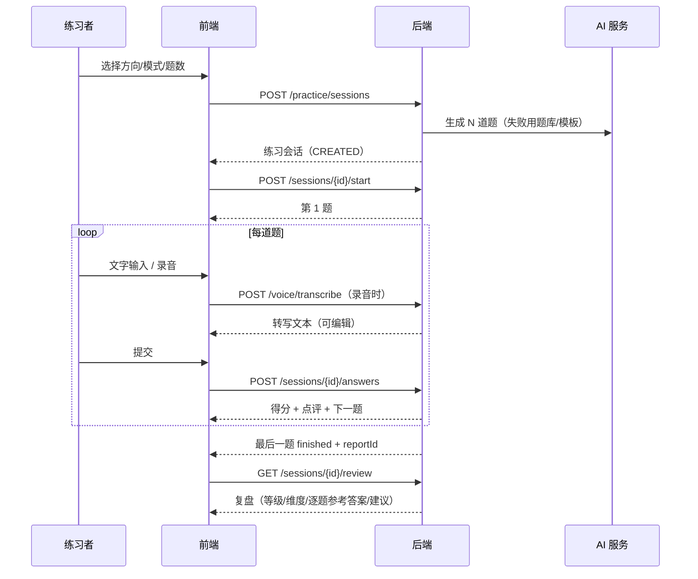

# 面试练习工具 · 产品重构方案

> 版本：v2.0（定位纠偏）
> 结论：把现有「企业招聘面试系统」重构为「面向求职者的 AI 面试练习工具」。
> 目标用户：**没有面试经验、或很久没面试的求职者**（校招、转行、社招回炉）。
> 关联文档：[技术方案](01-技术方案.md)、[源码阅读](02-源码阅读指南-全流程.md)、[前端方案](06-前端开发方案.md)。

---

## 1. 为什么要改

原实现按 B 端招聘设计：企业发岗位、HR 筛简历、面试官评分、给录用建议。
但真实需求是 C 端练习：

| 维度 | 招聘系统（旧） | 练习工具（新） |
|---|---|---|
| 用户 | HR / 面试官 / 候选人 | **求职者本人** |
| 目标 | 筛选、对比、发 offer | 练胆、练表达、知道会被问什么、拿到可执行改进 |
| 核心动作 | 发岗位、看简历、评人 | **开始练习 → 作答 → 复盘 → 再练一次** |
| 结果 | PASS / HOLD / REJECT | 能力分 + 参考答案 + 改进建议 + 下一步练什么 |
| 组织形态 | 多角色、公司视角 | 单用户工具，个人成长视角 |
| 成功指标 | 招聘效率 | **练习频次、能力提升、面试通过率** |

---

## 2. 产品定义

### 2.1 一句话

> 给没面试过的人一个安全的练习场：选方向 → AI 模拟面试 → 录音或打字作答 → 逐题复盘 → 再练一次。

### 2.2 核心价值

1. **敢开口**：没有真人压力，随时暂停、重答、跳过；
2. **知道会被问什么**：按方向、经验、面试类型出题，覆盖技术面 / HR 面 / 综合面；
3. **知道怎么答**：每题给参考答案与改进建议，而不是只给一个分数；
4. **看到进步**：历史记录、能力维度、薄弱点、每日一练。

### 2.3 非目标

- 不做企业招聘、不做候选人管理、不发 offer；
- 不做真人视频面试撮合；
- 首期不做付费与多租户。

---

## 3. 用户旅程

### 3.1 第一次使用（新手）

```
注册/登录 → 练习工作台（看到「第一次面试？先看指南」）
→ 选择方向（Java 后端 / 前端 / 产品…）
→ 选择经验与面试类型 → 可选上传简历
→ 开始练习 → 看到题目 → 不会？点「给我提示」/ 跳过
→ 文字作答 或 录音转写 → 提交
→ 即时看到本题得分与点评
→ 练完 → 复盘：总分、维度、逐题参考答案、下一步建议
→ 「再练一次」
```

### 3.2 回访用户

```
登录 → 工作台「继续上次练习」/「每日一练」
→ 练习记录里回看复盘
→ 成长页看薄弱点与趋势
```

---

## 4. 功能范围

| 优先级 | 功能 | 说明 |
|---|---|---|
| P0 | 练习方向（内置模板） | 8 个方向，含重点考察点、默认题数 |
| P0 | 创建练习 | 方向 + 模式 + 题数 + 可选简历 |
| P0 | 练习房间 | 逐题作答、提示、跳过、结束、即时反馈 |
| P0 | 语音作答 | 浏览器录音 → 后端 ASR 转写 → 可编辑后提交 |
| P0 | 练习复盘 | 总分、等级、维度、逐题参考答案、下一步建议 |
| P0 | 练习记录 | 进行中可继续、已完成可复盘 |
| P1 | 能力成长 | 能力雷达、历史趋势、薄弱点 |
| P1 | 每日一练 | 按薄弱点推荐 1 道题 |
| P1 | 收藏与错题本 | 收藏题目、低分题重练 |
| P1 | 新手引导 | 面试流程、准备清单、自我介绍模板、STAR |
| P2 | 语音分析 | 语速、停顿、口头禅、填充词 |
| P2 | 追问机制 | 低分题自动追问一层 |
| P2 | 分享与导出 | 复盘长图 / PDF |

本期落地：**P0 全部** + **P1 的面试指南页**。

---

## 5. 信息架构

```
练习工作台 /practice
├── 继续练习（进行中的会话）
├── 开始练习 /practice/new
│   ├── 选择方向
│   ├── 选择简历（可选）
│   ├── 面试模式（技术 / HR / 综合）
│   └── 题目数量
├── 练习房间 /practice/:id/room
│   ├── 题目 + 提示 + 跳过
│   ├── 文字作答
│   ├── 语音录音 → 转写
│   └── 本题反馈
├── 练习复盘 /practice/:id/review
│   ├── 总分 / 等级 / 维度
│   ├── 优势 / 待提升 / 下一步建议
│   └── 逐题回顾（我的回答 vs 参考答案）
├── 练习记录 /practice/history
├── 面试指南 /guide
├── 我的简历 /resumes
└── 个人中心 /profile
```

角色收敛为「练习者」：注册即练习者；原面试官/管理员入口从导航移除。

---

## 6. 练习闭环时序



---

## 7. 数据模型

### 7.1 新增 practice_target

| 字段 | 类型 | 说明 |
|---|---|---|
| id | BIGINT | 主键 |
| code | VARCHAR(32) | 唯一标识（java-backend、frontend…） |
| title | VARCHAR(64) | 方向名称 |
| subtitle | VARCHAR(128) | 一句话描述 |
| category | VARCHAR(32) | 技术 / 产品 / 数据 / 通用 |
| description | TEXT | 方向说明 |
| focus_topics | VARCHAR(512) | 重点考察点，逗号分隔 |
| default_questions | INT | 默认题数 |
| difficulty | INT | 默认难度 1-5 |
| icon | VARCHAR(32) | 图标名 |
| sort | INT | 排序 |

> 内置 8 个方向：Java 后端、前端、产品经理、数据分析、测试、运维/DevOps、算法、通用 HR 面。

### 7.2 复用现有表（保留物理名称，语义映射）

| 旧概念 | 新语义 | 说明 |
|---|---|---|
| interview_session | 练习会话 | `position_id` 存 practice_target.id |
| interview_question | 练习题目快照 | 不变 |
| interview_message | 练习对话 | 不变 |
| interview_report | 练习复盘数据 | 增加练习等级与下一步建议（应用层计算） |
| job_position | 招聘岗位（停用） | 前端不再使用，后续版本物理清理 |
| resume | 我的简历 | 用于个性化出题，可选 |

> 本期采用最小侵入：**复用面试引擎与表结构**，对外 API、前端界面、文案全部切换为「练习」语义。
> 下一阶段再做 `interview_* → practice_*` 的物理重命名与 `job_position` 清理。

---

## 8. API 设计

| 方法 | 路径 | 说明 |
|---|---|---|
| GET | `/api/v1/practice/targets` | 练习方向列表 |
| GET | `/api/v1/practice/targets/{id}` | 方向详情 |
| POST | `/api/v1/practice/sessions` | 创建练习（targetId / resumeId / mode / totalQuestions） |
| GET | `/api/v1/practice/sessions/my` | 我的练习（分页、状态筛选） |
| GET | `/api/v1/practice/sessions/{id}` | 练习详情 |
| POST | `/api/v1/practice/sessions/{id}/start` | 开始并返回第一题 |
| GET | `/api/v1/practice/sessions/{id}/current` | 当前题（刷新恢复） |
| POST | `/api/v1/practice/sessions/{id}/answers` | 提交答案（可带 audioPath） |
| POST | `/api/v1/practice/sessions/{id}/hint` | 获取提示（不给答案） |
| POST | `/api/v1/practice/sessions/{id}/skip` | 跳过本题 |
| POST | `/api/v1/practice/sessions/{id}/finish` | 提前结束 |
| GET | `/api/v1/practice/sessions/{id}/review` | 复盘 |
| GET | `/api/v1/practice/sessions/{id}/messages` | 对话回放 |
| POST | `/api/v1/practice/sessions/{id}/cancel` | 取消练习 |
| POST | `/api/v1/voice/transcribe` | 语音转写（multipart） |

### 8.1 复盘结构

```json
{
  "overallScore": 72.5,
  "level": "GOOD",
  "levelLabel": "良好",
  "dimensionScores": { "accuracy": 78, "depth": 66, "expression": 80, "structure": 70 },
  "strengths": ["技术基础扎实"],
  "weaknesses": ["原理深度不足"],
  "nextSteps": ["重点改进：原理深度不足", "加强深度：复述答案时先给结论，再补 2 个论据"],
  "questions": [
    { "seq": 1, "content": "…", "answer": "…", "score": 78, "comment": "…", "referenceAnswer": "…" }
  ]
}
```

等级：`>=85 优秀 / >=70 良好 / >=55 待提升 / 否则 需加强`。

---

## 9. 语音作答设计

### 9.1 链路

```
浏览器 MediaRecorder 录音（webm/opus）
  → POST /api/v1/voice/transcribe（multipart）
  → 后端保存音频 → ASR 转写（OpenAI 兼容 /audio/transcriptions）
  → 返回 text + audioPath
  → 前端把文本追加到答题框（可编辑）
  → 与文字作答走同一提交接口
```

### 9.2 为什么转写后仍可编辑

ASR 会有同音字、断句错误；练习者需要一个「改一下再提交」的机会，避免因识别问题被判低分。

### 9.3 配置

```yaml
app:
  voice:
    provider: openai          # mock | openai
    base-url: https://api.openai.com/v1
    api-key: ${APP_ASR_API_KEY:}
    model: whisper-1
    language: zh
```

- `provider=mock`（默认）：不发真实请求，接口返回 503 与明确提示，前端自动保留文字作答；
- 支持任意 OpenAI 兼容的转写服务（Whisper、通义听悟兼容层、vLLM 音频服务等）。

### 9.4 隐私

- 音频仅用于本次转写，默认保留在 `data/uploads/voice/`，提供清理策略（后续按会话删除）；
- 前端不把音频上传到第三方，只发给自己的后端；
- 复盘页默认只展示文本，不展示音频。

### 9.5 降级

| 场景 | 行为 |
|---|---|
| 浏览器不支持 MediaRecorder | 录音按钮禁用，提示「改用文字作答」 |
| 麦克风权限拒绝 | 提示授权方法，保留文字输入 |
| ASR 未配置 / 失败 | 展示服务端 message，文字输入不受影响 |
| 转写超时 | 可重试一次，或直接手动输入 |

---

## 10. 评分与反馈设计

- 四维度：准确性、深度、表达、结构；
- 单题：分数 + 维度分 + 命中/遗漏 + 一句点评；
- 整场：总分 + 等级 + 优势/待提升 + 下一步建议；
- 练习场景**允许查看参考答案**，且放在「我的回答」之后，避免先看答案；
- 「跳过」不计分（score 为空），不拉低整场均分，但计入进度。

---

## 11. 新手内容（面试指南）

面向「第一次面试」的用户，首期提供：

1. 面试流程：投递 → 笔试 → 一面 → 二面 → HR 面 → offer；
2. 准备清单：了解岗位、自我介绍、3 个项目故事、反问问题、设备与环境；
3. 自我介绍模板：30 秒结构；
4. STAR 法则与示例；
5. 常见问题分类；
6. 语音作答建议：语速、停顿、先说结论、少说口头禅。

---

## 12. 与旧版本的迁移

| 旧功能 | 处理 |
|---|---|
| 岗位管理 / 发布 / 关闭 | 前端移除；后端接口保留但不再使用 |
| 面试官 / 管理员菜单 | 前端移除；账号仍可登录但无入口 |
| 候选人列表 / 招聘统计 | 停用 |
| 录用建议 PASS/HOLD/REJECT | 前端不再展示；复盘用「练习等级 + 下一步建议」 |
| 面试记录 | 改为「练习记录」，操作变为继续/复盘 |
| 简历匹配「录用匹配度」 | 后续改为「简历与方向的能力差距」，本期先隐藏 |

---

## 13. 路线图

| 阶段 | 内容 |
|---|---|
| P0（本期） | 练习方向、创建练习、练习房间（文字 + 语音 + 提示 + 跳过）、复盘、练习记录、面试指南、产品外壳 |
| P1 | 成长页（能力雷达/趋势/薄弱点）、每日一练、收藏与错题本 |
| P2 | 语音分析（语速/停顿/口头禅）、追问、复盘导出 |
| P3 | 账号体系增强（游客模式、数据导出）、内容运营后台 |

---

## 14. 验收标准

- [ ] 新用户注册后，3 次点击内可以开始第一场练习；
- [ ] 练习中可获取提示、跳过题目、录音转写、文字修改后提交；
- [ ] 刷新页面能恢复到当前题，草稿不丢；
- [ ] 完成练习后能看到总分、等级、四维分、逐题参考答案与下一步建议；
- [ ] 练习记录能继续未完成的练习、回看已完成的复盘；
- [ ] 未配置 ASR 时，语音入口给出明确提示，文字作答完全可用；
- [ ] 全站不再出现「岗位/招聘/录用/HR 筛选」等招聘语义。
