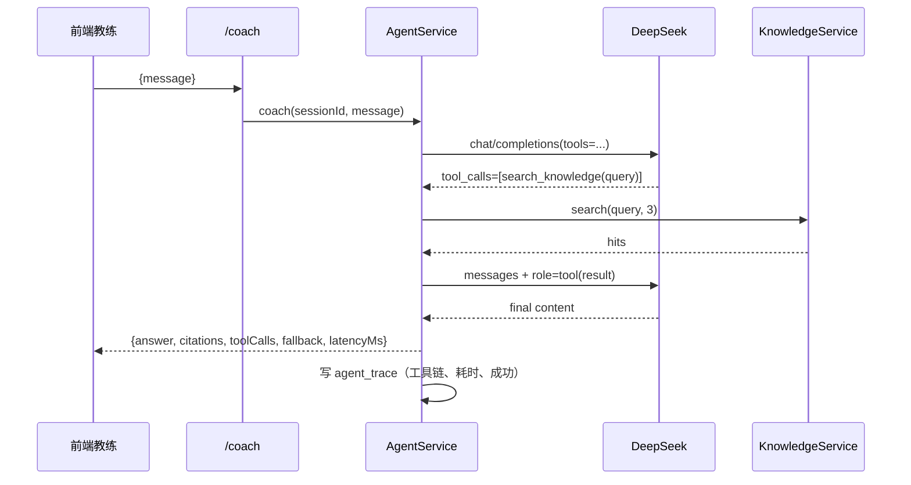
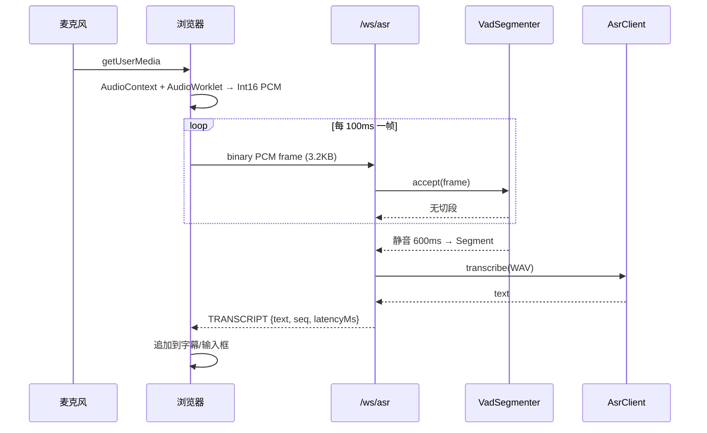

# RAG · AI Agent · 视频通话 实现说明

> 版本：v1.0
> 目标：说明「真实 RAG 检索」「真实 Agent 工具调用」「WebRTC 视频面试」三块能力的实现方式、配置与验证方法。
> 关联：[产品重构方案](07-练习工具产品重构方案.md)、[API 文档](04-API接口文档.md)。

---

## 1. 总览

```mermaid
flowchart TB
    subgraph 前端
      W[Vue 3]
      RTC[WebRTC 音视频]
      WS[WebSocket 信令/字幕]
      COACH[AI 教练抽屉]
      VADFE[流式录音<br/>AudioWorklet → PCM]
    end
    subgraph 后端
      K[KnowledgeService<br/>BM25 + 可选向量]
      A[AgentService<br/>工具循环]
      V[VideoRoomService]
      S[CallWebSocketHandler]
      P[PracticeService]
      ASRWS[/ws/asr<br/>VAD 断句]
      PDF[PDF → DOCX]
    end
    W --> COACH --> A
    A -->|search_knowledge| K
    A -->|chat/completions + tools| DS[(DeepSeek)]
    W --> RTC
    W --> WS --> S
    S --> V
    S -->|AI_SAY| P
    P --> K
    VADFE --> ASRWS
    ASRWS -->|逐段 WAV| ASR[(语音转写)]
    W --> PDF
```

三块能力都是可运行的实现，不是占位：

| 能力 | 真实性 | 降级 |
|---|---|---|
| RAG | 真实 BM25 打分 + 真实语料；配置 embedding 后做余弦混合 | 无 embedding 时纯 BM25，仍返回真实命中与分数 |
| Agent | 真实调用 OpenAI 兼容 `/chat/completions` 的 `tools`，执行工具并回填 `tool` 消息 | 无 Key 时用 RAG 结果生成确定性回答，`fallback=true` |
| 视频 | WebRTC 真实音视频 + WebSocket 信令；AI 模式 TTS + 字幕 + 语音作答 | 无摄像头可仅文字；无 STUN/TURN 时同局域网可用 |
| 语音 | 流式：WS + VAD 断句逐段转写；一次性：整段上传 | 流式不可用自动回退一次性，两者都失败则文字作答 |
| 简历 | docx / pdf / txt / md；PDF 先转 docx 再复用 docx 清洗 | 扫描件无文本层时提示粘贴文本 |

---

## 2. RAG

### 2.1 数据模型

- `knowledge_document`：标题、分类、来源、正文、状态
- `knowledge_chunk`：文档分块、序号、正文、token 数、embedding（JSON 文本，可为空）

启动时由 `DataInitializer` 灌入 9 篇中文资料（STAR、自我介绍、技术面、HR 面、项目讲述、面试收尾、项目架构选型、项目难点、Java 高频考点），共约 18 个分块。

### 2.2 切块与分词

- 切块：按段落累积到约 600 字符，块间重叠 80 字符；空白块丢弃。
- 分词（中文无词典场景）：
  - 连续 CJK 按 **2-gram** 切分；
  - 连续 ASCII 字母/数字整体小写；
  - 过滤单字停用词与符号。
- 查询时只保留 **IDF 最高的 12 个词元**，避免长问句里的「一下 / 说明 / 重点」等通用词稀释相关性。

### 2.3 打分

BM25（k1=1.5，b=0.75），标题参与分词并重复一次做轻量加权：

```
score = Σ idf(t) * tf * (k1 + 1) / (tf + k1 * (1 - b + b * len / avgLen))
idf(t) = ln(1 + (N - df + 0.5) / (df + 0.5))
```

配置 embedding 后：

1. BM25 先召回 `3 * topK`；
2. 对候选 chunk 与 query 计算余弦相似度；
3. 融合分 = `0.65 * 归一化 BM25 + 0.35 * 余弦`。

### 2.4 接口

| 方法 | 路径 | 说明 |
|---|---|---|
| GET | `/api/v1/knowledge/documents` | 文档列表 |
| POST | `/api/v1/knowledge/documents` | 灌入文档（自动切块/索引） |
| DELETE | `/api/v1/knowledge/documents/{id}` | 删除并重建索引 |
| POST | `/api/v1/knowledge/search` | 检索，返回 `title/content/score/source` |
| GET | `/api/v1/knowledge/stats` | 文档数、分块数、embedding 状态 |

示例：

```bash
curl -X POST http://localhost:8080/api/v1/knowledge/search \
  -H "Authorization: Bearer $TOKEN" -H "Content-Type: application/json" \
  -d '{"query":"项目 架构设计 技术选型","topK":3}'
```

### 2.5 在练习中的使用

- **出题**：`PracticeService.create` 用方向标题 + 重点考察点检索 5 条资料，拼进出题 Prompt 的参考上下文；
- **提示**：`hint` 先检索当前题 3 条，再交给模型；模型不可用时用检索结果生成提示；
- **教练**：Agent 的 `search_knowledge` 工具；
- **复盘**：当前版本未把引用写进复盘（避免为引用而引用），后续可加「延伸阅读」。

### 2.6 配置

```yaml
app:
  rag:
    enabled: true
    chunk-size: 600
    chunk-overlap: 80
    top-k: 5
    embedding:
      provider: none        # none | openai
      base-url: https://api.openai.com/v1
      api-key: ${APP_EMBEDDING_API_KEY:}
      model: text-embedding-3-small
```

DeepSeek 没有 embedding 接口，所以默认 `none`（纯 BM25）。要升级为混合检索，把 `provider` 改成 `openai` 并填入任意兼容 `/embeddings` 的服务（通义、硅基流动、OpenAI、Ollama 的 OpenAI 兼容层等）。

> 注意：`provider` 的取值只有 `none` / `openai` 两种，`openai` 表示「OpenAI 兼容协议」，不是指 OpenAI 公司。硅基流动、通义、DeepSeek 都填 `openai`，靠 `base-url` 和 `model` 区分。

**已实测可用的组合**（本项目当前默认推荐的混搭）：

| 能力 | 供应商 | base-url | model |
|---|---|---|---|
| 对话 / 出题 / 评分 / Agent | DeepSeek | `https://api.deepseek.com/v1` | `deepseek-chat` |
| Embedding | 硅基流动 | `https://api.siliconflow.cn/v1` | `BAAI/bge-m3` |
| 语音转写 | 硅基流动 | `https://api.siliconflow.cn/v1` | `FunAudioLLM/SenseVoiceSmall` |

切换 embedding 模型后必须重建向量：不同模型维度不同，旧向量不能参与余弦计算。H2 内存库重启会自动重灌；MySQL 需要清空 `knowledge_chunk` 或重新 ingest。

### 2.7 局限与演进

- 索引在 JVM 内存中构建，适合万级分块；更大规模应换 pgvector / Milvus / Elasticsearch；
- 分词为 2-gram，没有词性/同义词扩展；可用 HanLP/jieba 替换 `Bm25Index.tokenize`；
- 文档更新需要调用重建（当前为 ingest/delete 时全量重建，规模大时应增量更新）。

---

## 3. AI Agent（面试教练）

### 3.1 工具

| 工具 | 参数 | 作用 |
|---|---|---|
| `search_knowledge` | `query`, `topK?` | 检索知识库，返回标题、内容、分数 |
| `get_practice_state` | — | 当前练习方向 id、进度、当前题、最近 3 题得分与点评 |
| `get_my_resume` | — | 当前用户最新 PARSED 简历的技能、年限、学历、摘要 |

### 3.2 循环



- 最多 4 轮工具调用（`app.agent.max-steps`）；
- 工具参数解析失败、模型异常、轮数耗尽 → 降级；
- 每次对话写一条 `agent_trace`，`tool_calls` 保存完整工具调用链，可用于验收「确实调用了工具」。

### 3.3 接口

| 方法 | 路径 | 说明 |
|---|---|---|
| POST | `/api/v1/practice/sessions/{id}/coach` | `{message}` → CoachResponse |
| GET | `/api/v1/practice/sessions/{id}/coach/traces` | 调用链（调试/验收） |

响应示例：

```json
{
  "answer": "先给结论……",
  "citations": [{"title": "项目深挖：架构设计与技术选型怎么讲", "snippet": "……", "score": 22.6}],
  "toolCalls": [{"name": "search_knowledge", "arguments": "{\"query\":\"架构设计 技术选型\"}", "resultSummary": "命中 3 条"}],
  "fallback": false,
  "latencyMs": 1832
}
```

### 3.4 配置 DeepSeek

```bash
set APP_AI_PROVIDER=openai
set APP_AI_BASE_URL=https://api.deepseek.com/v1
set APP_AI_API_KEY=sk-xxxx
set APP_AI_MODEL=deepseek-chat
```

> 使用 `deepseek-chat`（支持 function calling）；`deepseek-reasoner` 不支持 tools。

不配置时进入降级：用当前题检索知识库，取分数接近的 1-2 条生成确定性建议，`fallback=true`，引用照常返回。降级也会写 `agent_trace`（`success=false`），便于区分。

### 3.5 验收方法

```bash
# 1. 建练习并开始
# 2. 提问
curl -X POST .../practice/sessions/$SID/coach \
  -H "Authorization: Bearer $TOKEN" -H "Content-Type: application/json" \
  -d '{"message":"这题我该怎么组织答案？"}'

# 3. 期望：配置 Key 后 fallback=false，toolCalls 中出现 search_knowledge
# 4. 查看调用链
curl .../practice/sessions/$SID/coach/traces -H "Authorization: Bearer $TOKEN"
```

---

## 4. 视频面试

### 4.1 为什么是 WebRTC + WebSocket

- **媒体**（摄像头/麦克风）走 **WebRTC**，P2P 传输，延迟低；
- **信令**（offer/answer/ICE/挂断/心跳）走 **WebSocket 长连接**；
- **AI 模式**的题目与字幕也走 WebSocket，音视频只需本地预览。

### 4.2 房间

| 字段 | 说明 |
|---|---|
| code | 8 位房间码（排除 0/O/1/I），唯一 |
| mode | `AI`（AI 模拟面试） / `HUMAN`（真人 1v1） |
| practice_session_id | AI 模式绑定的练习会话 |
| host_user_id | 房主 |
| status | WAITING / ACTIVE / ENDED |

REST：

| 方法 | 路径 |
|---|---|
| POST | `/api/v1/video/rooms` `{mode, practiceSessionId?}` |
| GET | `/api/v1/video/rooms/{code}` |
| POST | `/api/v1/video/rooms/{code}/end` |
| GET | `/api/v1/video/ice` |

### 4.3 信令协议

连接：`ws://host/ws/call?token=<jwt>&code=<code>&name=<显示名>`

| 方向 | type | data |
|---|---|---|
| S→C | `ROOM_STATE` | code/mode/practiceSessionId/hostUserId/selfUserId/selfId/peers[peerId,userId,name] |
| S→C | `PEER_JOINED` / `PEER_LEFT` | peerId/name |
| S→C | `OFFER` / `ANSWER` | sdp + from |
| S→C | `ICE` | candidate + from |
| S→C | `AI_SAY` | text/questionId/seq/totalQuestions |
| S→C | `AI_FINISHED` | practiceSessionId |
| S→C | `ERROR` / `PONG` | — |
| C→S | `OFFER` / `ANSWER` / `ICE` | sdp / candidate |
| C→S | `AI_NEXT` / `HANGUP` / `PING` / `CHAT` | — |

### 4.4 真人模式

1. 房主创建 HUMAN 房间，把房间码/链接发给朋友；
2. 双方进入 `/call/{code}`，各自 `getUserMedia`；
3. 房主收到 `PEER_JOINED` 后发 offer，加入者回 answer，双方交换 ICE；
4. 采用 **perfect negotiation**：房主 impolite、加入者 polite，处理 offer 冲突；
5. 挂断：发 `HANGUP` + 结束房间 + 返回大厅。

### 4.5 AI 模式

1. 大厅选择方向 → 创建练习会话 → 创建 AI 房间 → 进入通话；
2. 服务端连接后自动开始练习并下发 `AI_SAY` 当前题；
3. 前端用浏览器 `speechSynthesis` 朗读，显示字幕；
4. 练习者录音 → 后端 ASR 转写 → 可编辑 → 通过练习接口提交；
5. 展示得分与点评，点「下一题」发 `AI_NEXT`，服务端推下一题或 `AI_FINISHED`；
6. 结束后跳转复盘。

### 4.6 ICE / TURN

默认只配置公共 STUN：

```yaml
app:
  video:
    ice-servers:
      - stun:stun.l.google.com:19302
```

跨运营商/严格 NAT 下 P2P 可能失败，需要 TURN。当前 `IceServerVO` 已预留 `username/credential`，但配置只支持 URL 列表；上生产前应扩展为结构化配置并部署 coturn。

### 4.7 已知限制

- 信令房间状态存在 JVM 内存，多实例部署需要粘性会话或 Redis 广播；
- 没有 SFU，多人会议需引入 LiveKit/Janus/mediasoup；
- 未做通话录制与美颜；
- WebSocket URL 带 token（浏览器 API 限制），生产环境务必使用 `wss://`，并注意访问日志脱敏。

---

## 5. 语音转写（ASR）

练习房间和 AI 视频面试都支持「录音 → 转写 → 编辑 → 提交」。转写走 OpenAI 兼容的
`POST /audio/transcriptions`，`app.voice.provider=openai` 时启用。

### 5.1 配置

```yaml
app:
  voice:
    provider: ${APP_ASR_PROVIDER:mock}   # mock | openai
    base-url: ${APP_ASR_BASE_URL:}
    api-key: ${APP_ASR_API_KEY:}
    model: ${APP_ASR_MODEL:whisper-1}
    language: zh
    timeout-seconds: 180
    max-size: 10485760
```

已实测：硅基流动 `FunAudioLLM/SenseVoiceSmall`，10 秒中文音频约 12 秒返回，识别文本可直接回填输入框。
OpenAI `whisper-1` / `gpt-4o-mini-transcribe` 同样可用；通义 `qwen3-asr-flash` 走 DashScope 原生协议，当前客户端不支持。

### 5.2 一个真实踩过的坑：chunked multipart 会被拒

Spring 的 `MultipartBodyBuilder` + `RestClient` 默认是流式输出，请求带
`Transfer-Encoding: chunked`。OpenAI 能接受，但 **SiliconFlow 直接返回 500 `[no body]`**。
同样的文件用 `curl -F` 上传却正常，说明问题不在文件而在传输方式。

现在的实现是手写 multipart 请求体（`ByteArrayOutputStream`），交给 `HttpClient` 的
`BodyPublishers.ofByteArray`，请求自动带 `Content-Length`，与 curl 行为一致：

```java
HttpRequest request = HttpRequest.newBuilder(URI.create(baseUrl + "/audio/transcriptions"))
        .timeout(Duration.ofSeconds(timeout))
        .header("Authorization", "Bearer " + apiKey)
        .header("Content-Type", "multipart/form-data; boundary=" + boundary)
        .POST(HttpRequest.BodyPublishers.ofByteArray(body))
        .build();
```

字段：`file`（带文件名与推断的 MIME，如 `audio/webm`、`audio/wav`）、`model`、`language`、`response_format=json`。

回归测试 `OpenAiAsrClientTest` 用内置 `HttpServer` 断言：
`Content-Type` 是 multipart、有 `Content-Length`、**没有** `Transfer-Encoding`，并校验文件字段与模型字段。

### 5.3 前端录音格式

一次性转写走 `MediaRecorder`，产出 `audio/webm;codecs=opus`，后端按扩展名保存为 `.webm` 再上传。

流式转写不走 `MediaRecorder`，改用 `AudioContext` + `AudioWorklet` 直接取 PCM，
理由见 5.5：实时场景需要的不是「整段文件」，而是「定长小帧」。

### 5.4 失败语义

- 未配置 Key：直接提示 `APP_ASR_API_KEY`，不发起请求；
- 服务 4xx/5xx：包装为 `AI_ERROR`，消息带 HTTP 状态码与响应片段；
- 转写为空：前端提示「没有录到声音，请重试或直接输入文字」，文字作答始终可用。

### 5.5 流式转写：WS 长连接 + VAD 断句

**为什么改成流式**：一次性方案要等「停止录音 → 上传整段 → 转写」全部完成，
10 秒音频约 12 秒才出字；流式方案每说完一句（约 600ms 静音）就能拿到这一句，
实测 8.1 秒中文语音、单段 7.6 秒，转写耗时 **1157ms**。

**数据流**：



**协议**（`ws://host/ws/asr?token=<JWT>&language=zh`）：

| 方向 | 消息 | 说明 |
|---|---|---|
| C→S | 二进制帧 | 16kHz / 16bit / 单声道 PCM，默认 100ms 一帧 |
| C→S | `{"type":"STOP"}` | 结束并 flush 最后一段 |
| C→S | `{"type":"PING"}` | 心跳 |
| S→C | `READY` | `{sampleRate, frameMs, endSilenceMs, provider}` |
| S→C | `SPEECH_START` | VAD 判定开始说话 |
| S→C | `TRANSCRIPT` | `{text, seq, startMs, endMs, durationMs, latencyMs, provider}` |
| S→C | `ERROR` | 转写失败但连接保留 |
| S→C | `STOPPED` | 收尾完成 |

**VAD 策略**（`VadSegmenter`，零第三方依赖）：

- 每帧算归一化 RMS，阈值 = `max(静态阈值, 噪声底 × 系数)`；
- 噪声底只在非语音帧上做指数平滑，空调/键盘等稳定底噪不会持续误触发；
- 连续超阈值 `min-speech-ms`（200ms）才进入语音，过滤咳嗽、点击；
- 静音持续 `end-silence-ms`（600ms）判定一句结束；
- 超过 `max-segment-ms`（15s）强制切段，避免长句一直不出字；
- 切段时向前回补 `pre-roll-ms`（200ms），避免吞掉第一个字。

**并发与背压**：连接线程只做 VAD；转写交给固定线程池（默认 3 线程）。
线程池满时丢弃该段并回 `ERROR`，保证实时性优先于完整性。

**配置**（`application.yml`，均可用环境变量覆盖）：

```yaml
app:
  voice:
    stream:
      enabled: ${APP_ASR_STREAM_ENABLED:true}
      sample-rate: 16000
      frame-ms: 100
      energy-threshold: 0.012   # 安静环境可下调
      noise-factor: 3.0
      min-speech-ms: 200
      end-silence-ms: 600       # 说完到出字的主要延迟
      max-segment-ms: 15000
      pre-roll-ms: 200
      worker-threads: 3
      queue-capacity: 4
```

**调延迟的三个旋钮**：

| 想要 | 调整 | 代价 |
|---|---|---|
| 更快出字 | 调小 `end-silence-ms`（如 400） | 说话中途停顿容易被切句 |
| 更少误切 | 调大 `end-silence-ms`（如 800） | 延迟增加 |
| 更省 ASR 调用 | 调大 `min-speech-ms`、`pre-roll-ms` | 短句可能被丢弃 |

**前端实现**（`web/src/composables/useStreamingTranscription.ts`）：

- `AudioWorklet` 拿 Float32 采样，主线程按 100ms 聚合 → 降采样到 16kHz → Int16 → 二进制发送；
- 没有 `AudioWorklet` 的浏览器退回 `ScriptProcessor`；
- `TRANSCRIPT` 到达即追加到字幕并同步到输入框，中文不插入空格、英文保留空格；
- 连接失败/权限拒绝/不支持时自动回退到一次性录音方案，功能不中断。

**实测数据**（硅基流动 `SenseVoiceSmall`，本机）：

| 指标 | 数值 |
|---|---|
| 上行帧 | 100ms / 3.2KB |
| 断句判定 | 600ms 静音 |
| 单段转写耗时 | 1157ms（7.6s 音频） |
| 整段一次性转写 | 约 12000ms（8.1s 音频） |

### 5.6 回归测试

`VadSegmenterTest` 用合成 PCM 覆盖：全静音不切段、一句话切一段、长句强制切段、
`flush` 输出尾段、WAV 头与长度。`asr-stream-test.mjs` 用系统语音合成真实中文 WAV
重采样后按 100ms 推帧，断言 `READY`、`SPEECH_START`、`TRANSCRIPT` 与文本内容。

---

## 6. 简历解析（含 PDF）

### 6.1 为什么 PDF 先转 docx

简历链路上已经有一套经过验证的 docx 抽取（段落合并、制表符、换行、空行归一化）。
PDF 只需把文本按行还原成段落，再交给同一套逻辑，避免维护两份文本清洗规则、
也避免两种格式解析结果不一致。

```
PDF → PDFBox 抽取文本（按页、按行） → POI 写出 docx（一行一段） → 现有 docx 抽取 → 解析
```

实现：`PdfToDocxConverter`（PDFBox `PDFTextStripper` + POI `XWPFDocument`）。

### 6.2 支持格式

| 格式 | 处理方式 |
|---|---|
| txt / md | UTF-8 直读 |
| docx | JDK `ZipFile` + DOM 解析 `word/document.xml`（无第三方库） |
| pdf | PDFBox 抽取 → POI 转 docx → 复用 docx 解析 |
| 其他 | 拒绝并提示 `txt / md / docx / pdf` |

### 6.3 边界与提示

| 场景 | 行为 |
|---|---|
| 扫描件 / 图片型 PDF | 抽不到文本 → 提示「PDF 未提取到文字（可能是扫描件），请改用 docx 或粘贴文本」 |
| 加密 PDF | 提示「PDF 已加密，无法解析」 |
| 页数 > 30 | 只解析前 30 页并记录日志 |
| 文本 > 20000 字 | 截断，避免拖垮 AI 调用与数据库 |

### 6.4 依赖与测试

```xml
<dependency>
  <groupId>org.apache.pdfbox</groupId>
  <artifactId>pdfbox</artifactId>
  <version>2.0.32</version>
</dependency>
<dependency>
  <groupId>org.apache.poi</groupId>
  <artifactId>poi-ooxml</artifactId>
  <version>5.2.5</version>
</dependency>
```

`PdfResumeExtractionTest` 覆盖：正常 PDF 抽取关键信息、转出的 docx 是合法 ZIP、
空白 PDF 给出可操作提示、不支持格式仍被拒绝。
HTTP 层已实测：上传 `resume-sample.pdf` → `PARSED`，`rawText` 保留了分段。

---

## 7. 验证与截图

```bash
mvn test                                # 55 个后端测试
cd web && npm run test:e2e              # 练习 + 教练 UI 冒烟（截图 01-10、17）
cd web && node scripts/video-test.mjs   # 视频面试 E2E（截图 11-16）
cd web && node scripts/asr-stream-test.mjs   # 流式转写 E2E（WS + VAD + ASR）
```

`video-test.mjs` 使用 Chrome 假摄像头/麦克风：

- AI 模式：出题 → 5 题作答 → 反馈 → 复盘；
- 真人模式：两个独立账号 + 两个浏览器上下文，验证 offer/answer/ICE、双方远端视频、挂断。

截图：

| 文件 | 内容 |
|---|---|
| 11-video-lobby.png | 视频大厅（AI / 真人） |
| 12-video-ai-question.png | AI 视频面试出题 |
| 13-video-ai-feedback.png | AI 视频面试评分 |
| 15-video-human-call.png | 真人 1v1 视频通话（房主） |
| 16-video-human-call-guest.png | 真人 1v1 视频通话（加入方） |
| 17-coach.png | 练习房间 AI 教练 + 引用 |

---

## 8. 安全与隐私

- 知识库、教练、视频房间均要求登录；教练接口校验练习归属；
- 语音文件落在 `data/uploads/voice/`，仅用于转写，当前无自动清理，生产需加保留策略；
- 视频为 P2P，不经过服务端媒体转发（服务端只转发信令）；
- `agent_trace` 保存对话与工具链，生产需评估留存周期与脱敏；
- 生产必须使用 `wss://` 与 HTTPS，TURN 凭据使用临时凭证。

---

## 9. 后续演进

| 方向 | 内容 |
|---|---|
| 向量化 | 接入 pgvector / Milvus，替换内存 BM25 索引，支持增量更新 |
| 知识库管理 | 文档上传（PDF/docx）、审核、分类、引用溯源 |
| Agent | 多轮会话记忆、复盘报告 Agent、语音 Agent |
| 视频 | TURN/SFU、通话录制、AI 数字人视频、网络质量面板 |
| 分布式 | Redis Pub/Sub 广播信令、房间状态外置 |
